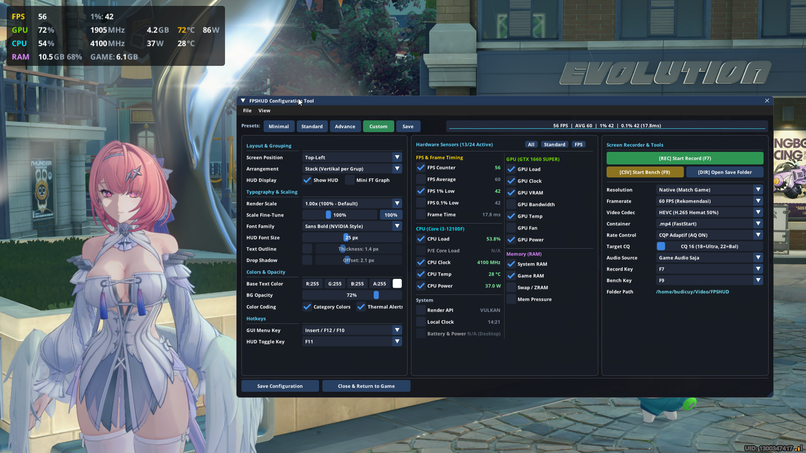
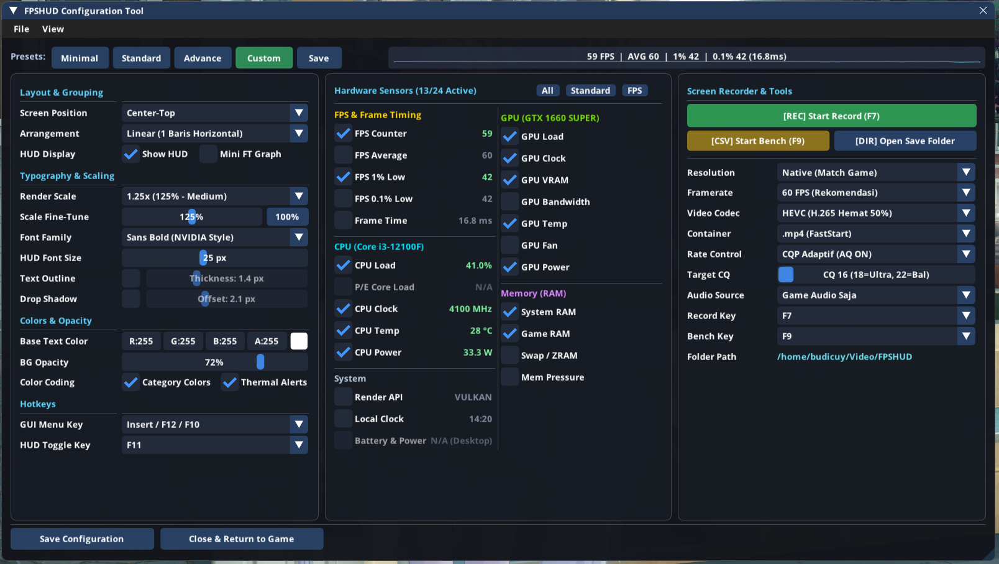
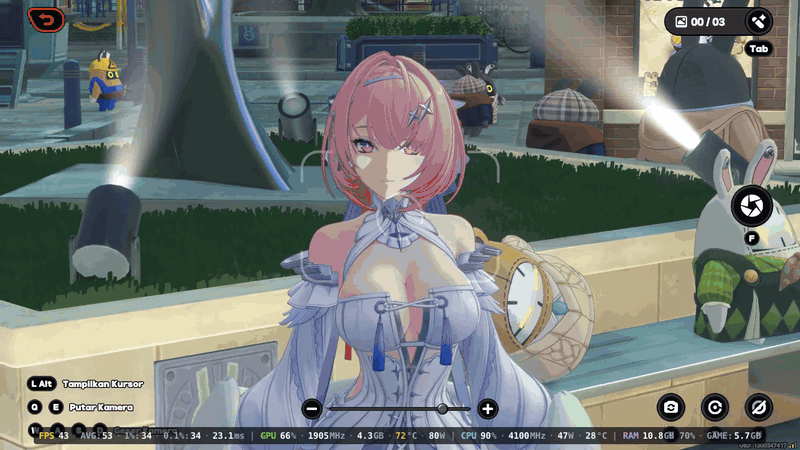
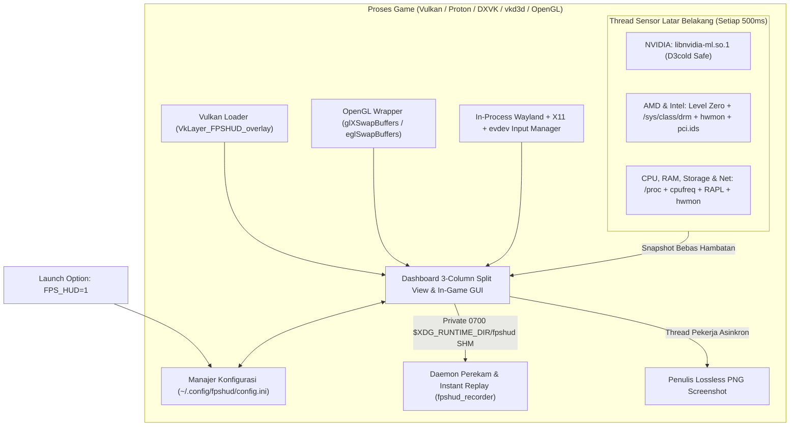

# FPSHUD

**Overlay Performa In-Game Ringan & Menu Pengaturan Interaktif untuk Gaming di Linux (Vulkan & OpenGL)**

[](https://github.com/budicuy/FPS_HUD_FOR_LINUX/actions/workflows/ci.yml)
[](LICENSE)
[](CMakeLists.txt)
[](src/)
[](src/telemetry/telemetry.cpp)

> **Bahasa Dokumentasi / Language:** **[English](README.md)** | **[Bahasa Indonesia (Aktif)](README.id.md)**

---

## Instalasi Cepat (Binary Portabel)

Instal **FPSHUD** dalam hitungan detik di distro Linux apa pun (Arch, Ubuntu, Debian, Fedora, Linux Mint, Pop!_OS, Nobara, Bazzite, maupun SteamOS) tanpa perlu menginstal paket compiler atau build tambahan:

```bash
curl -fsSL https://raw.githubusercontent.com/budicuy/FPS_HUD_FOR_LINUX/main/install.sh | bash
```

Untuk menghapus instalasi (uninstall) kapan saja:
```bash
~/.local/bin/fpshud --uninstall
```

---

## Pratinjau & Demo Tampilan

<p align="center">
  <b>Tampilan In-Game Performance Overlay</b><br>
  
</p>

<p align="center">
  <b>Menu Pengaturan In-Game Interaktif</b><br>
  
</p>

### Demo Gameplay

<p align="center">
  
</p>

---

## Gambaran Umum (Overview)

### Tujuan
Saat bermain game di Linux melalui Steam Proton, Lutris, Heroic, maupun port native, pemain sering perlu memantau frame rate, kelancaran frame pacing (1% low), serta memonitor suhu, frekuensi clock, konsumsi daya (Watt), dan pemakaian memori GPU/CPU.

Overlay Linux konvensional mengharuskan pemain keluar dari game untuk menyunting berkas konfigurasi teks secara manual. FPSHUD menyediakan menu konfigurasi interaktif langsung di dalam game. Aktifkan dengan `FPS_HUD=1`, lalu tekan `Insert` atau `F12` selama permainan untuk mengatur posisi, memilih sensor, dan mengubah tata letak langsung di layar.

### Arsitektur & Teknologi
FPSHUD ditulis dalam ISO C++26 menggunakan penyimpanan inline tetap (`std::inplace_vector`), pack indexing, dan analitik frametime SIMD untuk meniadakan alokasi heap selama gameplay. Dear ImGui menangani rendering overlay dan menu konfigurasi, dengan hook langsung ke Vulkan (implicit layer) dan OpenGL (`LD_PRELOAD`). Font ditanamkan langsung di dalam binary pustaka agar tipografi tetap tajam di lingkungan native maupun container seperti Proton dan Steam Linux Runtime.

### Fitur Utama
- **Dashboard 3-Column Split View In-Game (`Insert` / `F12`)**: Menu pengaturan widescreen modular 3 kolom (Kiri: Posisi, Tata Letak, Font, Warna, Skala Render GUI `50%–200%` & Shortcut 1/2 Tombol | Tengah: 31 Sensor Hardware & Filter Preset Cepat | Kanan: Perekam Layar Hardware, Instant Replay, Lossless Screenshot & Benchmark).
- **Perekam Layar Hardware Ringan (`F7`), Instant Replay (`F8`) & Lossless Screenshot (`F10`)**: Daemon perekaman terpisah dengan triple-buffering POSIX Shared Memory yang berjalan di luar proses game, mendukung codec HEVC (H.265) dan H.264 (`.mp4`, `.mkv`, `.webm`) dengan Adaptive CQP (`16–30`), VBV Max Bitrate Ceiling (`4–80 Mbps`), Experimental Pure `1:1` Adaptive VFR, In-RAM Instant Replay bebas aus disk (`15s–120s`), Lossless PNG Screenshot bebas dependensi (Clean Game atau With HUD, 8-bit & 10-bit HDR), dan perekaman audio (Game, Mic, atau Campuran).
- **4 Preset Siap Pakai (1-Klik)**: Bebas berganti tampilan antara **Minimal** (hanya FPS & Frametime), **Standard** (FPS, GPU, CPU, RAM utama), **Advance** (lengkap 31 sensor), atau menyimpan racikanmu sendiri ke tombol **Custom**.
- **Mendukung Semua Merek Perangkat Keras (NVIDIA, AMD, Intel)**: Otomatis mendeteksi dan membaca sensor pada **GPU NVIDIA** (dengan proteksi sleep Optimus `D3cold`), **GPU & APU AMD Radeon**, **GPU Intel Arc & Iris**, serta **CPU Intel Core & AMD Ryzen**—termasuk laptop gaming *dual-GPU* (otomatis memilih kartu grafis gaming diskrit) dan handheld seperti Steam Deck.
- **Tampilan *Two-Tone* yang Mudah Dibaca & Smart Color Alerts (14 Metrik)**: Angka ditampilkan dengan warna putih terang sedangkan satuan (`MHz`, `GB`, `°C`, `W`) dibuat sedikit redup dengan pemisah titik (`·`) agar tidak membingungkan mata, ditambah warna peringatan otomatis (Kuning/Merah) pada 14 metrik (FPS, 1%/0.1% Low, Frametime, Beban & Suhu GPU/CPU, VRAM, Kipas, RAM, Swap, Memory PSI, Suhu & I/O Disk, serta Baterai).
- **1% Low FPS Akurat & Perekam Benchmark ke CSV (`F9`)**: Menghitung rata-rata frame terendah secara akurat (otomatis mengabaikan jeda saat layar *loading*) dan bisa merekam laporan performa ke file `.csv` kapan saja dengan menekan `F9`.

### Alur Kerja
1. **Instalasi**: Pasang biner portabel ke `~/.local/lib/fpshud/` melalui skrip `curl` atau ekstraksi tarball manual.
2. **Aktivasi**: Tambahkan `FPS_HUD=1 %command%` pada Launch Options game di Steam, Lutris, atau Heroic (atau gunakan terminal).
3. **Overhead render rendah**: FPSHUD menggambar overlay sebelum presentasi frame dalam waktu di bawah 8 mikrodetik. Pengambilan telemetri hardware dijalankan pada thread terpisah setiap 0,5 detik sehingga tidak membebani thread render game.

---

## Daftar Isi

- [Pratinjau & Demo Tampilan](#pratinjau--demo-tampilan)
1. [Fitur Utama](#1-fitur-utama)
2. [Instalasi & Izin Akses Sensor](#2-instalasi--izin-akses-sensor)
3. [Cara Pakai di Steam, Lutris, Heroic & Terminal](#3-cara-pakai-di-steam-lutris-heroic--terminal)
4. [Panduan Menu In-Game GUI & Tombol Shortcut](#4-panduan-menu-in-game-gui--tombol-shortcut)
5. [Perekam Layar, Instant Replay & Lossless Screenshot](#5-perekam-layar-instant-replay--lossless-screenshot)
6. [Dukungan Perangkat Keras & Daftar 31 Sensor](#6-dukungan-perangkat-keras--daftar-31-sensor)
7. [Tech Stack & Arsitektur Sistem](#7-tech-stack--arsitektur-sistem)
8. [Panduan Pengembang (Build dari Source, Sanitizers & Pengujian)](#8-panduan-pengembang-build-dari-source-sanitizers--pengujian)
9. [Troubleshooting & Tanya Jawab (FAQ)](#9-troubleshooting--tanya-jawab-faq)
10. [Kontribusi, Kredit & Lisensi](#10-kontribusi-kredit--lisensi)

---

## 1. Fitur Utama

- **Aktivasi Simpel (`FPS_HUD=1` / `FPS_HUD=0`)**:
  - `FPS_HUD=1`: Menyalakan HUD Overlay, Perekam Layar, Instant Replay, Lossless Screenshot, dan menu In-Game GUI Configurator.
  - `FPS_HUD=0` (atau dikosongkan/dihapus dari launch options): Mematikan overlay sepenuhnya tanpa beban di latar belakang.
- **Dashboard In-Game GUI 3-Column Split View (`FPSHUD Configuration Tool`)**:
  - Tekan **`Insert`** atau **`F12`** di dalam game untuk membuka antarmuka widescreen 3 kolom berbahasa Inggris (Kiri: Posisi, Kotak Preview Monitor Interaktif + Input Manual X/Y & Tombol Reset Layout, Susunan, Font, Warna, Skala GUI `50%–200%`, Shortcut 1/2 Tombol | Tengah: 31 Sensor Hardware & Tombol Filter Preset | Kanan: Perekam Layar, Instant Replay, Screenshot & Benchmark).
  - Otomatis menangkap kursor mouse saat menu dibuka, dan langsung mengembalikan kursor ke dalam game saat menu ditutup.
  - Setiap perubahan tersimpan ke satu file konfigurasi di `~/.config/fpshud/config.ini`.
- **Perekam Layar Hardware (`F7`), Instant Replay (`F8`) & Lossless Screenshot (`F10`)**:
  - Companion daemon khusus (`fpshud_recorder`) yang berjalan terpisah dengan zero copy lewat triple-buffered POSIX Shared Memory IPC di dalam direktori runtime privat `0700` (`$XDG_RUNTIME_DIR/fpshud`).
  - Mendukung akselerasi hardware **HEVC (H.265 / `hvc1`)** dan **H.264** via NVIDIA NVENC dan VAAPI dalam format **`.mp4 (FastStart)`**, **`.mkv (Matroska)`**, atau **`.webm (WebM)`** dengan kualitas **Adaptive CQP (CQ 16–30)** + **VBV Max Bitrate Ceiling (`4–80 Mbps`)** atau **Fixed VBR**, serta **Experimental Pure `1:1` Adaptive VFR**.
  - **Instant Replay Bebas Aus Disk (`F8`)**: Ring buffer paket video terkompresi di dalam RAM (`15s`, `30s`, `60s`, atau `120s`, `0 MB` RAM saat dimatikan) yang menyimpan N detik terakhir ke disk secara instan saat diminta.
  - **Lossless PNG Screenshot (`F10`)**: Encoder PNG latar belakang bebas dependensi dengan pilihan mode **Clean Game (Tanpa HUD)** atau **With HUD (Dengan HUD)**, mendukung swapchain 8-bit (`RGBA`/`BGRA`) maupun 10-bit HDR (`A2B10G10R10`/`A2R10G10B10`).
  - Perekaman audio multi-sumber (Game Audio Saja, Mikrofon Saja, Game + Mikrofon stereo mixed, atau Mute) via PulseAudio/PipeWire yang langsung tersimpan rapi ke folder `$XDG_VIDEOS_DIR/FPSHUD` (`~/Videos/FPSHUD` atau `~/Video/FPSHUD`).
- **Dukungan Universal Multi-Vendor & Pengerasan Sensor (NVIDIA, AMD, Intel & APU)**:
  - **NVIDIA (`NVML` + Proteksi Optimus `D3cold` + Prioritas dGPU)**: Membaca sensor melalui `libnvidia-ml.so.1` secara dinamis, memeriksa `/sys/bus/pci/devices/*/power/runtime_status` sebelum memanggil NVML agar dGPU laptop yang sedang tidur (`suspended` / `D3cold`) tidak terbangun saat hemat baterai, dan memindai seluruh adapter NVIDIA (`nvmlDeviceGetCount_v2`) untuk memprioritaskan GPU gaming diskrit (`dGPU`) melalui pencocokan PCI Device ID aktif atau kapasitas VRAM terbesar.
  - **AMD Radeon & APU (`amdgpu` + Estimasi Bandwidth VRAM 5-Lapis)**: Membaca sensor DRM & `hwmon` Linux, fallback clock `pp_dpm_sclk` / `pp_dpm_mclk`, menggabungkan memori *Shared GTT* pada APU/Steam Deck, serta mengestimasi lebar bus dan bandwidth VRAM melalui `gpu_metrics` `vram_max_bandwidth` atau **hierarki 5 lapis kapasitas VRAM** (`>=19.5 GB` -> 384-bit, `>=14.5 GB` -> 256-bit, `>=10.5 GB` -> 192-bit, `>=5.5 GB` -> 128-bit, `<5.5 GB` -> 64-bit).
  - **Suhu Asli Silikon AMD Ryzen (`Tdie` vs `Tctl`)**: Memprioritaskan sensor `Tdie` di atas `Tctl` pada driver `k10temp` / `zenpower` sehingga prosesor AMD Ryzen menampilkan suhu asli silikon tanpa offset +10°C/+20°C bawaan kontrol kipas.
  - **Intel Arc & Integrated Graphics (Level Zero + `drm_sysfs` Hibrida)**: Backend dinamis Intel Level Zero Sysman (`libze_loader.so.1` via runtime `dlopen`) yang membaca suhu GPU (`ZES_TEMP_SENSORS_GPU`), clock core & memori, beban engine 3D/Compute, counter energi, status VRAM, dan kecepatan kipas, dilengkapi **fallback hibrida per-metrik** ke `drm_sysfs` & `hwmon` Linux (`gt_act_freq_mhz`, `freq1_input`, `energy1_input`) untuk metrik apa pun yang tidak didukung oleh Level Zero.
  - **Pelacakan VRAM Vulkan `VK_EXT_memory_budget`**: Membaca penggunaan dan anggaran memori heap GPU secara real-time langsung dari perangkat fisik Vulkan aktif ketika sensor sysfs kernel tidak tersedia (seperti pada Intel iGPU atau container).
  - **Arsitektur Daya CPU 3-Lapis (100% Berfungsi Tanpa Sudo)**:
    1. *Lapis 1 (Sensor Daya Hardware)*: Membaca sensor `hwmon` bebas sudo (`k10temp`, `zenpower`, `amd_energy`, `zenergy`) atau counter RAPL (`/sys/class/powercap/*rapl*/energy_uj`).
    2. *Lapis 2 (Estimasi Dinamis Berbasis TDP & Frekuensi)*: Jika counter RAPL dikunci root (`0400`) dan pengguna melewati `sudo`, FPSHUD otomatis menghitung estimasi Watt CPU secara real-time dari `constraint_0_max_power_uw` (batas TDP PL1 yang selalu dapat dibaca tanpa root di Intel/AMD) atau baseline TDP model CPU yang diskalakan dengan beban kerja dan rasio frekuensi boost—**tidak pernah tertahan di `0 W`**.
    3. *Lapis 3 (Aturan udev `0440` Grup `render` Opsional)*: Opsi `fpshud --setup` membuka akses baca counter RAPL khusus untuk anggota grup `GROUP="render", MODE="0440"` (jauh lebih aman daripada `0444`).
  - **Beban & Clock CPU Per-Core (`All-Core`)**: Pemantauan persentase beban kerja dan frekuensi (MHz) setiap thread CPU hingga 64 thread secara real-time tanpa alokasi heap dinamis.
  - **Kecepatan Disk I/O, Suhu NVMe & Kecepatan Jaringan (100% Bebas Sudo)**: Kecepatan baca/tulis disk fisik real-time (`/proc/diskstats`), suhu NVMe/SATA (`nvme` / `drivetemp` `hwmon`), serta kecepatan unduh/unggah jaringan aktif (`/proc/net/dev` dengan skala otomatis `KB/s` <-> `MB/s`).
  - **Deteksi Layer Translasi Render API (`VULKAN`, `DX12`, `DX11`, `DX9`, `OPENGL`)**: Memindai `/proc/self/maps` untuk mendeteksi secara otomatis apakah game berjalan melalui `vkd3d-proton` (`DX12`), `dxvk` (`DX11` / `DX9`), `VULKAN` murni, atau `OPENGL`.
  - **Status Baterai Laptop & Handheld (`/sys/class/power_supply`)**: Persentase kapasitas baterai, daya listrik Watt (discharge/charge), dan indikator charging dengan deteksi otomatis Desktop PC (otomatis di-disabled dan digelapkan pada komputer desktop tanpa baterai).
  - **Laptop Gaming Hybrid Dual-GPU (Seleksi dGPU Vulkan & DRM)**: Otomatis memprioritaskan GPU gaming diskrit dibanding kartu grafis terintegrasi (iGPU) dengan mengevaluasi `VK_PHYSICAL_DEVICE_TYPE_DISCRETE_GPU` pada Vulkan, ID vendor PCI (`0x10de` NVIDIA / `0x1002` AMD diskrit di atas `0x8086` Intel iGPU), dan atribut `boot_vga` daripada nomor urut `cardN` statis, disertai resolusi nama model GPU akurat lewat `/usr/share/hwdata/pci.ids`.
- **Keterbacaan Kontras Tinggi & Smart Color Alerts (14 Metrik)**:
  - Badge warna kategori (`FPS` Emas, `GPU` Hijau, `CPU` Cyan, `RAM` Ungu, `SYS` Perak), opsi peredup label satuan (`Dim Unit & Sub-Labels`), pemisah titik tengah (`·`), dan **Smart Color Alerts (Kuning/Merah)** pada 14 metrik (termasuk Suhu GPU/CPU **Kuning saat `>= 72°C`**, **Merah saat `>= 82°C`**, Beban GPU/CPU, FPS/1% Low, Frametime, VRAM, Kipas, RAM, Swap, PSI, Suhu/IO Disk, dan Baterai).
- **Grafik Mini Frametime & Perekam Benchmark CSV (`F9`)**:
  - Tersedia opsi grafik gelombang frametime langsung di HUD, serta perekam benchmark CSV (`~/Documents/fpshud_benchmark.csv` atau `~/Dokumen/fpshud_benchmark.csv`) yang mencatat rata-rata FPS, 1% Low, 0.1% Low, serta suhu & daya maksimum GPU/CPU.
- **Optimasi Toolchain LLVM/Clang & Keamanan Memori**:
  - Dikompilasi menggunakan modern Clang, linker LLD, ThinLTO (`-flto=thin`), dan `-O3` menghasilkan biner shared library ramping **1.3 MB** dengan keamanan memori yang diverifikasi melalui AddressSanitizer & UndefinedBehaviorSanitizer.

### Komparasi dengan MangoHud

| Aspek | **MangoHud** | **FPSHUD** |
| :--- | :--- | :--- |
| **Filosofi Utama** | Overlay standar industri Linux dengan opsi konfigurasi berbasis berkas teks yang sangat mendalam. | Pengalaman modern serba-ada di dalam game dengan konfigurasi visual langsung (*live*). |
| **Alur Konfigurasi** | Memerlukan keluar dari game dan mengedit berkas teks konfigurasi (`~/.config/MangoHud/MangoHud.conf`) atau memanfaatkan aplikasi GUI eksternal seperti GOverlay. | **In-game 3-Column GUI (`Insert` / `F12`)**: ubah posisi, tata letak, 31 sensor, font, warna, skala GUI, dan tombol pintas 1/2 tombol langsung di layar tanpa keluar dari permainan. |
| **Perekaman Layar & Replay** | Membutuhkan perangkat lunak capture eksternal terpisah (OBS Studio, GPU Screen Recorder, ReplaySorcery). | **Built-in companion daemon perekam (`fpshud_recorder`)** dengan tombol rekam 1-klik (`F7`), Instant Replay (`F8`), Lossless Screenshot (`F10`), HEVC/H.264 CQP, dan mixing audio. |
| **Maturitas & Ekosistem** | Sangat matang, diadopsi luas di berbagai distro Linux, menjadi overlay standar di SteamOS GameScope. | Alternatif modern dan ramping bagi gamer yang menginginkan kustomisasi visual instan dan perekam klip terintegrasi. |

---

## 2. Instalasi & Izin Akses Sensor

### Instalasi 1 Perintah (Instalasi Cepat Otomatis)
Penginstal mengunduh paket rilis biner portabel siap pakai langsung dari GitHub Releases dan memverifikasi integritas hash SHA256 secara kriptografis sebelum ekstraksi (tanpa perlu kompilasi atau toolchain apa pun):
```bash
curl -fsSL https://raw.githubusercontent.com/budicuy/FPS_HUD_FOR_LINUX/main/install.sh | bash
```

### Opsi B: Instalasi Manual dengan Verifikasi Checksum SHA256
Bagi Anda yang memilih tidak menggunakan perintah pipe remote script ke `bash`, Anda dapat mengunduh dan memverifikasi arsip biner rilis secara manual:
```bash
# 1. Unduh arsip rilis portabel dan berkas hash checksum dari GitHub Releases:
curl -LO https://github.com/budicuy/FPS_HUD_FOR_LINUX/releases/latest/download/fpshud-linux-x86_64.tar.gz
curl -LO https://github.com/budicuy/FPS_HUD_FOR_LINUX/releases/latest/download/fpshud-linux-x86_64.tar.gz.sha256

# 2. Verifikasi integritas arsip secara kriptografis:
sha256sum -c fpshud-linux-x86_64.tar.gz.sha256

# 3. Ekstrak pustaka dan biner ke folder pengguna (~/.local):
mkdir -p ~/.local/lib/fpshud ~/.local/bin ~/.local/share/vulkan/implicit_layer.d
tar -xzf fpshud-linux-x86_64.tar.gz -C ~/.local/lib/fpshud/
ln -sf ~/.local/lib/fpshud/fpshud_test ~/.local/bin/fpshud_test
```

### Izin Akses Perangkat Keras, Transparansi `sudo` & Model Keamanan
> [!NOTE]
> **Arsitektur Bebas Sudo**
> FPSHUD beroperasi tanpa hak root untuk seluruh fitur, termasuk metrik daya CPU:
> - **Shortcut Keyboard & Navigasi GUI In-Game**: Ditangani langsung secara in-process melalui hooked event queue Wayland display (`wl_keyboard` / `wl_pointer`) dan X11 tanpa memerlukan grup `input` atau akses root `/dev/input/event*`.
> - **Metrik RAM**: Kapasitas memori dinamis, konsumsi game resident (`VmRSS`), Swap/ZRAM, dan memory stall pressure (PSI) dibaca secara aman langsung dari `/proc/meminfo`, `/proc/self/status`, dan `/proc/pressure/memory` (100% world-readable).
> - **Telemetri Grafis**: FPS, frametimes, dan sensor GPU (NVIDIA NVML, AMD sysfs, Intel Level Zero + DRM hibrida) beroperasi penuh tanpa hak root.
> - **Daya CPU 3-Lapis (Tidak Pernah `0 W` Meski Tanpa Sudo)**:
>   1. **Lapis 1 (Sensor Hardware Langsung)**: Membaca sensor daya `hwmon` bebas sudo (`amd_energy`, `zenergy`, `zenpower`, `k10temp`) atau counter RAPL `/sys/class/powercap/*rapl*/energy_uj` jika sudah dapat dibaca.
>   2. **Lapis 2 (Estimasi Dinamis TDP Bebas Sudo)**: Jika counter RAPL dikunci ke root (`0400`), FPSHUD otomatis membaca batas daya paket (`constraint_0_max_power_uw` PL1 pada Intel/AMD yang berizin `0444`) atau nilai TDP model CPU lalu menghitung daya secara dinamis berdasarkan beban kerja CPU dan rasio frekuensi boost.
>   3. **Lapis 3 (Aturan udev `0440` Terbatas Opsional)**: Bagi pengguna yang menginginkan pembacaan counter energi hardware RAPL secara langsung, `fpshud --setup` menyediakan aturan udev terbatas untuk grup `render`.

> [!IMPORTANT]
> **Tindakan Sudo dan Mitigasi Platypus (CVE-2020-8694)**
> Game dan hook overlay tidak pernah dijalankan sebagai root. Akses sudo bersifat opsional dan hanya diminta jika pengguna menyetujui pemasangan aturan udev RAPL saat instalasi atau memilih pembersihan sistem saat uninstalasi:
> 1. **Saat menjalankan `fpshud --setup` (atau menyetujui prompt di `install.sh`)**:
>    - Membuat satu berkas aturan udev di `/etc/udev/rules.d/99-fpshud-rapl.rules` yang berisi:
>      ```udev
>      SUBSYSTEM=="powercap", ACTION=="add|change", KERNEL=="*rapl*", ATTR{energy_uj}!="", GROUP="render", MODE="0440"
>      SUBSYSTEM=="powercap", ACTION=="add|change", KERNEL=="*rapl:*", ATTR{energy_uj}!="", GROUP="render", MODE="0440"
>      ```
>    - Mengapa menggunakan `GROUP="render", MODE="0440"` dan bukan `0444`? Kernel Linux membatasi file `energy_uj` (`0400`) untuk memitigasi serangan side-channel **Platypus** (`CVE-2020-8694`). Alih-alih membuka izin baca ke semua akun di sistem (`0444`), FPSHUD membatasi izin baca (`0440`) hanya untuk grup `render` (pengguna lokal desktop/GPU gaming Anda), sehingga layanan latar belakang atau proses asing tanpa grup `render` tetap terblokir.
>    - Memuat ulang aturan udev dengan perintah `sudo udevadm control --reload-rules` dan `sudo udevadm trigger --subsystem-match=powercap`.
>    - Jika terdeteksi instalasi Flatpak Steam (`~/.var/app/com.valvesoftware.Steam`), memastikan kepemilikan folder manifes Vulkan Implicit Layer tetap milik akun pengguna biasa Anda (`chown -R $USER`).
> 2. **Saat menjalankan `fpshud --uninstall`**:
>    - Seluruh file utama di ruang pengguna (`~/.local/lib/fpshud`, `~/.local/bin/fpshud*`, manifes layer Vulkan, dan `~/.config/fpshud`) dihapus **terlebih dahulu tanpa `sudo`**.
>    - Jika Anda tidak pernah mengaktifkan `sudo` saat instalasi, maka `fpshud --uninstall` langsung selesai secara instan tanpa menanyakan `sudo` sama sekali.
>    - Hanya jika file `/etc/udev/rules.d/99-fpshud-*.rules` terdeteksi di sistem, skrip akan menanyakan konfirmasi opsional `[y/N]` apakah Anda ingin sekalian menghapus file aturan udev tersebut dengan `sudo` (Anda bebas menekan `N`/`Enter` untuk melewati `sudo`).

> [!NOTE]
> **Verifikasi Izin Sensor**
> Izin sensor RAPL opsional dapat dikonfigurasi atau diperiksa kapan saja:
> ```bash
> ~/.local/bin/fpshud --setup
> ```
> Untuk memeriksa status keterbacaan sensor hardware pada akun Anda:
> ```bash
> ~/.local/bin/fpshud --status
> ```

> [!TIP]
> **Batasan Hak Akses**
> Seluruh proses game dan overlay berjalan murni dengan hak akses pengguna biasa. Hak akses root tidak pernah diminta saat gameplay berlangsung.

### Uninstall 1 Perintah (Hapus Bersih Secara Lokal)
```bash
~/.local/bin/fpshud --uninstall
```

---

## 3. Cara Pakai di Steam, Lutris, Heroic & Terminal

### 1. Steam (Game Proton / DXVK / Vulkan — 99% Game Steam)
Klik kanan game di Steam -> **Properties** -> **General** -> **Launch Options**:
```bash
FPS_HUD=1 %command%
```
*(Untuk menonaktifkan sementara tanpa menghapus opsi peluncuran, ubah menjadi `FPS_HUD=0 %command%`. Untuk mematikan secara permanen, hapus variabel `FPS_HUD` dari Launch Options).*

> [!NOTE]
> Seluruh game Windows yang berjalan melalui Proton, DXVK, dan game native Linux modern berbasis Vulkan menggunakan opsi ini.

### 2. Steam (Khusus Game Native Linux OpenGL Lawas)
Hanya dibutuhkan untuk game native Linux jadul yang masih memakai API OpenGL:
```bash
FPS_HUD=1 ~/.local/bin/fpshud %command%
```

### 3. Lutris & Heroic Games Launcher
Buka **Game Settings / Configuration** -> **System / Environment Variables** -> Tambahkan:
- **Key**: `FPS_HUD`
- **Value**: `1`

### 4. Terminal / Command Line
```bash
# Menjalankan game atau aplikasi berbasis Vulkan:
FPS_HUD=1 ./nama_game

# Menjalankan game atau aplikasi berbasis OpenGL:
~/.local/bin/fpshud ./nama_game
```

### Peringatan Terkait Anti-Cheat (EAC, BattlEye, VAC, Ricochet)
> [!WARNING]
> **Game Online Multiplayer dan Anti-Cheat (EAC, BattlEye, VAC, Ricochet)**
> Serupa dengan MangoHud, OBS Game Capture, dan ReShade, FPSHUD bekerja dengan menyisipkan hook ke pipeline rendering grafis via Vulkan implicit layer atau `LD_PRELOAD`.
> Kendati overlay hanya memantau performa, perangkat lunak anti-cheat pada game multiplayer kompetitif (seperti Easy Anti-Cheat, BattlEye, Valve Anti-Cheat, atau Ricochet) dapat mendeteksi injeksi pustaka pihak ketiga sebagai pelanggaran integritas, yang berisiko menggagalkan peluncuran game atau memicu sanksi akun.
>
> **Rekomendasi:** Saat memainkan game online kompetitif dengan anti-cheat, nonaktifkan overlay dengan menyetel `FPS_HUD=0 %command%` atau hapus variabel `FPS_HUD` dari launch options.

### Kompatibilitas Game 32-Bit
> [!NOTE]
> FPSHUD dibangun sebagai pustaka 64-bit (`x86_64`) untuk game Linux dan Proton modern. Saat menjalankan game 32-bit lawas, loader sistem mengabaikan layer 64-bit ini tanpa menimbulkan kesalahan sistem, dan tampilan HUD tidak muncul.

---

## 4. Panduan Menu In-Game GUI & Tombol Shortcut

Saat game berjalan dengan `FPS_HUD=1`, gunakan tombol shortcut berikut. Seluruh 6 pintasan mendukung **perekaman interaktif 1 tombol atau kombinasi 2 tombol (`Modifier + Tombol`, misal `Alt + F` atau `Ctrl + Shift`)** langsung di Kolom 1 GUI:

| Tombol Default | Fungsi |
| :--- | :--- |
| **`Insert` / `F12`** | Membuka atau Menutup menu **`FPSHUD Configuration Tool`** |
| **`F11`** | Menyembunyikan atau Menampilkan HUD dengan cepat tanpa membuka menu |
| **`F7`** | Memulai atau Menghentikan **Perekam Layar Hardware** (`~/Videos/FPSHUD`) |
| **`F8`** | Menyimpan klip **Instant Replay** (menyimpan 15s–120s terakhir dari buffer RAM ke disk) |
| **`F10`** | Mengambil **Lossless PNG Screenshot** (Clean Game tanpa HUD, atau With HUD) |
| **`F9`** | Memulai atau Menghentikan perekaman **Benchmark CSV** (`~/Documents/fpshud_benchmark.csv`) |
| **`ESC`** | Menutup menu GUI (atau membatalkan perekaman tombol pintas) dan mengembalikan kursor ke game |

> [!TIP]
> **Steam Deck dan Perangkat Handheld**
> Untuk membuka menu pada perangkat handheld tanpa keyboard fisik, petakan tombol grip belakang (seperti `L4` atau `R4`) ke `F12` atau `Insert` melalui **Steam Controller Settings -> Edit Layout**. Slider **GUI Scale (50%–200%)** di Kolom 1 menyesuaikan ukuran antarmuka untuk layar beresolusi tinggi atau layar kecil.

### 4 Pilihan Preset di Dalam GUI
- **`Minimal`**: Hanya menampilkan `FPS` dan `Frametime (ms)`.
- **`Standard`**: Menampilkan `FPS`, `Frametime`, `GPU (Load, Clock, Temp)`, `CPU (Load, Clock, Temp)`, dan `RAM`.
- **`Advance`**: Menampilkan lengkap **31 sensor** (`FPS`, `AVG`, `1% Low`, `0.1% Low`, `Frametime`, 8 sensor `GPU` termasuk `VRAM Clock`, 6 sensor `CPU` termasuk `All-Core Load` & `All-Core Clock`, 4 sensor `RAM/Memori`, `Disk I/O & Suhu NVMe`, `Kecepatan Jaringan`, `Render API`, `Model GPU/CPU`, `Local Clock`, dan `Battery & Power`).
- **`Custom`**: Kustomisasi kombinasi sensor dan tata letak favoritmu lalu simpan langsung ke `~/.config/fpshud/config.ini`.

### Smart Color Alerts (14 Metrik) & Ambang Batas
Saat opsi **Smart Color Alerts (Yellow/Red)** diaktifkan di GUI, FPSHUD memberikan peringatan warna dinamis pada 14 metrik performa dan perangkat keras:
- **Suhu GPU & CPU**: **Kuning** saat **`>= 72°C`**, **Merah** saat **`>= 82°C`**
- **Suhu NVMe / SSD**: **Kuning** saat **`>= 65°C`**, **Merah** saat **`>= 75°C`**
- **Beban Kerja GPU, CPU & Per-Core**: **Kuning** saat **`>= 80%`**, **Merah** saat **`>= 95%`**
- **Pemakaian VRAM GPU**: **Kuning** saat **`>= 80%`**, **Merah** saat **`>= 92%`**
- **Kecepatan Kipas GPU**: **Kuning** saat **`>= 75%`**, **Merah** saat **`>= 90%`**
- **Memori RAM Sistem & Game**: **Kuning** saat **`>= 80%`**, **Merah** saat **`>= 90%`**
- **Swap / ZRAM**: **Kuning** saat **`>= 50%`** (atau `>= 2 GB`), **Merah** saat **`>= 80%`** (atau `>= 4 GB`)
- **Memory Pressure (PSI)**: **Kuning** saat **`>= 5%`**, **Merah** saat **`>= 20%`**
- **Kecepatan Disk I/O**: **Kuning** saat **`>= 500 MB/s`**, **Merah** saat **`>= 1500 MB/s`**
- **FPS, 1% Low, 0.1% Low & Frametime**: **Kuning** saat FPS `< 45` (atau Frametime `> 22.2 ms`), **Merah** saat FPS `< 30` (atau Frametime `> 33.3 ms`)
- **Baterai (Discharging)**: **Kuning** saat **`<= 25%`**, **Merah** saat **`<= 12%`**

---

## 5. Perekam Layar, Instant Replay & Lossless Screenshot

FPSHUD dilengkapi dengan daemon perekam layar latar belakang khusus yang sangat ringan (`fpshud_recorder`) dan berjalan terpisah dari proses game utama. Frame dikirimkan melalui triple-buffered POSIX Shared Memory di dalam direktori runtime privat `0700` (`$XDG_RUNTIME_DIR/fpshud`), memastikan bahwa proses encoding video hardware tidak pernah menyebabkan stutter (*frame drop*) atau *micro-freeze* pada permainan Anda.

### Arsitektur Hardware Encoder & GPU Readback
Untuk memastikan performa framerate game tetap mulus selama proses perekaman aktif:
- **Dukungan Hardware Encoder**:
  - **NVIDIA**: Akselerasi hardware otomatis via **NVENC** (`hevc_nvenc`, `h264_nvenc`) dengan Spatial-AQ & Temporal-AQ aktif pada mode CQP.
  - **AMD & Intel**: Akselerasi hardware otomatis via **VAAPI** (`hevc_vaapi`, `h264_vaapi`).
  - **Software Fallback**: Fallback otomatis ke `libx265` / `libx264` jika inisialisasi context encoder hardware tidak tersedia.
- **Pipeline GPU Readback Asinkron**:
  - **Vulkan**: Salinan staging buffer *double-buffered* menggunakan `vkCmdCopyImageToBuffer` ke memori *host-cached* dengan batas waktu fence terukur 2 detik. Pengiriman frame ke shared memory IPC dipipelinemen di balik fence transfer GPU, sehingga meniadakan jeda tunggu (stall) pada thread presentasi CPU.
  - **OpenGL**: Ring buffer *dual-PBO* (`GL_PIXEL_PACK_BUFFER`) asinkron. Perekaman frame menjalankan *DMA readback* non-blocking pada `pbo[write]` sembari memetakan frame yang sudah selesai dari `pbo[read]`.
  - **Daemon Terpisah**: Proses encoding video, muxing kontainer, dan mixing audio dijalankan sepenuhnya di dalam daemon mandiri `fpshud_recorder` lewat POSIX shared memory privat (`$XDG_RUNTIME_DIR/fpshud`), sehingga beban komputasi encoder tidak membebani render thread game.

### Fitur Utama & Opsi Codec

| Fitur | Penjelasan | Default / Rekomendasi |
| :--- | :--- | :--- |
| **Codec Video** | **HEVC (H.265 / `hvc1`)** atau **H.264 (AVC)** | **H.264 (AVC)** default; **HEVC (`hvc1`)** untuk ukuran file 50% lebih hemat dengan pemutaran native di MPV, VLC, Haruna, dan browser. |
| **Format Kontainer** | **`.mp4 (FastStart)`**, **`.mkv (Matroska)`**, atau **`.webm (WebM)`** | **`.mp4 (FastStart)`** untuk pemutaran instan di web/Discord. |
| **Kontrol Bitrate & Batas Atas** | **Adaptive CQP (CQ 16–28 di GUI / 16–30 CLI)** dengan **VBV Max Bitrate Ceiling (`4–80 Mbps`)** atau **Fixed VBR (`4–80 Mbps`)** | **Adaptive CQP (CQ 22)** dengan **Batas 20 Mbps (Cap)** agar adegan rumit tetap tajam tanpa membuat ukuran file membengkak. |
| **Framerate & Resolusi** | **Native (Match Game)**, **1440p (`2560x1440`)**, **1080p (`1920x1080`)**, atau **720p (`1280x720`)** pada **60, 30, 120 FPS, atau Match Display** | **Native @ 60 FPS** |
| **Experimental Adaptive VFR** | **Pure `1:1` Adaptive Variable Framerate** (menu bar `Experimental`) dengan **Safety Max FPS (`30–240 FPS`)** | Merekam stempel waktu frame game secara murni 1:1 tanpa duplikasi atau drop frame statis 60 FPS. |
| **Instant Replay (`F8`)** | **In-RAM Encoded Packet Ring Buffer** (**OFF / `0 MB` RAM**, **15s**, **30s**, **60s**, atau **120s**) | Nol keausan tulis SSD/NVMe selama buffering; tekan **`F8`** untuk menyimpan `Replay_YYYYMMDD_HHMMSS.<ext>` ke disk. |
| **Lossless Screenshot (`F10`)** | **Encoder PNG Latar Belakang Bebas Dependensi** (**Clean Game Tanpa HUD** atau **With HUD**, 8-bit & 10-bit HDR) | Disimpan secara asinkron ke `Screenshot_YYYYMMDD_HHMMSS_mmm.png` tanpa menghambat render game. |
| **Perekaman Audio** | Rekam audio latensi rendah via PulseAudio / PipeWire: **Game Audio Saja**, **Mikrofon Saja**, **Game + Mikrofon (Stereo Mixed)**, atau **Mute**. | **Game Audio Saja** |
| **Lokasi Penyimpanan** | Otomatis disimpan ke `$XDG_VIDEOS_DIR/FPSHUD` (`~/Videos/FPSHUD` atau `~/Video/FPSHUD`). | `~/Videos/FPSHUD` |

### Cara Menggunakan Perekam Layar, Instant Replay & Screenshot

1. **Mulai / Hentikan Perekaman Penuh (`F7`)**:
   - Tekan **`F7`** di dalam game (atau klik tombol **`[REC] Start Record`** pada Kolom 3 di GUI).
   - Indikator notifikasi in-game akan mengonfirmasi bahwa perekaman telah dimulai. Tekan **`F7`** kembali untuk menyelesaikan dan menyimpan file video `.mp4`/`.mkv`/`.webm` di latar belakang.
2. **Simpan Klip Instant Replay (`F8`)**:
   - Aktifkan **Replay Buffer** (`15s`–`120s`) di Kolom 3. Saat momen penting terjadi, tekan **`F8`** (atau klik **`[SAVE REPLAY]`**) untuk langsung menulis rekaman dari RAM ke disk.
3. **Ambil Lossless Screenshot (`F10`)**:
   - Pilih mode **Clean Game (Tanpa HUD)** atau **With HUD (Dengan HUD)** pada bagian Screenshot, lalu tekan **`F10`** (atau klik **`[IMG] Take Screenshot`**).
4. **Buka Folder Penyimpanan**:
   - Klik tombol **`[DIR] Open Save Folder`** di Kolom 3 menu GUI untuk membuka direktori rekaman langsung di file manager desktop Anda.

---

## 6. Dukungan Perangkat Keras & Daftar 31 Sensor

### Matriks Kompatibilitas Perangkat Keras

| Komponen | Vendor & Driver yang Didukung | Sumber Data Linux & Hierarki Fallback |
| :--- | :--- | :--- |
| **GPU NVIDIA** | Driver NVIDIA Proprietary / Open (`nvidia`) | `libnvidia-ml.so.1` (NVML runtime `dlopen`) dengan prioritas GPU diskrit (`dGPU`) multi-GPU via PCI ID & ukuran VRAM |
| **GPU & APU AMD** | AMD Radeon Discrete & APU (`amdgpu`) | `/sys/class/drm/card*/device` + `hwmon` + `gpu_metrics` + estimasi lebar bus & bandwidth VRAM 5-lapis + `mem_info_gtt_*` + `pci.ids` |
| **GPU Intel** | Intel Arc Discrete & Iris/UHD (`xe`, `i915`) | Intel Level Zero Sysman (`libze_loader.so.1` runtime `dlopen`) dengan fallback hibrida per-metrik ke `/sys/class/drm/card*` + `hwmon` + `intel-rapl` |
| **CPU Intel** | Intel Core & Core Ultra | `/proc/cpuinfo`, `/proc/stat` (Total & All-Core), `cpufreq`, `coretemp`, `intel-rapl` (`0440` grup `render`) + fallback estimasi dinamis TDP PL1 |
| **CPU AMD** | AMD Ryzen / Threadripper / Custom APU | `/proc/cpuinfo`, `/proc/stat` (Total & All-Core), `cpufreq`, `k10temp`/`zenpower` (prioritas `Tdie` di atas `Tctl`), `amd_energy`/`zenergy`/`amd-rapl` + fallback estimasi dinamis TDP |
| **Memori RAM** | DDR3, DDR4, DDR5, LPDDR4, LPDDR5 | `/proc/meminfo`, `/proc/self/status`, `/proc/pressure/memory` (100% bebas sudo) |
| **Storage & Jaringan** | NVMe, SATA SSD/HDD & Ethernet/Wi-Fi | `/proc/diskstats`, `/sys/class/hwmon` (`nvme`/`drivetemp`), `/proc/net/dev` (100% bebas sudo) |
| **Baterai & Daya** | Standar ACPI / Linux Power Supply (`BAT0`, `BAT1`) | `/sys/class/power_supply/BAT*/{capacity,power_now,status}` (otomatis disabled di Desktop PC) |

### Daftar Lengkap 31 Sensor

| # | Nama Sensor | Grup | Informasi yang Ditampilkan | Contoh di HUD |
| :--- | :--- | :--- | :--- | :--- |
| `01` | **FPS Counter** | `FPS` | Jumlah frame per detik saat ini | `144` |
| `02` | **FPS Average** | `FPS` | Rata-rata FPS selama 3,5 detik terakhir | `AVG: 138` |
| `03` | **FPS 1% Low** | `FPS` | Rata-rata 1% frame paling lambat (indikator kelancaran) | `1%: 112` |
| `04` | **FPS 0.1% Low** | `FPS` | Rata-rata 0,1% frame paling lambat (*micro-stutter*) | `0.1%: 95` |
| `05` | **Frame Time** | `FPS` | Waktu yang dibutuhkan untuk merender 1 frame (milidetik) | `6.9 ms` |
| `06` | **GPU Load** | `GPU` | Persentase beban kerja core GPU | `98%` |
| `07` | **GPU Core Clock** | `GPU` | Kecepatan frekuensi core GPU saat ini | `2430 MHz` |
| `08` | **GPU VRAM Clock** | `GPU` | Kecepatan frekuensi memori VRAM GPU saat ini | `VCLK: 2200 MHz` |
| `09` | **GPU VRAM** | `GPU` | Pemakaian memori VRAM GPU dalam GB (termasuk GTT di APU & `VK_EXT_memory_budget`) | `6.4 GB` |
| `10` | **GPU Bandwidth** | `GPU` | Kecepatan transfer bandwidth memori VRAM + PCIe aktif | `165.4 GB/s` |
| `11` | **GPU Temp** | `GPU` | Suhu GPU dalam derajat Celcius | `65 °C` |
| `12` | **GPU Fan** | `GPU` | Persentase kecepatan putaran kipas GPU | `FAN: 55%` |
| `13` | **GPU Power** | `GPU` | Konsumsi daya listrik GPU dalam Watt | `185 W` |
| `14` | **CPU Load** | `CPU` | Persentase pemakaian total seluruh thread CPU | `42%` |
| `15` | **CPU All-Core Load** | `CPU` | Persentase beban kerja setiap thread CPU secara individual | `C0:45% C1:38%` |
| `16` | **CPU Clock** | `CPU` | Kecepatan frekuensi core CPU tertinggi yang sedang aktif | `5050 MHz` |
| `17` | **CPU All-Core Clock** | `CPU` | Kecepatan frekuensi masing-masing core CPU dalam MHz | `C0:5050MHz` |
| `18` | **CPU Power** | `CPU` | Konsumsi daya listrik CPU dalam Watt (RAPL/hwmon atau estimasi TDP) | `58 W` |
| `19` | **CPU Temp** | `CPU` | Suhu prosesor CPU (`Tdie`) dalam derajat Celcius | `62 °C` |
| `20` | **System RAM** | `RAM` | Pemakaian RAM sistem dalam GB & persen dengan peringatan warna | `9.2 GB 60%` |
| `21` | **Game RAM** | `RAM` | Memori fisik (VmRSS) khusus yang dipakai oleh game ini saja | `GAME: 4.8 GB` |
| `22` | **Swap / ZRAM** | `RAM` | Pemakaian swap / zram aktif dalam GB | `SWAP: 1.2 GB` |
| `23` | **Memory Pressure** | `RAM` | Metrik Linux PSI (persentase stall memori 10 detik terakhir) | `PSI: 2.1%` |
| `24` | **Disk I/O Speed** | `SYS` | Kecepatan baca / tulis penyimpanan fisik (Read / Write) | `DSK: 120.0R 45.0W MB/s` |
| `25` | **Disk / NVMe Temp** | `SYS` | Suhu perangkat penyimpanan NVMe / SSD dalam Celcius | `NVME: 46 °C` |
| `26` | **Network Speed** | `SYS` | Kecepatan unduh / unggah jaringan aktif (Download / Upload) | `NET: 12.4D 1.2U MB/s` |
| `27` | **Render API** | `SYS` | Engine grafis yang digunakan game (`VULKAN`, `DX12`, `DX11`, `DX9`, `OPENGL`) | `VULKAN` |
| `28` | **GPU Model** | `SYS` | Nama model kartu grafis GPU diskrit / terintegrasi | `GTX 1660 SUPER` |
| `29` | **CPU Model** | `SYS` | Nama model prosesor CPU yang terdeteksi | `Ryzen 7 7800X3D` |
| `30` | **Local Clock** | `SYS` | Jam lokal sistem saat ini (`HH:MM`) | `21:45` |
| `31` | **Battery & Power** | `SYS` | Persentase baterai, daya Watt, dan status cas (otomatis disabled di PC Desktop) | `BAT: 82% (16.5W+)` |

---

## 7. Tech Stack & Arsitektur Sistem

| Bagian | Teknologi | Keunggulan Utama |
| :--- | :--- | :--- |
| **Bahasa & Build** | **C++26**, **Clang/LLVM 23 + LLD**, **ThinLTO (`-O3`)** | Arsitektur ISO C++26 zero-heap inline storage (`std::inplace_vector`), Pack Indexing, analitik frametime SIMD, ThinLTO, `-fno-plt`, stack canaries, deteksi bug ASan/UBSan & static libstdc++. |
| **Intersepsi Grafis** | **Vulkan Layer (`1.3`)** + **GLX/EGL Hook** | Menangkap fungsi `vkQueuePresentKHR`, `glXSwapBuffers`, dan `eglSwapBuffers`. |
| **Antarmuka UI** | **Dear ImGui (`v1.91.6`)** | Renderer teks dua warna dengan *outline/shadow* & dashboard 3-Column Split View tanpa tab. |
| **Penangkap Input** | **In-Process Wayland & X11 Hooks + `evdev`** | Zero-sudo in-process Wayland `wl_keyboard`/`wl_pointer` hooking & pembacaan `evdev` non-blocking dengan `EVIOCGRAB`. |
| **Mesin Sensor** | **Thread Pekerja Asinkron (500ms)** | Nol alokasi memori per frame; pembacaan data ke layar bebas hambatan (*lock-free*). |
| **Perekam Layar** | **POSIX SHM IPC + FFmpeg (libavcodec)** | Perekaman HEVC/H.264 terakselerasi hardware triple-buffered & audio PulseAudio/PipeWire. |



### Tolok Ukur Performa Riil & Pemakaian Sumber Daya (Data Empiris)

Untuk transparansi penuh tanpa spekulasi, beban overhead FPSHUD diuji secara terisolasi langsung pada perangkat keras fisik (**Intel Core i3-12100F @ 4.10 GHz, NVIDIA GeForce GTX 1660 SUPER, Linux 6.x Wayland**) selama **10.000 frame berturut-turut** dan **500 siklus telemetri hardware** menggunakan glibc `mallinfo2()` dan `std::chrono::high_resolution_clock`:

| Metrik / Skenario | Hasil Ukur Riil | Dampak Performa & Sumber Daya |
| :--- | :---: | :--- |
| **Render HUD (Minimal: 2 Sensor)** | **1,97 μs** (0,002 ms) / frame | **0,01%** dari 1 core CPU @ 60 FPS (0,03% @ 144 FPS) |
| **Render HUD (Standard: 9 Sensor)** | **4,43 μs** (0,004 ms) / frame | **0,03%** dari 1 core CPU @ 60 FPS (0,06% @ 144 FPS) |
| **Render HUD (Advance: 31 Sensor)** | **7,67 μs** (0,008 ms) / frame | **0,05%** dari 1 core CPU @ 60 FPS (0,11% @ 144 FPS) |
| **Menu GUI In-Game (3-Kolom)** | **64,71 μs** (0,065 ms) / frame | **0,39%** dari 1 core CPU @ 60 FPS (0,93% @ 144 FPS) |
| **Thread Telemetri Latar Belakang** | **226,77 μs** (0,22 ms) / poll | **0,045%** dari 1 core CPU (membaca NVML, RAPL, procfs tiap 500ms) |
| **Struktur Data Core C++** | **8,66 KB** (8.864 byte) | Total gabungan `TelemetryCollector`, `HudConfig`, & state core |
| **Alokasi Heap Runtime** | **~372 KB** (0,36 MB) | State Dear ImGui, metadata glyph font, dan buffer format teks |
| **Texture Atlas Font (Bitmap)** | **4,00 MB** (1024x1024 RGBA32) | Glyph font resolusi tinggi OpenSans-Bold & VeraMono-Bold |
| **Geometri Draw per Frame** | **11,34 KB** total | Vertex buffer 9,69 KB + Index buffer 1,65 KB |
| **Kestabilan Heap per Frame** | **0 byte / frame** | Terverifikasi **zero-heap allocation** sepanjang 10.000 frame |

> [!NOTE]
> **Ringkasan Konsumsi Sumber Daya**
> - **Rentang Penggunaan CPU:** **0,01% – 0,05% dari 1 core CPU** saat bermain game pada 60 FPS (**0,03% – 0,11% @ 144 FPS**); thread telemetri hardware menambah **~0,045% dari 1 core**. Beban terhadap total prosesor multi-core adalah **< 0,01% dari total kapasitas CPU**.
> - **Rentang Pemakaian Memori (RAM):** **~4,5 MB** memori internal & font atlas (**~17 MB** total VmRSS proses terisolasi), dengan **0 byte/frame** alokasi heap saat gameplay berjalan.
> - **Transparansi Perangkat Uji:** Tolok ukur empiris langsung di atas diukur pada sistem uji referensi Linux kami (**Intel Core i3-12100F @ 4.10 GHz, NVIDIA GeForce GTX 1660 SUPER, Linux 6.x Wayland**). Implementasi telemetri AMD Radeon (`amdgpu`/`hwmon`) dan Intel Arc (`i915`/`xe`/Level Zero) divalidasi menggunakan suite simulasi pengujian otomatis 99-check (`./build/fpshud_test 1`). Kontribusi hasil pengujian pada perangkat keras AMD dan Intel Arc dapat dikirimkan melalui issues atau pull requests.

---

## 8. Panduan Pengembang (Build dari Source, Sanitizers & Pengujian)

Bagi pengembang (*developer*) yang ingin memodifikasi kode sumber atau melakukan kompilasi manual:

### 1. Persyaratan Sistem & Toolchain (Requirements)

Untuk mengompilasi FPSHUD dari kode sumber, pastikan lingkungan Anda memenuhi spesifikasi berikut:

| Kebutuhan | Versi Minimum / Spesifikasi | Fungsi |
| :--- | :--- | :--- |
| **Kompiler C++** | **Clang 19+** (Direkomendasikan Clang 23) atau **GCC 15+** | Implementasi murni native ISO C++26 (`-std=c++26`) |
| **Sistem Build** | **CMake >= 3.25** & **Ninja** | Orkestrasi kompilasi multi-threaded cepat |
| **Linker** | **LLD (`lld`)** | Fast linking dengan optimasi ThinLTO (`-flto=thin`) |
| **API Grafis** | **Vulkan Headers & Loader (>= 1.3)** & **libglvnd (OpenGL / EGL)** | Intersepsi swapchain presentasi frame |
| **Windowing & Input** | **libX11**, **Header klien Wayland**, **Linux evdev** (`linux-api-headers`) | Penangkapan input in-game & kontrol kursor |
| **Perekam Layar** | **Pustaka pengembang FFmpeg** (`libavcodec`, `libavformat`, `libswscale`, `libswresample`, `libavutil`) & **libpulse** | Encoding video hardware & penangkapan audio |
| **Database Hardware** | **hwdata** atau **pci.ids** | Identifikasi nama kartu grafis GPU diskrit/terintegrasi |
| **Peralatan Asset** | **Python 3.8+** | Menghasilkan header C++ font tertanam dari berkas TTF |

> [!NOTE]
> **Arsitektur ISO C++26**
> - **Dukungan Standar Library Native:** Menggunakan murni native ISO C++26 `<inplace_vector>` (`std::inplace_vector`) dan Pack Indexing bahasa (`Types...[N]` dan `args...[N]`), membutuhkan Clang 19+ atau GCC 15+.
> - **Nol Polyfill & Shim:** Bebas dari polyfill atau fallback standar lama. Ditegakkan melalui gerbang `FATAL_ERROR` CMake untuk menjamin standar bahasa modern dan verifikasi waktu kompilasi yang ketat.
> - **Mengapa C++26?** Menjamin nol alokasi heap (*zero-heap churn*) di loop render per frame melalui penyimpanan vektor inline dan ekspansi pack saat kompilasi.

### 2. Clone, Compile & Jalankan Pengujian Simulasi 5 Perangkat
```bash
git clone https://github.com/budicuy/FPS_HUD_FOR_LINUX.git
cd FPS_HUD_FOR_LINUX

# 1. Kompilasi Performa Ekstrem dengan Clang 23 + LLD + ThinLTO (-O3 Extreme)
./scripts/build_clang.sh

# 2. Jalankan 99 pengujian otomatis pada 5 profil perangkat + pengujian ketahanan memori:
./build/fpshud_test 1

# 3. (Opsional) Instal build lokal langsung ke ~/.local (offline / tanpa download):
./scripts/install.sh

# 4. (Opsional) Jalankan pendeteksi bug AddressSanitizer + LeakSanitizer + UBSan:
./scripts/run_sanitizers.sh

# 5. (Opsional) Jalankan analisis kode statis otomatis Clang-Tidy:
ninja -C build clang-tidy
```

### Struktur Proyek
```text
FPS_HUD_FOR_LINUX/
├── .github/workflows/ci.yml             # Otomatisasi CI build, pengujian 5 perangkat, matriks multi-distro & rilis GitHub
├── .clang-tidy                          # Aturan analisis statis memori & keamanan kode C++
├── CMakeLists.txt                       # Konfigurasi build C++26 dengan ThinLTO, LLD, ASan/UBSan & static libstdc++
├── install.sh                           # Skrip instalasi instan curl
├── manifest/
│   ├── libfpshud.version                # Peta ekspor simbol (menyembunyikan simbol internal dari game)
│   └── VkLayer_FPSHUD_overlay.json.in   # Templat manifes Vulkan Implicit Layer
├── README.md / README.id.md             # Dokumentasi lengkap Bahasa Inggris & Bahasa Indonesia
├── scripts/
│   ├── build_clang.sh                   # Skrip kompilasi Clang 23 + LLD + ThinLTO
│   ├── fpshud.in                        # Skrip pembungkus CLI manajemen & LD_PRELOAD OpenGL
│   ├── gen_embedded_fonts.py            # Konversi file font TTF menjadi C++ byte array
│   ├── install.sh / uninstall.sh        # Skrip instalasi & uninstalasi build lokal pengembang
│   ├── package_release.sh               # Pembuat paket rilis standalone untuk distribusi portabel
│   ├── run_sanitizers.sh                # Skrip pengujian AddressSanitizer, LeakSanitizer & UBSan
│   ├── test_e2e_install.sh              # Pengujian end-to-end siklus hidup instalasi & uninstalasi sandbox
│   └── test_vulkan_headless.sh          # Pengujian rendering Vulkan headless & swapchain Mesa Lavapipe
├── src/
│   ├── core/                            # Pengelola konfigurasi, parser INI, pack_indexing native C++26
│   ├── experimental-feature/            # Pengendali Pure 1:1 Adaptive VFR & menu GUI Experimental
│   ├── input/                           # Hook Wayland + X11 in-process & pengunci mouse Linux evdev
│   ├── layer/                           # Vulkan Implicit Layer, hook OpenGL GLX/EGL & glibc_compat.c
│   ├── recorder/                        # Daemon FFmpeg, Instant Replay, penulis PNG & recorder_launcher.c
│   ├── telemetry/                       # Telemetri GPU/CPU/Storage/Net multi-vendor & benchmark CSV
│   └── ui/                              # Menu GUI 3-kolom Dear ImGui, HUD two-tone & font embedded
└── tests/
    └── test_cli.cpp                     # Suite pengujian 99-check simulasi 5-perangkat, sensor probe & memori
```

---

## 9. Troubleshooting & Tanya Jawab (FAQ)

1. **Menu GUI tidak terbuka atau klik mouse tembus ke dalam game:**
   - Pada Wayland dan X11, penanganan input keyboard dan mouse berjalan langsung secara in-process. Pastikan jendela game sedang aktif dan terfokus, lalu tekan `Insert` atau `F12`.
2. **Pembacaan daya CPU tanpa `sudo` vs dengan `fpshud --setup`:**
   - Tanpa `sudo`, FPSHUD menggunakan Lapis 2 (estimasi dinamis TDP berdasarkan `constraint_0_max_power_uw` dan frekuensi kerja). Untuk membaca counter energi hardware RAPL langsung (Lapis 1/3), jalankan `~/.local/bin/fpshud --setup` guna memasang aturan udev `0440` (`GROUP="render"`, lihat [Bagian 2](#2-instalasi--izin-akses-sensor)).
3. **Mengembalikan pengaturan ke default:**
   - Pada menu in-game GUI (`Insert` / `F12`), pilih **File -> Reset to Standard Default** di bilah menu atas, atau hapus berkas `~/.config/fpshud/config.ini`.
4. **Kompatibilitas anti-cheat di game online:**
   - Lihat [Peringatan Terkait Anti-Cheat](#peringatan-terkait-anti-cheat-eac-battleye-vac-ricochet). Untuk game kompetitif online dengan proteksi EAC, BattlEye, VAC, atau Ricochet, nonaktifkan overlay dengan `FPS_HUD=0 %command%` atau hapus variabel `FPS_HUD` dari launch options.
5. **Dukungan game 32-bit:**
   - FPSHUD menargetkan game 64-bit (`x86_64`). Saat game 32-bit dijalankan, loader sistem melewati layer 64-bit secara otomatis dan overlay tidak akan ditampilkan.

---

## 10. Kontribusi, Kredit & Lisensi

### Kontribusi
Kontribusi kode, laporan kendala (*Issues*), maupun masukan pengujian di berbagai perangkat sangat disambut! Sebelum mengirimkan *Pull Request*, pastikan seluruh 99 pengujian multi-perangkat dan pengujian ketahanan memori lulus (`PASS`) dengan menjalankan `./build/fpshud_test 1`.

### Kredit & Penghargaan
- **[Dear ImGui](https://github.com/ocornut/imgui)** oleh Omar Cornut — Pustaka antarmuka grafis *Immediate Mode* yang menjadi fondasi tampilan HUD dan menu interaktif.
- **Khronos Group** — Spesifikasi standar Vulkan Implicit Layer dan OpenGL.
- **Komunitas Kernel Linux** — Pengembang subsistem `drm`, `amdgpu`, `i915`/`xe`, `hwmon`, dan `powercap`.
- **Open Sans & Bitstream Vera** — Font TrueType open-source yang ditanamkan di dalam program.

### Lisensi
Didistribusikan di bawah lisensi **[MIT License](LICENSE)**.
