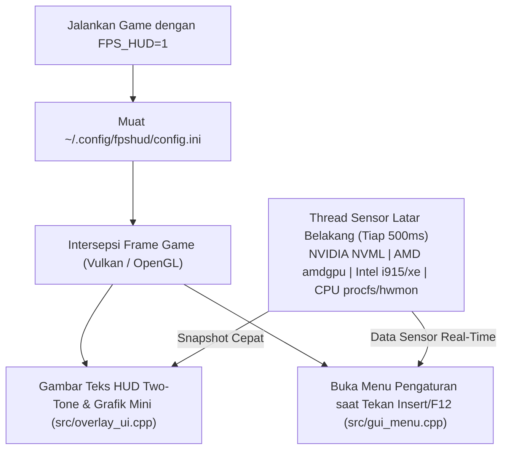

# FPSHUD for Linux

**Overlay Monitoring FPS & Hardware Ringan dengan Menu Pengaturan Langsung di Dalam Game untuk Linux (Vulkan & OpenGL)**

[](https://github.com/budicuy/FPS_HUD_FOR_LINUX/actions)
[](LICENSE)
[](CMakeLists.txt)
[](src/)
[](src/telemetry.cpp)

> 🌐 **Bahasa Dokumentasi:** **[English](README.md)** | **[Bahasa Indonesia (Aktif)](README.id.md)**

---

## Gambaran Umum (Overview)

### Apa itu FPSHUD?
**FPSHUD** adalah aplikasi pemantau performa (*in-game overlay* / HUD) ringan yang dibuat untuk para pemain game di Linux. Aplikasi ini berfungsi untuk menampilkan informasi **FPS, 1% Low (indikator patah-patah/*stutter*), suhu GPU & CPU, kecepatan clock, konsumsi daya (Watt), hingga pemakaian RAM** secara langsung di layar saat kamu bermain game di Steam (Proton/DXVK), Lutris, Heroic, maupun game Linux native.

Kebanyakan overlay di Linux mengharuskan kamu keluar dari game dan mengedit file teks konfigurasi yang rumit hanya untuk memindahkan posisi tulisan atau menambah sensor. **FPSHUD dibuat agar jauh lebih praktis:** kamu cukup menjalankan game dengan **`FPS_HUD=1`**, lalu tekan tombol **`Insert`** atau **`F12`** kapan saja saat bermain untuk mengatur semuanya secara langsung lewat **Menu Pengaturan di Dalam Game (`FPSHUD Configuration Tool`)**!

### Dibangun Menggunakan Apa?
FPSHUD dibangun menggunakan bahasa **C++20** modern agar ukurannya sangat kecil (`~950 KB`) dan tidak membebani FPS game kamu sama sekali. Teknologi utama di dalamnya meliputi:
- **Vulkan Implicit Layer & OpenGL Hook** untuk menampilkan teks di atas layar game dengan mulus tanpa *lag*.
- **Dear ImGui** untuk menyediakan menu pengaturan interaktif di dalam game yang rapi dan responsif.
- **Sensor Kernel Linux (`drm`, `hwmon`, `powercap`) & NVIDIA NVML** untuk membaca suhu, kipas, clock, dan daya langsung dari perangkat keras tanpa membutuhkan aplikasi latar belakang yang berat.

### Fitur Apa Saja yang Ada di Dalamnya?
- **Instalasi 1 Perintah (`curl`)**: Cukup salin dan jalankan 1 baris perintah di terminal untuk menginstal—tidak perlu repot menginstal paket *compiler* atau melakukan *build* manual.
- **Menu Pengaturan Langsung di Dalam Game (Tanpa Tab yang Rumit)**: Tekan `Insert`, `F12`, atau `F10` saat bermain untuk mengubah posisi HUD, ukuran huruf, transparansi latar belakang, warna, atau memilih **19 sensor hardware** secara *real-time*.
- **Mendukung Semua Perangkat (NVIDIA, AMD, Intel & Steam Deck/APU)**: Otomatis mengenali nama model CPU & GPU kamu dan bekerja di kartu grafis **NVIDIA GeForce**, **AMD Radeon**, maupun **Intel Arc / Iris**, serta prosesor **Intel Core** dan **AMD Ryzen**.
- **4 Preset Siap Pakai**: Ganti tampilan dengan 1 klik antara **Minimal** (hanya FPS), **Standard**, **Advance** (lengkap 19 sensor), atau simpan racikanmu sendiri di **Custom**.
- **Tampilan Dua Warna (*Two-Tone*) yang Mudah Dibaca & Peringatan Suhu**: Angka ditampilkan dengan warna putih terang yang tegas sedangkan satuan (`MHz`, `GB`, `°C`, `W`) berwarna perak lembut, dilengkapi warna peringatan otomatis saat suhu GPU/CPU mulai panas (`>= 72°C` Kuning, `>= 82°C` Merah).
- **Perekam Benchmark ke CSV (`F9`)**: Tekan `F9` saat bermain untuk merekam rata-rata FPS, 1% Low, 0.1% Low, serta suhu maksimum ke dalam file `.csv` di folder `Dokumen` / `Documents`.

### Bagaimana Cara Kerjanya?
1. Saat kamu menjalankan game dengan `FPS_HUD=1`, sistem Linux secara otomatis menyisipkan `libfpshud.so` ke dalam proses gambar game tersebut.
2. Setiap kali game selesai menggambar satu frame ke layar, FPSHUD menghitung waktu antar-frame secara presisi dan menggambar teks HUD di atasnya.
3. Sementara itu, proses pembacaan suhu, daya, dan beban CPU/GPU dijalankan secara terpisah di latar belakang setiap **0,5 detik sekali** (`500ms`), sehingga pemantauan sensor dijamin tidak akan pernah membuat game kamu mengalami penurunan FPS.

---

## Instalasi Cepat (Cukup 1 Perintah `curl`)

Kamu bisa langsung menginstal **FPSHUD** di distro Linux apa pun (Arch, Ubuntu, Debian, Linux Mint, Fedora, Pop!_OS, Nobara, Bazzite, maupun SteamOS) hanya dengan **1 perintah** berikut di terminal:

```bash
curl -fsSL https://raw.githubusercontent.com/budicuy/FPS_HUD_FOR_LINUX/main/install.sh | bash
```

### Cara Uninstall Cepat (1 Perintah)
```bash
curl -fsSL https://raw.githubusercontent.com/budicuy/FPS_HUD_FOR_LINUX/main/uninstall.sh | bash
```

---

## Daftar Isi

1. [Cara Pakai di Game (Steam, Lutris, Heroic, Terminal)](#1-cara-pakai-di-game-steam-lutris-heroic-terminal)
2. [Menu Pengaturan di Dalam Game & Tombol Shortcut](#2-menu-pengaturan-di-dalam-game--tombol-shortcut)
3. [Dukungan Hardware & Daftar 19 Sensor](#3-dukungan-hardware--daftar-19-sensor)
4. [Izin Tambahan untuk Sensor Daya & Wayland (Opsional)](#4-izin-tambahan-untuk-sensor-daya--wayland-opsional)
5. [Tech Stack & Arsitektur Sistem](#5-tech-stack--arsitektur-sistem)
6. [Panduan Developer (Build dari Source & Pengujian Otomatis)](#6-panduan-developer-build-dari-source--pengujian-otomatis)
7. [Troubleshooting & Tanya Jawab (FAQ)](#7-troubleshooting--tanya-jawab-faq)
8. [Kontribusi, Kredit & Lisensi](#8-kontribusi-kredit--lisensi)

---

## 1. Cara Pakai di Game (Steam, Lutris, Heroic, Terminal)

FPSHUD hanya menggunakan **satu perintah pengaktifan**:
- **`FPS_HUD=1`** — **Menyalakan** HUD Overlay sekaligus Menu Pengaturan di dalam game.
- **`FPS_HUD=0`** — **Mematikan** HUD Overlay sepenuhnya.

### Steam (Game Proton / DXVK / Vulkan)
1. Klik kanan game di Steam -> **Properties** -> **General**.
2. Pada kolom **Launch Options**, isi dengan:
   ```bash
   FPS_HUD=1 %command%
   ```
   *(Catatan: Jika kamu memainkan game Linux lawas yang masih menggunakan **OpenGL**, gunakan: `FPS_HUD=1 ~/.local/bin/fpshud %command%`)*

### Lutris & Heroic Games Launcher
- Buka **Pengaturan Game (Configuration)** -> **System / Environment Variables**:
  - Tambahkan Key **`FPS_HUD`** dengan nilai **`1`**.

### Terminal
```bash
# Coba dengan Vulkan cube:
FPS_HUD=1 vkcube

# Coba dengan OpenGL gears:
~/.local/bin/fpshud glxgears
```

---

## 2. Menu Pengaturan di Dalam Game & Tombol Shortcut

Saat sedang berada di dalam game, gunakan tombol shortcut berikut kapan saja (tombol ini juga bisa kamu ganti sendiri di dalam menu GUI):

| Tombol Default | Fungsi |
| :--- | :--- |
| **`Insert`** / **`F12`** / **`F10`** | **Membuka / Menutup Menu Pengaturan GUI** (otomatis menyimpan pengaturan saat ditutup) |
| **`F11`** | **Menyembunyikan / Menampilkan HUD** di layar dengan cepat tanpa membuka menu |
| **`F9`** | **Mulai / Berhenti Merekam Benchmark CSV** (tersimpan ke `~/Dokumen/fpshud_benchmark.csv` atau `~/Documents/fpshud_benchmark.csv`) |
| **`ESC`** | Menutup menu pengaturan dan mengembalikan kursor mouse ke dalam game |

### 4 Pilihan Preset Siap Pakai
Di bagian bar atas jendela menu GUI, kamu bisa memilih 4 preset hanya dengan 1 klik:
1. **`Minimal`**: Hanya menampilkan `FPS` dan `Frametime (ms)` secara simpel.
2. **`Standard`**: Menampilkan `FPS`, `Frametime`, `GPU (Load, Clock, Suhu)`, `CPU (Load, Clock, Suhu)`, dan `RAM`.
3. **`Advance`**: Menampilkan lengkap **19 sensor** (`FPS`, `AVG`, `1% Low`, `0.1% Low`, `FT`, semua sensor `GPU`, semua sensor `CPU`, `RAM`, `Render API`, dan `Jam Lokal`).
4. **`Custom` & `Save Custom`**: Menyimpan susunan sensor pilihanmu sendiri ke `~/.config/fpshud/custom_preset.ini`.

---

## 3. Dukungan Hardware & Daftar 19 Sensor

### Kompatibilitas Semua Merek Hardware (Multi-Vendor)

| Jenis Perangkat | Hardware & Driver yang Didukung | Fitur Otomatis |
| :--- | :--- | :--- |
| **GPU NVIDIA** | GeForce GTX / RTX (`nvidia` via `libnvidia-ml.so.1`) | Load, Clock, VRAM, Bandwidth, Suhu, Fan %, Daya (Watt) |
| **GPU & APU AMD** | Radeon RX / APU / Steam Deck (`amdgpu`) | Load, Clock, VRAM + Shared GTT RAM, Bandwidth, Suhu, Fan %, Daya (Watt), deteksi nama via `pci.ids` |
| **GPU Intel** | Intel Arc Discrete & Iris Xe / UHD (`xe` & `i915`) | Load, Clock, VRAM, Bandwidth, Suhu, Fan %, Daya (Watt), deteksi nama via `pci.ids` |
| **Laptop Hybrid** | Laptop Dual-GPU (`iGPU` + `dGPU`) | Otomatis memilih GPU gaming utama (`card1`) dibanding iGPU bawaan prosesor (`card0`) |
| **CPU Intel & AMD** | Prosesor Intel Core & AMD Ryzen | Otomatis mengenali nama prosesor, kecepatan clock tertinggi, beban %, suhu (`coretemp` / `k10temp` / `zenpower`), dan daya (`RAPL`) |

### Daftar Lengkap 19 Sensor

| # | Nama Sensor | Grup | Fungsi / Informasi yang Ditampilkan | Contoh di HUD |
| :--- | :--- | :--- | :--- | :--- |
| `01` | **FPS Counter** | `FPS` | Jumlah frame per detik saat ini | `144` |
| `02` | **FPS Average** | `FPS` | Rata-rata FPS selama 3,5 detik terakhir | `AVG: 138` |
| `03` | **FPS 1% Low** | `FPS` | Rata-rata 1% frame paling lambat (indikator *stutter*) | `1%: 112` |
| `04` | **FPS 0.1% Low** | `FPS` | Rata-rata 0,1% frame paling lambat (*micro-stutter*) | `0.1%: 95` |
| `05` | **Frame Time** | `FPS` | Waktu render per frame dalam milidetik | `6.9 ms` |
| `06` | **GPU Load** | `GPU` | Persentase kerja kartu grafis | `98%` |
| `07` | **GPU Clock** | `GPU` | Kecepatan frekuensi core GPU saat ini | `2430 MHz` |
| `08` | **GPU VRAM** | `GPU` | Pemakaian memori VRAM dalam GB (termasuk GTT pada APU) | `6.4 GB` |
| `09` | **GPU Bandwidth** | `GPU` | Kecepatan transfer memori VRAM aktif dalam GB/s | `165.4 GB/s` |
| `10` | **GPU Temp** | `GPU` | Suhu GPU dalam derajat Celcius | `65 °C` |
| `11` | **GPU Fan** | `GPU` | Persentase kecepatan putaran kipas GPU | `FAN: 55%` |
| `12` | **GPU Power** | `GPU` | Konsumsi daya listrik GPU dalam Watt | `185 W` |
| `13` | **CPU Load** | `CPU` | Persentase beban kerja prosesor | `42%` |
| `14` | **CPU Clock** | `CPU` | Kecepatan frekuensi core CPU aktif tertinggi | `5050 MHz` |
| `15` | **CPU Power** | `CPU` | Konsumsi daya listrik prosesor dalam Watt | `58 W` |
| `16` | **CPU Temp** | `CPU` | Suhu prosesor dalam derajat Celcius | `62 °C` |
| `17` | **System RAM** | `RAM` | Pemakaian memori RAM sistem dalam GB | `9.2 GB` |
| `18` | **Render API** | `SYS` | API grafis yang dipakai game (`VULKAN` atau `OPENGL`) | `VULKAN` |
| `19` | **Local Clock** | `SYS` | Jam lokal sistem saat ini (`HH:MM`) | `21:45` |

---

## 4. Izin Tambahan untuk Sensor Daya & Wayland (Opsional)

Pada beberapa distro Linux, jalankan dua perintah singkat ini agar tombol shortcut di Wayland dan sensor Watt CPU bisa terbaca tanpa memerlukan `sudo`:

1. **Mengizinkan Shortcut Keyboard & Mouse GUI di Wayland (`evdev`)**:
   ```bash
   sudo usermod -aG input $USER
   # Aktifkan langsung saat ini tanpa perlu restart:
   sudo chmod a+r /dev/input/event*
   ```
2. **Mengizinkan Pembacaan Watt CPU (`intel-rapl` / `amd-rapl`)**:
   ```bash
   echo 'SUBSYSTEM=="powercap", KERNEL=="*rapl:*", RUN+="/bin/chmod a+r /sys/class/powercap/%k/energy_uj"' | sudo tee /etc/udev/rules.d/99-rapl-read.rules
   sudo chmod a+r /sys/class/powercap/*rapl*/energy_uj 2>/dev/null || true
   ```

---

## 5. Tech Stack & Arsitektur Sistem

| Komponen | Teknologi | Keunggulan |
| :--- | :--- | :--- |
| **Bahasa & Build** | **C++20**, CMake, LTO, `-O3` | Menautkan `libstdc++` & `libgcc` secara statis agar portabel di semua distro (`~950 KB`). |
| **Graphics Hook** | **Vulkan 1.3 Layer** + **GLX/EGL** | Mengintersepsi `vkQueuePresentKHR`, `glXSwapBuffers`, dan `eglSwapBuffers`. |
| **Overlay & GUI** | **Dear ImGui (`v1.91.6`)** | Teks tajam dengan *outline*/*drop shadow* & atlas font ringkas hemat memori. |
| **Mesin Sensor** | **POSIX `sysfs`/`procfs` + NVML** | *Snapshot* memori tanpa alokasi heap per frame (*zero frame-time overhead*). |



---

## 6. Panduan Developer (Build dari Source & Pengujian Otomatis)

Jika kamu seorang pengembang yang ingin memodifikasi kode sumber atau melakukan kompilasi manual:

```bash
git clone https://github.com/budicuy/FPS_HUD_FOR_LINUX.git
cd FPS_HUD_FOR_LINUX
./install.sh
```

### Menjalankan Pengujian Simulasi 5 Perangkat Otomatis
FPSHUD dilengkapi *test suite* otomatis (`src/test_cli.cpp`) yang menyimulasikan struktur file kernel Linux untuk menguji ke-19 sensor, database `pci.ids`, pemilihan dGPU laptop hybrid, akurasi 1% Low FPS, dan perekam CSV benchmark pada **5 profil perangkat berbeda** (Hardware Asli, PC Desktop AMD, PC Desktop Intel Arc, Laptop Hybrid Dual-GPU, dan Steam Deck/APU):

```bash
./build/fpshud_test 1
```

---

## 7. Troubleshooting & Tanya Jawab (FAQ)

- **Menekan `Insert` / `F12` tidak membuka menu di dalam game:**
  Jalankan `sudo chmod a+r /dev/input/event*` (atau tambahkan user ke grup `input` dengan `sudo usermod -aG input $USER` lalu login ulang).
- **Nilai CPU Power menampilkan `0 W`:**
  Jalankan `sudo chmod a+r /sys/class/powercap/*rapl*/energy_uj`.
- **Bagaimana cara mengembalikan semua pengaturan ke awal (Reset)?**
  Buka menu di dalam game (`Insert`/`F12`) lalu klik tombol **`Reset`** di pojok kanan atas, atau hapus file `~/.config/fpshud/config.ini`.

---

## 8. Kontribusi, Kredit & Lisensi

- **Kontribusi**: *Pull Request* dan laporan *issue* sangat terbuka! Pastikan seluruh pengujian `./build/fpshud_test 1` lulus sebelum mengirimkan PR.
- **Kredit**:
  - **[Dear ImGui](https://github.com/ocornut/imgui)** oleh Omar Cornut untuk pustaka antarmuka grafis di dalam game.
  - **Khronos Group** untuk spesifikasi standar Vulkan & OpenGL.
  - **Komunitas Kernel Linux** untuk antarmuka sensor `drm`, `amdgpu`, `i915`/`xe`, `hwmon`, dan `powercap`.
- **Lisensi**: Dirilis di bawah lisensi sumber terbuka **[MIT License](LICENSE)**.
