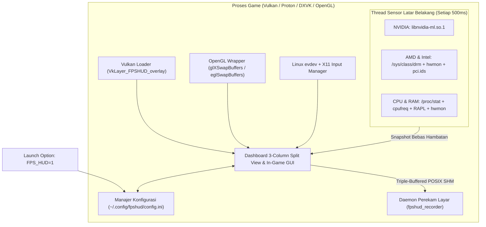

# FPSHUD

**Overlay Performa In-Game Ringan & Menu Pengaturan Interaktif untuk Gaming di Linux (Vulkan & OpenGL)**

[](https://github.com/budicuy/FPS_HUD_FOR_LINUX/actions/workflows/ci.yml)
[](LICENSE)
[](CMakeLists.txt)
[](src/)
[](src/telemetry/telemetry.cpp)

> 🌐 **Bahasa Dokumentasi / Language:** **[English](README.md)** | **[Bahasa Indonesia (Aktif)](README.id.md)**

---

## Instalasi Cepat (Cukup 1 Perintah — Tanpa Perlu Compile!)

Instal **FPSHUD** dalam hitungan detik di distro Linux apa pun (Arch, Ubuntu, Debian, Fedora, Linux Mint, Pop!_OS, Nobara, Bazzite, maupun SteamOS) tanpa perlu menginstal paket compiler atau build tambahan:

```bash
curl -fsSL https://raw.githubusercontent.com/budicuy/FPS_HUD_FOR_LINUX/main/install.sh | bash
```

Untuk menghapus instalasi (uninstall) kapan saja:
```bash
curl -fsSL https://raw.githubusercontent.com/budicuy/FPS_HUD_FOR_LINUX/main/uninstall.sh | bash
```

---

## Gambaran Umum (Overview)

### Untuk apa aplikasi ini dibuat?
Saat bermain game di Linux (baik lewat Steam Proton, Lutris, Heroic, maupun game native Linux), kita sering ingin memantau **berapa FPS yang didapat**, apakah ada patah-patah (**1% Low / Frametime**), serta mengecek kondisi kesehatan PC/laptop seperti **suhu GPU & CPU, kecepatan clock, konsumsi daya (Watt), dan pemakaian RAM/VRAM**.

Pada aplikasi overlay Linux kebanyakan, jika kamu ingin mengubah posisi teks, mengganti ukuran huruf, atau memilih sensor mana saja yang tampil, kamu harus keluar dulu dari game lalu mengedit file konfigurasi teks secara manual. **FPSHUD hadir untuk membuat semuanya jauh lebih praktis:** cukup aktifkan dengan `FPS_HUD=1`, lalu tekan tombol **`Insert`** atau **`F12`** langsung di tengah permainan untuk membuka menu pengaturan interaktif di layar game kamu!

### Dibangun menggunakan apa?
FPSHUD dibangun menggunakan **ISO C++26** dengan arsitektur *zero-heap inline storage* (`std::inplace_vector`), Pack Indexing, dan analitik frametime SIMD yang sangat kencang, hemat memori, dan bebas alokasi dinamis saat bermain game. Menggunakan **Dear ImGui** untuk menggambar teks HUD sekaligus menu pengaturan di dalam game, serta berjalan langsung di jalur grafis **Vulkan Layer** dan **OpenGL** (`LD_PRELOAD`). Font huruf juga sudah ditanamkan langsung di dalam file program, sehingga tampilan teks dijamin selalu tajam meskipun dijalankan di dalam container Steam Linux Runtime / Proton.

### Fitur apa saja yang ada di dalamnya?
- **Dashboard 3-Column Split View In-Game (`Insert` / `F12` / `F10`)**: Menu pengaturan widescreen modular 3 kolom (Kiri: Posisi, Tata Letak, Font & Warna | Tengah: 25 Sensor Hardware & Filter Preset Cepat | Kanan: Perekam Layar Hardware & Benchmark).
- **Perekam Layar Hardware Bebas Lag (`F7`)**: Daemon perekaman terpisah dengan triple-buffering POSIX Shared Memory yang tidak membebani game engine, mendukung codec HEVC (H.265) dan H.264 dengan Adaptive CQP (16–30), tombol rekam 1-klik, dan perekaman audio (Game, Mic, atau Campuran).
- **4 Preset Siap Pakai (1-Klik)**: Bebas berganti tampilan antara **Minimal** (hanya FPS & Frametime), **Standard** (FPS, GPU, CPU, RAM utama), **Advance** (lengkap 25 sensor), atau menyimpan racikanmu sendiri ke tombol **Custom**.
- **Mendukung Semua Merek Perangkat Keras (NVIDIA, AMD, Intel)**: Otomatis mendeteksi dan membaca sensor pada **GPU NVIDIA**, **GPU & APU AMD Radeon**, **GPU Intel Arc & Iris**, serta **CPU Intel Core & AMD Ryzen**—termasuk laptop gaming *dual-GPU* (otomatis memilih kartu grafis gaming diskrit) dan handheld seperti Steam Deck.
- **Tampilan *Two-Tone* yang Mudah Dibaca & Peringatan Suhu Panas**: Angka ditampilkan dengan warna putih terang sedangkan satuan (`MHz`, `GB`, `°C`, `W`) dibuat sedikit redup dengan pemisah titik (`·`) agar tidak membingungkan mata, ditambah warna peringatan otomatis (**Kuning saat `>= 72°C`** dan **Merah saat `>= 82°C`**).
- **1% Low FPS Akurat & Perekam Benchmark ke CSV (`F9`)**: Menghitung rata-rata frame terendah secara akurat (otomatis mengabaikan jeda saat layar *loading*) dan bisa merekam laporan performa ke file `.csv` kapan saja dengan menekan `F9`.

### Bagaimana cara kerjanya?
1. **Pasang sekali lewat 1 perintah `curl`**: Script installer otomatis mengunduh file `libfpshud.so` siap pakai ke `~/.local/lib/fpshud/` dan mendaftarkannya ke sistem Vulkan/OpenGL pengguna.
2. **Aktifkan di game**: Cukup tambahkan `FPS_HUD=1 %command%` pada Launch Options game di Steam (atau Lutris/Heroic).
3. **Tidak bikin FPS game turun**: Saat game menggambar setiap frame ke layar, FPSHUD ikut menempelkan teks informasi tepat sebelum gambar ditampilkan ke monitor. Sementara itu, tugas membaca sensor suhu, kipas, dan Watt dilakukan oleh pekerja terpisah di latar belakang setiap 0,5 detik—sehingga performa game kamu tetap kencang tanpa gangguan.

---

## Daftar Isi

1. [Fitur Utama](#1-fitur-utama)
2. [Instalasi & Izin Akses Sensor](#2-instalasi--izin-akses-sensor)
3. [Cara Pakai di Steam, Lutris, Heroic & Terminal](#3-cara-pakai-di-steam-lutris-heroic--terminal)
4. [Panduan Menu In-Game GUI & Tombol Shortcut](#4-panduan-menu-in-game-gui--tombol-shortcut)
5. [Perekam Layar Hardware](#5-perekam-layar-hardware)
6. [Dukungan Perangkat Keras & Daftar 25 Sensor](#6-dukungan-perangkat-keras--daftar-25-sensor)
7. [Tech Stack & Arsitektur Sistem](#7-tech-stack--arsitektur-sistem)
8. [Panduan Pengembang (Build dari Source, Sanitizers & Pengujian)](#8-panduan-pengembang-build-dari-source-sanitizers--pengujian)
9. [Troubleshooting & Tanya Jawab (FAQ)](#9-troubleshooting--tanya-jawab-faq)
10. [Kontribusi, Kredit & Lisensi](#10-kontribusi-kredit--lisensi)

---

## 1. Fitur Utama

- **Aktivasi Simpel (`FPS_HUD=1` / `FPS_HUD=0`)**:
  - `FPS_HUD=1`: Menyalakan HUD Overlay, Perekam Layar, dan menu In-Game GUI Configurator.
  - `FPS_HUD=0` (atau dikosongkan): Mematikan overlay sepenuhnya tanpa beban di latar belakang.
- **Dashboard In-Game GUI 3-Column Split View (`FPSHUD Configuration Tool`)**:
  - Tekan **`Insert`**, **`F12`**, atau **`F10`** di dalam game untuk membuka antarmuka widescreen 3 kolom (Kiri: Posisi, Susunan, Font, Warna, Shortcut | Tengah: 25 Sensor Hardware & Tombol Filter Preset | Kanan: Perekam Layar & Benchmark).
  - Otomatis menangkap kursor mouse saat menu dibuka, dan langsung mengembalikan kursor ke dalam game saat menu ditutup.
  - Setiap perubahan otomatis tersimpan ke `~/.config/fpshud/config.ini`.
- **Perekam Layar Hardware Zero-Stutter**:
  - Companion daemon khusus (`fpshud_recorder`) yang berjalan terpisah dengan zero copy lewat triple-buffered POSIX Shared Memory IPC.
  - Mendukung standar video modern **HEVC (H.265 / `hvc1`)** dan **H.264** dengan kualitas **Adaptive CQP (CQ 16–30)** untuk hasil rekaman tajam tanpa artifak piksel.
  - Perekaman audio multi-sumber (Game Audio, Mikrofon, Campuran, atau Mute) via PulseAudio/PipeWire yang langsung tersimpan rapi ke folder `~/Videos/FPSHUD`.
- **Dukungan Universal Multi-Vendor (NVIDIA, AMD, Intel & APU)**:
  - **NVIDIA**: Membaca sensor melalui `libnvidia-ml.so.1` (NVML) secara dinamis.
  - **AMD Radeon & APU (`amdgpu`)**: Membaca sensor DRM & `hwmon` Linux, fallback clock `pp_dpm_sclk`, serta menggabungkan memori *Shared GTT* pada APU/Steam Deck.
  - **Intel Arc & Integrated Graphics (`i915` / `xe` / Level Zero)**: Backend dinamis Intel Level Zero Sysman (`libze_loader.so.1` via runtime `dlopen`), fallback sensor Linux DRM & `hwmon`, serta sensor daya Intel RAPL.
  - **Topologi Core Intel Hybrid (P-Core vs E-Core)**: Penguraian otomatis topologi prosesor Intel Core Generasi 12/13/14 dan Core Ultra via `/sys/devices/cpu_{core,atom}/cpus` dengan beban kerja klaster terpisah secara real-time.
  - **Status Baterai Laptop & Handheld (`/sys/class/power_supply`)**: Persentase kapasitas baterai, daya listrik Watt (discharge/charge), dan indikator charging dengan deteksi otomatis Desktop PC (otomatis di-disabled dan digelapkan pada komputer desktop tanpa baterai).
  - **Laptop Gaming Hybrid Dual-GPU**: Otomatis memprioritaskan GPU diskrit (`card1`) dibanding iGPU (`card0`) serta menampilkan nama model GPU secara akurat lewat database `/usr/share/hwdata/pci.ids`.
- **Grafik Mini Frametime & Perekam Benchmark CSV (`F9`)**:
  - Tersedia opsi grafik gelombang frametime langsung di HUD, serta perekam benchmark CSV (`~/Documents/fpshud_benchmark.csv` atau `~/Dokumen/fpshud_benchmark.csv`) yang mencatat rata-rata FPS, 1% Low, 0.1% Low, serta suhu & daya maksimum GPU/CPU.
- **Optimasi Ekstrem Clang 23 & Arsitektur Zero-Heap C++26**:
  - Dikompilasi menggunakan Clang 23.1.4, linker LLD, ThinLTO (`-flto=thin`), dan `-O3` menghasilkan biner shared library ramping **1.3 MB** yang zero-overhead dan bebas memory leak/UB (diverifikasi dengan ASan & UBSan).

---

## 2. Instalasi & Izin Akses Sensor

### Instalasi 1 Perintah (Direkomendasikan untuk Semua Pengguna)
```bash
curl -fsSL https://raw.githubusercontent.com/budicuy/FPS_HUD_FOR_LINUX/main/install.sh | bash
```

### Izin Sensor Hardware (SANGAT DISARANKAN)
> [!IMPORTANT]
> Saat instalasi meminta **izin akses `sudo`**, Anda **sangat disarankan untuk menyetujuinya**.
>
> Secara bawaan, kebijakan keamanan kernel Linux membatasi pembacaan beberapa counter perangkat keras bagi akun pengguna biasa:
> 1. **Daya CPU / Konsumsi Listrik (Watt via RAPL)**: Mitigasi keamanan kernel untuk celah CVE-2020-8694 (Platypus) membatasi file `/sys/class/powercap/*rapl*/energy_uj` hanya untuk root (mode `0400`). Sudo akan memasang aturan udev Linux standar (`/etc/udev/rules.d/99-fpshud-rapl.rules`) yang dengan aman memberikan hak baca saja (`0444`) bagi pengguna biasa.
> 2. **Kecepatan RAM (MT/s) & Generasi Memori (DDR4 / DDR5)**: Tabel raw SMBIOS DMI pada `/sys/firmware/dmi/entries/` dibatasi untuk root. Sudo akan melakukan deteksi cepat sekali saja dan menyimpan hasilnya ke `~/.local/share/fpshud/ram_info` (berpemilik pengguna biasa).
> 3. **Shortcut Keyboard & Mouse Wayland (`Insert` / `F12`)**: Pada sistem desktop Wayland (GNOME Wayland, KDE Plasma Wayland, Hyprland, Sway), isolasi keamanan mencegah aplikasi membaca tombol keyboard dan klik mouse lintas jendela. Sudo akan memasang `/etc/udev/rules.d/99-fpshud-input.rules` dan menambahkan pengguna Anda ke grup standar `input`.

> [!NOTE]
> **Lupa atau melewatkan sudo saat instalasi? Tidak perlu install ulang!**
> Anda dapat mengonfigurasi seluruh izin sensor hardware kapan saja cukup dengan 1 perintah:
> ```bash
> fpshud --setup
> ```
> Untuk memeriksa status izin sensor hardware kapan saja:
> ```bash
> fpshud --status
> ```

> [!TIP]
> **Jaminan Keamanan & Privasi:**
> Game dan aplikasi **TIDAK PERNAH** dijalankan sebagai root atau dengan sudo. Seluruh game dijalankan murni dengan hak akses pengguna biasa Anda. Hak sudo hanya digunakan satu kali saat konfigurasi untuk mendaftarkan aturan udev dan membaca tabel SMBIOS.

### Uninstall 1 Perintah (Hapus Bersih Seluruh Komponen & Konfigurasi)
```bash
curl -fsSL https://raw.githubusercontent.com/budicuy/FPS_HUD_FOR_LINUX/main/uninstall.sh | bash
```

---

## 3. Cara Pakai di Steam, Lutris, Heroic & Terminal

### 1. Steam (Game Proton / DXVK / Vulkan — 99% Game Steam)
Klik kanan game di Steam -> **Properties** -> **General** -> **Launch Options**:
```bash
FPS_HUD=1 %command%
```
*(Untuk mematikan sementara, cukup ubah menjadi `FPS_HUD=0 %command%`)*

> [!NOTE]
> Seluruh game Windows yang berjalan melalui Proton, DXVK, serta game native Linux berbasis Vulkan modern cukup menggunakan opsi ini.

### 2. Steam (Khusus Game Native Linux OpenGL Lawas)
Hanya dibutuhkan untuk game native Linux jadul yang masih memakai API OpenGL:
```bash
FPS_HUD=1 ~/.local/bin/fpshud %command%
```

### 3. Lutris & Heroic Games Launcher
Buka **Game Settings / Configuration** -> **System / Environment Variables** -> Tambahkan:
- **Key**: `FPS_HUD`
- **Value**: `1`

### 4. Terminal / Command Line
```bash
# Menjalankan game atau aplikasi berbasis Vulkan:
FPS_HUD=1 ./nama_game

# Menjalankan game atau aplikasi berbasis OpenGL:
~/.local/bin/fpshud ./nama_game
```

---

## 4. Panduan Menu In-Game GUI & Tombol Shortcut

Saat game berjalan dengan `FPS_HUD=1`, gunakan tombol shortcut berikut (semua tombol bisa diganti lewat menu GUI):

| Tombol Default | Fungsi |
| :--- | :--- |
| **`Insert` / `F12` / `F10`** | Membuka atau Menutup menu **`FPSHUD Configuration Tool`** |
| **`F11`** | Menyembunyikan atau Menampilkan HUD dengan cepat tanpa membuka menu |
| **`F7`** | Memulai atau Menghentikan **Screen Recorder Ringan** (`~/Videos/FPSHUD`) |
| **`F9`** | Memulai atau Menghentikan perekaman **Benchmark CSV** |
| **`ESC`** | Menutup menu GUI dan mengembalikan kursor mouse ke dalam game |

> [!TIP]
> **Pengguna Steam Deck & Perangkat Gaming Handheld:**
> Anda dapat membuka menu pengaturan in-game tanpa keyboard fisik dengan memetakan tombol belakang (seperti **`L4`** atau **`R4`**) ke tombol keyboard **`F12`** atau **`Insert`** melalui menu **Steam Controller Settings -> Edit Layout**.

### 4 Pilihan Preset di Dalam GUI
- **`Minimal`**: Hanya menampilkan `FPS` dan `Frametime (ms)`.
- **`Standard`**: Menampilkan `FPS`, `Frametime`, `GPU (Load, Clock, Temp)`, `CPU (Load, Clock, Temp)`, dan `RAM`.
- **`Advance`**: Menampilkan lengkap **25 sensor** (`FPS`, `AVG`, `1% Low`, `0.1% Low`, `Frametime`, 7 sensor `GPU`, 5 sensor `CPU` termasuk `P/E Core Load`, 5 sensor `RAM/Memori`, `Render API`, `Local Clock`, dan `Battery & Power`).
- **`Custom` / `Save Custom`**: Menyimpan pilihan sensor dan tata letak favoritmu ke `~/.config/fpshud/custom_preset.ini`.

---

## 5. Perekam Layar Hardware

FPSHUD dilengkapi dengan daemon perekam layar latar belakang khusus yang sangat ringan (`fpshud_recorder`) dan berjalan terpisah dari proses game utama. Frame dikirimkan melalui triple-buffered POSIX Shared Memory (`/dev/shm`), memastikan bahwa proses encoding video hardware tidak pernah menyebabkan stutter (*frame drop*) atau *micro-freeze* pada permainan Anda.

### Fitur Utama & Opsi Codec

| Fitur | Penjelasan | Default / Rekomendasi |
| :--- | :--- | :--- |
| **Codec Video** | **HEVC (H.265 / `hvc1`)** atau **H.264 (AVC)** | **HEVC (`hvc1`)** untuk ukuran file 50% lebih hemat dengan kompatibilitas universal di Discord, Chrome, QuickTime, dan Premiere. |
| **Kontrol Bitrate** | **Adaptive CQP (Constant Quantization Parameter)** atau **Fixed VBR** | **Adaptive CQP (Level 22)**: mengalokasikan bitrate secara dinamis berdasarkan kompleksitas adegan sehingga aksi cepat tetap tajam tanpa pecah piksel. |
| **Tingkat Kualitas CQP** | Sesuaikan kualitas visual dari **CQ 16** (*Near-lossless*, bitrate tinggi) hingga **CQ 30** (Kompresi maksimal). | **CQ 20 - 22** |
| **Framerate & Resolusi** | Native (Sesuai resolusi game), 1080p, 720p, atau 1440p pada **30, 60, 120 FPS, atau Match Display** (hingga 144+ FPS via CLI). | **Native @ 60 FPS** |
| **Perekaman Audio** | Rekam audio latensi rendah via PulseAudio / PipeWire: **Hanya Game**, **Hanya Mikrofon**, **Game + Mikrofon (Stereo Downmixed)**, atau **Mute**. | **Hanya Audio Game** |
| **Lokasi Penyimpanan** | Klip video otomatis disimpan ke folder `~/Videos/FPSHUD/` dengan nama file berstempel waktu (`FPSHUD_YYYYMMDD_HHMMSS.mp4`). | `~/Videos/FPSHUD` |

### Cara Menggunakan Perekam Layar

1. **Mulai / Hentikan Perekaman Penuh (`F7`)**:
   - Tekan **`F7`** di dalam game (atau klik tombol **`[REC] Start Record`** pada Kolom 3 di GUI).
   - Indikator notifikasi in-game akan mengonfirmasi bahwa perekaman telah dimulai. Tekan **`F7`** kembali untuk menyelesaikan dan menyimpan file video MP4/MKV.
2. **Buka Folder Rekaman**:
   - Klik tombol **`Open System Folder`** di menu GUI in-game untuk membuka direktori rekaman langsung di file manager desktop Anda (Dolphin, Nautilus, Nemo, Thunar, dll.).

---

## 6. Dukungan Perangkat Keras & Daftar 25 Sensor

### Matriks Kompatibilitas Perangkat Keras

| Komponen | Vendor & Driver yang Didukung | Sumber Data di Linux |
| :--- | :--- | :--- |
| **GPU NVIDIA** | Driver NVIDIA Proprietary / Open (`nvidia`) | `libnvidia-ml.so.1` (NVML runtime `dlopen`) |
| **GPU & APU AMD** | AMD Radeon Discrete & APU (`amdgpu`) | `/sys/class/drm/card*/device` + `hwmon` + `mem_info_gtt_*` + `pci.ids` |
| **GPU Intel** | Intel Arc Discrete & Iris/UHD (`xe`, `i915`) | Intel Level Zero Sysman (`libze_loader.so.1` runtime `dlopen`) dengan `/sys/class/drm/card*` + `hwmon` + `intel-rapl` fallback |
| **CPU Intel** | Intel Core & Core Ultra (Hybrid & Standar) | `/proc/cpuinfo`, `/proc/stat`, `/sys/devices/cpu_{core,atom}/cpus`, `cpufreq`, `coretemp`, `intel-rapl` |
| **CPU AMD** | AMD Ryzen / Threadripper / Custom APU | `/proc/cpuinfo`, `/proc/stat`, `cpufreq`, `k10temp`/`zenpower`, `amd-rapl` |
| **Memori RAM** | DDR3, DDR4, DDR5, LPDDR4, LPDDR5 | `/proc/meminfo`, `/proc/self/status`, `/proc/pressure/memory`, SMBIOS 17 |
| **Baterai & Daya** | Standar ACPI / Linux Power Supply (`BAT0`, `BAT1`) | `/sys/class/power_supply/BAT*/{capacity,power_now,status}` (otomatis disabled di Desktop PC) |

### Daftar Lengkap 25 Sensor

| # | Nama Sensor | Grup | Informasi yang Ditampilkan | Contoh di HUD |
| :--- | :--- | :--- | :--- | :--- |
| `01` | **FPS Counter** | `FPS` | Jumlah frame per detik saat ini | `144` |
| `02` | **FPS Average** | `FPS` | Rata-rata FPS selama 3,5 detik terakhir | `AVG: 138` |
| `03` | **FPS 1% Low** | `FPS` | Rata-rata 1% frame paling lambat (indikator kelancaran) | `1%: 112` |
| `04` | **FPS 0.1% Low** | `FPS` | Rata-rata 0,1% frame paling lambat (*micro-stutter*) | `0.1%: 95` |
| `05` | **Frame Time** | `FPS` | Waktu yang dibutuhkan untuk merender 1 frame (milidetik) | `6.9 ms` |
| `06` | **GPU Load** | `GPU` | Persentase beban kerja core GPU | `98%` |
| `07` | **GPU Clock** | `GPU` | Kecepatan frekuensi core GPU saat ini | `2430 MHz` |
| `08` | **GPU VRAM** | `GPU` | Pemakaian memori VRAM GPU dalam GB (termasuk GTT di APU) | `6.4 GB` |
| `09` | **GPU Bandwidth** | `GPU` | Kecepatan transfer bandwidth memori VRAM + PCIe aktif | `165.4 GB/s` |
| `10` | **GPU Temp** | `GPU` | Suhu GPU dalam derajat Celcius | `65 °C` |
| `11` | **GPU Fan** | `GPU` | Persentase kecepatan putaran kipas GPU | `FAN: 55%` |
| `12` | **GPU Power** | `GPU` | Konsumsi daya listrik GPU dalam Watt | `185 W` |
| `13` | **CPU Load** | `CPU` | Persentase pemakaian total seluruh thread CPU | `42%` |
| `14` | **CPU Clock** | `CPU` | Kecepatan frekuensi core CPU tertinggi yang sedang aktif | `5050 MHz` |
| `15` | **CPU Power** | `CPU` | Konsumsi daya listrik CPU dalam Watt | `58 W` |
| `16` | **CPU Temp** | `CPU` | Suhu prosesor CPU dalam derajat Celcius | `62 °C` |
| `17` | **P/E Core Load** | `CPU` | Penguraian beban core Intel Hybrid (P-Core % / E-Core %; auto-disabled pada non-hybrid) | `P/E: 45/20%` |
| `18` | **System RAM** | `RAM` | Pemakaian RAM sistem dalam GB & persen dengan peringatan warna | `9.2 GB 60%` |
| `19` | **Game RAM** | `RAM` | Memori fisik (VmRSS) khusus yang dipakai oleh game ini saja | `GAME: 4.8 GB` |
| `20` | **Swap / ZRAM** | `RAM` | Pemakaian swap / zram aktif dalam GB | `SWAP: 1.2 GB` |
| `21` | **Memory Pressure** | `RAM` | Metrik Linux PSI (persentase stall memori 10 detik terakhir) | `PSI: 2.1%` |
| `22` | **RAM Speed** | `RAM` | Kecepatan transfer efektif & generasi RAM | `DDR5: 6000 MT/s` |
| `23` | **Render API** | `SYS` | Engine grafis yang digunakan game (`VULKAN` atau `OPENGL`) | `VULKAN` |
| `24` | **Local Clock** | `SYS` | Jam lokal sistem saat ini (`HH:MM`) | `21:45` |
| `25` | **Battery & Power** | `SYS` | Persentase baterai, daya Watt, dan status cas (otomatis disabled di PC Desktop) | `BAT: 82% (16.5W+)` |

---

## 7. Tech Stack & Arsitektur Sistem

| Bagian | Teknologi | Keunggulan Utama |
| :--- | :--- | :--- |
| **Bahasa & Build** | **C++26**, **Clang/LLVM 23 + LLD**, **ThinLTO (`-O3`)** | Arsitektur ISO C++26 zero-heap inline storage (`std::inplace_vector`), Pack Indexing, analitik frametime SIMD, ThinLTO, `-fno-plt`, stack canaries, deteksi bug ASan/UBSan & static libstdc++. |
| **Intersepsi Grafis** | **Vulkan Layer (`1.3`)** + **GLX/EGL Hook** | Menangkap fungsi `vkQueuePresentKHR`, `glXSwapBuffers`, dan `eglSwapBuffers`. |
| **Antarmuka UI** | **Dear ImGui (`v1.91.6`)** | Renderer teks dua warna dengan *outline/shadow* & dashboard 3-Column Split View tanpa tab. |
| **Penangkap Input** | **Linux `evdev` + Fallback `X11`** | Pembacaan `/dev/input/event*` non-blocking dengan pengunci kursor `EVIOCGRAB`. |
| **Mesin Sensor** | **Thread Pekerja Asinkron (500ms)** | Nol alokasi memori per frame; pembacaan data ke layar bebas hambatan (*lock-free*). |
| **Perekam Layar** | **POSIX SHM IPC + FFmpeg (libavcodec)** | Perekaman HEVC/H.264 terakselerasi hardware triple-buffered & audio PulseAudio/PipeWire. |



---

## 8. Panduan Pengembang (Build dari Source, Sanitizers & Pengujian)

Bagi pengembang (*developer*) yang ingin memodifikasi kode sumber atau melakukan kompilasi manual:

### 1. Persyaratan Sistem & Toolchain (Requirements)

Untuk mengompilasi FPSHUD dari kode sumber, pastikan lingkungan Anda memenuhi spesifikasi berikut:

| Kebutuhan | Versi Minimum / Spesifikasi | Fungsi |
| :--- | :--- | :--- |
| **Kompiler C++** | **Clang 18+** (Direkomendasikan Clang 23) atau **GCC 14+** | Dukungan penuh standar ISO C++26 (`-std=c++26`), `std::inplace_vector`, Pack Indexing |
| **Sistem Build** | **CMake >= 3.25** & **Ninja** | Orkestrasi kompilasi multi-threaded cepat |
| **Linker** | **LLD (`lld`)** | Fast linking dengan optimasi ThinLTO (`-flto=thin`) |
| **API Grafis** | **Vulkan Headers & Loader (>= 1.3)** & **libglvnd (OpenGL / EGL)** | Intersepsi swapchain presentasi frame |
| **Windowing & Input** | **libX11**, **Header klien Wayland**, **Linux evdev** (`linux-api-headers`) | Penangkapan input in-game & kontrol kursor |
| **Perekam Layar** | **Pustaka pengembang FFmpeg** (`libavcodec`, `libavformat`, `libswscale`, `libswresample`, `libavutil`) & **libpulse** | Encoding video hardware & penangkapan audio |
| **Database Hardware** | **hwdata** atau **pci.ids** | Identifikasi nama kartu grafis GPU diskrit/terintegrasi |
| **Peralatan Asset** | **Python 3.8+** | Menghasilkan header C++ font tertanam dari berkas TTF |

### 2. Clone, Compile & Jalankan Pengujian Simulasi 5 Perangkat
```bash
git clone https://github.com/budicuy/FPS_HUD_FOR_LINUX.git
cd FPS_HUD_FOR_LINUX

# 1. Kompilasi Performa Ekstrem dengan Clang 23 + LLD + ThinLTO (-O3 Extreme)
./scripts/build_clang.sh

# 2. Jalankan 61 pengujian otomatis pada 5 profil perangkat + pengujian ketahanan memori:
./build/fpshud_test 1

# 3. (Opsional) Jalankan pendeteksi bug AddressSanitizer + LeakSanitizer + UBSan:
./scripts/run_sanitizers.sh

# 4. (Opsional) Jalankan analisis kode statis otomatis Clang-Tidy:
ninja -C build clang-tidy
```

### Struktur Proyek
```text
FPS_HUD_FOR_LINUX/
├── .github/workflows/ci.yml             # Otomatisasi CI build, pengujian 5 perangkat, matriks multi-distro & rilis GitHub
├── .clang-tidy                          # Aturan analisis statis memori & keamanan kode C++
├── CMakeLists.txt                       # Konfigurasi build C++26 dengan ThinLTO, LLD, ASan/UBSan & static libstdc++
├── dist/fpshud-linux-x86_64.tar.gz      # Paket biner portabel siap pakai untuk instalasi 1-perintah curl
├── install.sh / uninstall.sh            # Skrip instalasi & uninstalasi instan curl
├── manifest/
│   ├── libfpshud.version                # Peta ekspor simbol (menyembunyikan simbol internal dari game)
│   └── VkLayer_FPSHUD_overlay.json.in   # Templat manifes Vulkan Implicit Layer
├── README.md / README.id.md             # Dokumentasi lengkap Bahasa Inggris & Bahasa Indonesia
├── scripts/
│   ├── build_clang.sh                   # Skrip kompilasi Clang 23 + LLD + ThinLTO
│   ├── fpshud.in                        # Skrip pembungkus CLI manajemen & LD_PRELOAD OpenGL
│   ├── gen_embedded_fonts.py            # Konversi file font TTF menjadi C++ byte array
│   ├── install.sh / uninstall.sh        # Skrip penerus instalasi & uninstalasi build lokal
│   ├── package_release.sh               # Pembuat paket rilis standalone untuk distribusi portabel
│   ├── run_sanitizers.sh                # Skrip pengujian AddressSanitizer, LeakSanitizer & UBSan
│   ├── test_e2e_install.sh              # Pengujian end-to-end siklus hidup instalasi & uninstalasi sandbox
│   └── test_vulkan_headless.sh          # Pengujian rendering Vulkan headless & swapchain Mesa Lavapipe
├── src/
│   ├── core/                            # Pengelola konfigurasi, parser INI, inplace_vec & pack_indexing
│   ├── input/                           # Pembaca input Linux evdev + X11 & pengunci mouse EVIOCGRAB
│   ├── layer/                           # Hook swapchain Vulkan Implicit Layer & OpenGL GLX/EGL
│   ├── recorder/                        # Daemon perekam FFmpeg, IPC & peluncur ramah container
│   ├── telemetry/                       # Telemetri GPU/CPU multi-vendor & perekam benchmark CSV
│   ├── ui/                              # Menu in-game Dear ImGui, HUD two-tone & font embedded
│   └── main.cpp                         # Titik masuk CLI diagnostik
└── tests/
    └── test_cli.cpp                     # Suite pengujian 61-check simulasi sysfs 5-perangkat & keamanan memori
```

---

## 9. Troubleshooting & Tanya Jawab (FAQ)

1. **Menekan `Insert` / `F12` tidak membuka menu GUI atau klik mouse tembus ke dalam game:**
   - Jalankan `sudo chmod a+r /dev/input/event*` (atau tambahkan user ke grup `input` secara permanen dengan `sudo usermod -aG input $USER` lalu login ulang).
2. **Daya CPU menampilkan `0 W`:**
   - Jalankan `sudo chmod a+r /sys/class/powercap/*rapl*/energy_uj` (lihat [Bagian 2](#2-instalasi--izin-akses-sensor) agar aktif permanen setiap kali komputer dinyalakan).
3. **Bagaimana cara mengembalikan semua pengaturan ke kondisi awal (Reset)?**
   - Buka menu GUI di dalam game (`Insert` / `F12`) lalu klik tombol **`Reset`** di pojok kanan atas, atau hapus file `~/.config/fpshud/config.ini`.

---

## 10. Kontribusi, Kredit & Lisensi

### Kontribusi
Kontribusi kode, laporan kendala (*Issues*), maupun masukan pengujian di berbagai perangkat sangat disambut! Sebelum mengirimkan *Pull Request*, pastikan seluruh 61 pengujian multi-perangkat dan pengujian ketahanan memori lulus (`PASS`) dengan menjalankan `./build/fpshud_test 1`.

### Kredit & Penghargaan
- **[Dear ImGui](https://github.com/ocornut/imgui)** oleh Omar Cornut — Pustaka antarmuka grafis *Immediate Mode* yang menjadi fondasi tampilan HUD dan menu interaktif.
- **Khronos Group** — Spesifikasi standar Vulkan Implicit Layer dan OpenGL.
- **Komunitas Kernel Linux** — Pengembang subsistem `drm`, `amdgpu`, `i915`/`xe`, `hwmon`, dan `powercap`.
- **Open Sans & Bitstream Vera** — Font TrueType open-source yang ditanamkan di dalam program.

### Lisensi
Didistribusikan di bawah lisensi **[MIT License](LICENSE)**.
