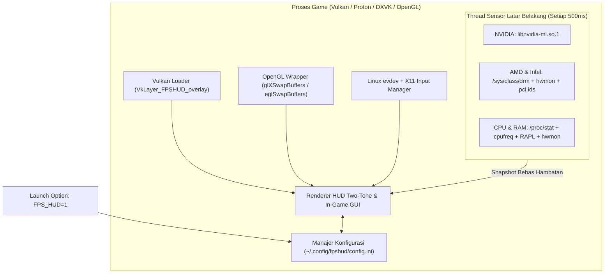

# FPSHUD

**Overlay Performa In-Game Ringan & Menu Pengaturan Interaktif untuk Gaming di Linux (Vulkan & OpenGL)**

[](https://github.com/budicuy/FPS_HUD_FOR_LINUX/actions/workflows/ci.yml)
[](LICENSE)
[](CMakeLists.txt)
[](src/)
[](src/telemetry.cpp)

> 🌐 **Bahasa Dokumentasi / Language:** **[English](README.md)** | **[Bahasa Indonesia (Aktif)](README.id.md)**

---

## Instalasi Cepat (Cukup 1 Perintah — Tanpa Perlu Compile!)

Instal **FPSHUD** dalam hitungan detik di distro Linux apa pun (Arch, Ubuntu, Debian, Fedora, Linux Mint, Pop!_OS, Nobara, Bazzite, maupun SteamOS) tanpa perlu menginstal paket compiler atau build tambahan:

```bash
curl -fsSL https://raw.githubusercontent.com/budicuy/FPS_HUD_FOR_LINUX/main/install.sh | bash
```

Untuk menghapus instalasi (uninstall) kapan saja:
```bash
curl -fsSL https://raw.githubusercontent.com/budicuy/FPS_HUD_FOR_LINUX/main/uninstall.sh | bash
```

---

## Gambaran Umum (Overview)

### Untuk apa aplikasi ini dibuat?
Saat bermain game di Linux (baik lewat Steam Proton, Lutris, Heroic, maupun game native Linux), kita sering ingin memantau **berapa FPS yang didapat**, apakah ada patah-patah (**1% Low / Frametime**), serta mengecek kondisi kesehatan PC/laptop seperti **suhu GPU & CPU, kecepatan clock, konsumsi daya (Watt), dan pemakaian RAM/VRAM**.

Pada aplikasi overlay Linux kebanyakan, jika kamu ingin mengubah posisi teks, mengganti ukuran huruf, atau memilih sensor mana saja yang tampil, kamu harus keluar dulu dari game lalu mengedit file konfigurasi teks secara manual. **FPSHUD hadir untuk membuat semuanya jauh lebih praktis:** cukup aktifkan dengan `FPS_HUD=1`, lalu tekan tombol **`Insert`** atau **`F12`** langsung di tengah permainan untuk membuka menu pengaturan interaktif di layar game kamu!

### Dibangun menggunakan apa?
FPSHUD dibangun menggunakan **C++20** yang sangat ringan dan hemat memori, memanfaatkan **Dear ImGui** untuk menggambar teks HUD sekaligus menu pengaturan di dalam game, serta berjalan langsung di jalur grafis **Vulkan Layer** dan **OpenGL** (`LD_PRELOAD`). Font huruf juga sudah ditanamkan langsung di dalam file program, sehingga tampilan teks dijamin selalu tajam meskipun dijalankan di dalam container Steam Linux Runtime / Proton.

### Fitur apa saja yang ada di dalamnya?
- **Menu Pengaturan Langsung di Dalam Game (`Insert` / `F12` / `F10`)**: Dashboard 2 kolom yang rapi tanpa tab berbelit-belit. Kamu bisa langsung mencentang sensor yang ingin ditampilkan, mengatur posisi layar, ukuran font, transparansi background, hingga warna teks tanpa keluar dari game.
- **4 Preset Siap Pakai (1-Klik)**: Bebas berganti tampilan antara **Minimal** (hanya FPS & Frametime), **Standard** (FPS, GPU, CPU, RAM utama), **Advance** (lengkap 19 sensor), atau menyimpan racikanmu sendiri ke tombol **Custom**.
- **Mendukung Semua Merek Perangkat Keras (NVIDIA, AMD, Intel)**: Otomatis mendeteksi dan membaca sensor pada **GPU NVIDIA**, **GPU & APU AMD Radeon**, **GPU Intel Arc & Iris**, serta **CPU Intel Core & AMD Ryzen**—termasuk laptop gaming *dual-GPU* (otomatis memilih kartu grafis gaming diskrit) dan handheld seperti Steam Deck.
- **Tampilan *Two-Tone* yang Mudah Dibaca & Peringatan Suhu Panas**: Angka ditampilkan dengan warna putih terang sedangkan satuan (`MHz`, `GB`, `°C`, `W`) dibuat sedikit redup dengan pemisah titik (`·`) agar tidak membingungkan mata, ditambah warna peringatan otomatis (**Kuning saat `>= 72°C`** dan **Merah saat `>= 82°C`**).
- **1% Low FPS Akurat & Perekam Benchmark ke CSV (`F9`)**: Menghitung rata-rata frame terendah secara akurat (otomatis mengabaikan jeda saat layar *loading*) dan bisa merekam laporan performa ke file `.csv` kapan saja dengan menekan `F9`.

### Bagaimana cara kerjanya?
1. **Pasang sekali lewat 1 perintah `curl`**: Script installer otomatis mengunduh file `libfpshud.so` siap pakai ke `~/.local/lib/fpshud/` dan mendaftarkannya ke sistem Vulkan/OpenGL pengguna.
2. **Aktifkan di game**: Cukup tambahkan `FPS_HUD=1 %command%` pada Launch Options game di Steam (atau Lutris/Heroic).
3. **Tidak bikin FPS game turun**: Saat game menggambar setiap frame ke layar, FPSHUD ikut menempelkan teks informasi tepat sebelum gambar ditampilkan ke monitor. Sementara itu, tugas membaca sensor suhu, kipas, dan Watt dilakukan oleh pekerja terpisah di latar belakang setiap 0,5 detik—sehingga performa game kamu tetap kencang tanpa gangguan.

---

## Daftar Isi

1. [Fitur Utama](#1-fitur-utama)
2. [Instalasi & Izin Akses Sensor](#2-instalasi--izin-akses-sensor)
3. [Cara Pakai di Steam, Lutris, Heroic & Terminal](#3-cara-pakai-di-steam-lutris-heroic--terminal)
4. [Panduan Menu In-Game GUI & Tombol Shortcut](#4-panduan-menu-in-game-gui--tombol-shortcut)
5. [Dukungan Perangkat Keras & Daftar 19 Sensor](#5-dukungan-perangkat-keras--daftar-19-sensor)
6. [Tech Stack & Arsitektur Sistem](#6-tech-stack--arsitektur-sistem)
7. [Panduan Pengembang (Build dari Source & Pengujian)](#7-panduan-pengembang-build-dari-source--pengujian)
8. [Troubleshooting & Tanya Jawab (FAQ)](#8-troubleshooting--tanya-jawab-faq)
9. [Kontribusi, Kredit & Lisensi](#9-kontribusi-kredit--lisensi)

---

## 1. Fitur Utama

- **Aktivasi Simpel (`FPS_HUD=1` / `FPS_HUD=0`)**:
  - `FPS_HUD=1`: Menyalakan HUD Overlay dan menu In-Game GUI Configurator.
  - `FPS_HUD=0` (atau dikosongkan): Mematikan overlay sepenuhnya tanpa beban di latar belakang.
- **Dashboard In-Game GUI Tanpa Tab (`FPSHUD Configuration Tool`)**:
  - Tekan **`Insert`**, **`F12`**, atau **`F10`** di dalam game untuk membuka panel berdampingan (Kiri: Posisi, Susunan, Font, Warna, Shortcut | Kanan: 19 Sensor Hardware & Tombol Preset).
  - Otomatis menangkap kursor mouse saat menu dibuka, dan langsung mengembalikan kursor ke dalam game saat menu ditutup.
  - Setiap perubahan otomatis tersimpan ke `~/.config/fpshud/config.ini`.
- **Dukungan Universal Multi-Vendor (NVIDIA, AMD, Intel & APU)**:
  - **NVIDIA**: Membaca sensor melalui `libnvidia-ml.so.1` (NVML) secara dinamis.
  - **AMD Radeon & APU (`amdgpu`)**: Membaca sensor DRM & `hwmon` Linux, fallback clock `pp_dpm_sclk`, serta menggabungkan memori *Shared GTT* pada APU/Steam Deck.
  - **Intel Arc & Integrated Graphics (`i915` / `xe`)**: Membaca sensor DRM & `hwmon`, `lmem_total_bytes`, serta sensor daya Intel RAPL.
  - **Laptop Gaming Hybrid Dual-GPU**: Otomatis memprioritaskan GPU diskrit (`card1`) dibanding iGPU (`card0`) serta menampilkan nama model GPU secara akurat lewat database `/usr/share/hwdata/pci.ids`.
- **Grafik Mini Frametime & Perekam Benchmark CSV (`F9`)**:
  - Tersedia opsi grafik gelombang frametime langsung di HUD, serta perekam benchmark CSV (`~/Documents/fpshud_benchmark.csv` atau `~/Dokumen/fpshud_benchmark.csv`) yang mencatat rata-rata FPS, 1% Low, 0.1% Low, serta suhu & daya maksimum GPU/CPU.

---

## 2. Instalasi & Izin Akses Sensor

### Instalasi 1 Perintah (Direkomendasikan untuk Semua Pengguna)
```bash
curl -fsSL https://raw.githubusercontent.com/budicuy/FPS_HUD_FOR_LINUX/main/install.sh | bash
```
> [!NOTE]
> Saat instalasi berjalan, skrip akan menawarkan izin `sudo` opsional. Jika disetujui, installer akan mengonfigurasi otomatis:
> 1. **Kecepatan & Generasi RAM** (`DDR4 / DDR5 / LPDDR5` dalam `MT/s`).
> 2. **Sensor Daya CPU** (`intel-rapl` / `amd-rapl` dalam Watt).
> 3. **Shortcut Keyboard & Mouse Wayland** (`/dev/input/event*` untuk menu GUI `Insert` / `F12`).
>
> Jika kamu memilih melewati sudo atau menginstal secara non-interaktif, instalasi tetap berhasil dan seluruh sensor non-privilege tetap berfungsi normal.

### Uninstall 1 Perintah (Hapus Bersih Seluruh Komponen & Konfigurasi)
```bash
curl -fsSL https://raw.githubusercontent.com/budicuy/FPS_HUD_FOR_LINUX/main/uninstall.sh | bash
```

---

## 3. Cara Pakai di Steam, Lutris, Heroic & Terminal

### 1. Steam (Game Proton / DXVK / Vulkan)
Klik kanan game di Steam -> **Properties** -> **General** -> **Launch Options**:
```bash
FPS_HUD=1 %command%
```
*(Untuk mematikan sementara, cukup ubah menjadi `FPS_HUD=0 %command%`)*

### 2. Steam (Game Linux OpenGL Native)
```bash
FPS_HUD=1 ~/.local/bin/fpshud %command%
```

### 3. Lutris & Heroic Games Launcher
Buka **Game Settings / Configuration** -> **System / Environment Variables** -> Tambahkan:
- **Key**: `FPS_HUD`
- **Value**: `1`

### 4. Terminal / Command Line
```bash
# Menjalankan game atau aplikasi berbasis Vulkan:
FPS_HUD=1 ./nama_game

# Menjalankan game atau aplikasi berbasis OpenGL:
~/.local/bin/fpshud ./nama_game
```

---

## 4. Panduan Menu In-Game GUI & Tombol Shortcut

Saat game berjalan dengan `FPS_HUD=1`, gunakan tombol shortcut berikut (semua tombol bisa diganti lewat menu GUI):

| Tombol Default | Fungsi |
| :--- | :--- |
| **`Insert` / `F12` / `F10`** | Membuka atau Menutup menu **`FPSHUD Configuration Tool`** |
| **`F11`** | Menyembunyikan atau Menampilkan HUD dengan cepat tanpa membuka menu |
| **`F7`** | Memulai atau Menghentikan **Screen Recorder Ringan** (`~/Videos/FPSHUD`) |
| **`F8`** | Menyimpan **Instant Replay** (klip 60 detik gameplay terakhir) |
| **`F9`** | Memulai atau Menghentikan perekaman **Benchmark CSV** |
| **`ESC`** | Menutup menu GUI dan mengembalikan kursor mouse ke dalam game |

### 4 Pilihan Preset di Dalam GUI
- **`Minimal`**: Hanya menampilkan `FPS` dan `Frametime (ms)`.
- **`Standard`**: Menampilkan `FPS`, `Frametime`, `GPU (Load, Clock, Temp)`, `CPU (Load, Clock, Temp)`, dan `RAM`.
- **`Advance`**: Menampilkan lengkap **23 sensor** (`FPS`, `AVG`, `1% Low`, `0.1% Low`, `Frametime`, 7 sensor `GPU`, 4 sensor `CPU`, 5 sensor `RAM/Memori`, `Render API`, dan `Local Clock`).
- **`Custom` / `Save Custom`**: Menyimpan pilihan sensor dan tata letak favoritmu ke `~/.config/fpshud/custom_preset.ini`.

---

## 5. Dukungan Perangkat Keras & Daftar 23 Sensor

### Matriks Kompatibilitas Perangkat Keras

| Komponen | Vendor & Driver yang Didukung | Sumber Data di Linux |
| :--- | :--- | :--- |
| **GPU NVIDIA** | Driver NVIDIA Proprietary / Open (`nvidia`) | `libnvidia-ml.so.1` (NVML runtime `dlopen`) |
| **GPU & APU AMD** | AMD Radeon Discrete & APU (`amdgpu`) | `/sys/class/drm/card*/device` + `hwmon` + `mem_info_gtt_*` + `pci.ids` |
| **GPU Intel** | Intel Arc Discrete & Iris/UHD (`xe`, `i915`) | `/sys/class/drm/card*` + `hwmon` + `intel-rapl:0:1` + `pci.ids` |
| **CPU Intel** | Intel Core (Semua Generasi) | `/proc/cpuinfo`, `/proc/stat`, `cpufreq`, `coretemp`, `intel-rapl` |
| **CPU AMD** | AMD Ryzen / Threadripper / Custom APU | `/proc/cpuinfo`, `/proc/stat`, `cpufreq`, `k10temp`/`zenpower`, `amd-rapl` |
| **Memori RAM** | DDR3, DDR4, DDR5, LPDDR4, LPDDR5 | `/proc/meminfo`, `/proc/self/status`, `/proc/pressure/memory`, SMBIOS 17 |

### Daftar Lengkap 23 Sensor

| # | Nama Sensor | Grup | Informasi yang Ditampilkan | Contoh di HUD |
| :--- | :--- | :--- | :--- | :--- |
| `01` | **FPS Counter** | `FPS` | Jumlah frame per detik saat ini | `144` |
| `02` | **FPS Average** | `FPS` | Rata-rata FPS selama 3,5 detik terakhir | `AVG: 138` |
| `03` | **FPS 1% Low** | `FPS` | Rata-rata 1% frame paling lambat (indikator kelancaran) | `1%: 112` |
| `04` | **FPS 0.1% Low** | `FPS` | Rata-rata 0,1% frame paling lambat (*micro-stutter*) | `0.1%: 95` |
| `05` | **Frame Time** | `FPS` | Waktu yang dibutuhkan untuk merender 1 frame (milidetik) | `6.9 ms` |
| `06` | **GPU Load** | `GPU` | Persentase beban kerja core GPU | `98%` |
| `07` | **GPU Clock** | `GPU` | Kecepatan frekuensi core GPU saat ini | `2430 MHz` |
| `08` | **GPU VRAM** | `GPU` | Pemakaian memori VRAM GPU dalam GB (termasuk GTT di APU) | `6.4 GB` |
| `09` | **GPU Bandwidth** | `GPU` | Kecepatan transfer bandwidth memori VRAM + PCIe aktif | `165.4 GB/s` |
| `10` | **GPU Temp** | `GPU` | Suhu GPU dalam derajat Celcius | `65 °C` |
| `11` | **GPU Fan** | `GPU` | Persentase kecepatan putaran kipas GPU | `FAN: 55%` |
| `12` | **GPU Power** | `GPU` | Konsumsi daya listrik GPU dalam Watt | `185 W` |
| `13` | **CPU Load** | `CPU` | Persentase pemakaian total seluruh thread CPU | `42%` |
| `14` | **CPU Clock** | `CPU` | Kecepatan frekuensi core CPU tertinggi yang sedang aktif | `5050 MHz` |
| `15` | **CPU Power** | `CPU` | Konsumsi daya listrik CPU dalam Watt | `58 W` |
| `16` | **CPU Temp** | `CPU` | Suhu prosesor CPU dalam derajat Celcius | `62 °C` |
| `17` | **System RAM** | `RAM` | Pemakaian RAM sistem dalam GB & persen dengan peringatan warna | `9.2 GB 60%` |
| `18` | **Game RAM** | `RAM` | Memori fisik (VmRSS) khusus yang dipakai oleh game ini saja | `GAME: 4.8 GB` |
| `19` | **Swap / ZRAM** | `RAM` | Pemakaian swap / zram aktif dalam GB | `SWAP: 1.2 GB` |
| `20` | **Memory Pressure** | `RAM` | Metrik Linux PSI (persentase stall memori 10 detik terakhir) | `PSI: 2.1%` |
| `21` | **RAM Speed** | `RAM` | Kecepatan transfer efektif & generasi RAM | `DDR4: 3200 MT/s` |
| `22` | **Render API** | `SYS` | Engine grafis yang digunakan game (`VULKAN` atau `OPENGL`) | `VULKAN` |
| `23` | **Local Clock** | `SYS` | Jam lokal sistem saat ini (`HH:MM`) | `21:45` |

---

## 6. Tech Stack & Arsitektur Sistem

| Bagian | Teknologi | Keunggulan Utama |
| :--- | :--- | :--- |
| **Bahasa & Build** | **C++20**, **Clang/LLVM 23 + LLD**, **ThinLTO (`-O3`)** | Optimasi extreme dengan ThinLTO, `-fno-plt`, stack canaries, deteksi bug ASan/UBSan & static libstdc++. |
| **Intersepsi Grafis** | **Vulkan Layer (`1.3`)** + **GLX/EGL Hook** | Menangkap fungsi `vkQueuePresentKHR`, `glXSwapBuffers`, dan `eglSwapBuffers`. |
| **Antarmuka UI** | **Dear ImGui (`v1.91.6`)** | Renderer teks dua warna dengan *outline/shadow* & dashboard 2 kolom tanpa tab. |
| **Penangkap Input** | **Linux `evdev` + Fallback `X11`** | Pembacaan `/dev/input/event*` non-blocking dengan pengunci kursor `EVIOCGRAB`. |
| **Mesin Sensor** | **Thread Pekerja Asinkron (500ms)** | Nol alokasi memori per frame; pembacaan data ke layar bebas hambatan (*lock-free*). |



---

## 7. Panduan Pengembang (Build dari Source & Pengujian)

Bagi pengembang (*developer*) yang ingin memodifikasi kode sumber atau melakukan kompilasi manual:

### 1. Instal Paket Dependensi Build
- **Arch Linux**: `sudo pacman -S --needed base-devel cmake ninja git pkgconf vulkan-headers vulkan-icd-loader mesa libglvnd libx11 wayland hwdata`
- **Ubuntu / Debian**: `sudo apt install -y build-essential cmake ninja-build git pkg-config libvulkan-dev libgl1-mesa-dev libegl1-mesa-dev libx11-dev pci.ids`
- **Fedora**: `sudo dnf install -y gcc-c++ cmake ninja-build git pkgconf-pkg-config vulkan-headers vulkan-loader-devel mesa-libGL-devel mesa-libEGL-devel libX11-devel hwdata`

### 2. Clone, Compile & Jalankan Pengujian Simulasi 5 Perangkat
```bash
git clone https://github.com/budicuy/FPS_HUD_FOR_LINUX.git
cd FPS_HUD_FOR_LINUX

# 1. Kompilasi Performa Ekstrem dengan Clang 23 + LLD + ThinLTO (-O3 Extreme)
./scripts/build_clang.sh

# 2. Jalankan 37 pengujian otomatis pada 5 profil perangkat + pengujian ketahanan memori:
./build/fpshud_test 1

# 3. (Opsional) Jalankan pendeteksi bug AddressSanitizer + LeakSanitizer + UBSan:
./scripts/run_sanitizers.sh

# 4. (Opsional) Jalankan analisis kode statis otomatis Clang-Tidy:
ninja -C build clang-tidy
```

---

## 8. Troubleshooting & Tanya Jawab (FAQ)

1. **Menekan `Insert` / `F12` tidak membuka menu GUI atau klik mouse tembus ke dalam game:**
   - Jalankan `sudo chmod a+r /dev/input/event*` (atau tambahkan user ke grup `input` secara permanen dengan `sudo usermod -aG input $USER` lalu login ulang).
2. **Daya CPU menampilkan `0 W`:**
   - Jalankan `sudo chmod a+r /sys/class/powercap/*rapl*/energy_uj` (lihat [Bagian 2](#2-instalasi--izin-akses-sensor) agar aktif permanen setiap kali komputer dinyalakan).
3. **Bagaimana cara mengembalikan semua pengaturan ke kondisi awal (Reset)?**
   - Buka menu GUI di dalam game (`Insert` / `F12`) lalu klik tombol **`Reset`** di pojok kanan atas, atau hapus file `~/.config/fpshud/config.ini`.

---

## 9. Kontribusi, Kredit & Lisensi

### Kontribusi
Kontribusi kode, laporan kendala (*Issues*), maupun masukan pengujian di berbagai perangkat sangat disambut! Sebelum mengirimkan *Pull Request*, pastikan seluruh 31 pengujian multi-perangkat lulus (`PASS`) dengan menjalankan `./build/fpshud_test 1`.

### Kredit & Penghargaan
- **[Dear ImGui](https://github.com/ocornut/imgui)** oleh Omar Cornut — Pustaka antarmuka grafis *Immediate Mode* yang menjadi fondasi tampilan HUD dan menu interaktif.
- **Khronos Group** — Spesifikasi standar Vulkan Implicit Layer dan OpenGL.
- **Komunitas Kernel Linux** — Pengembang subsistem `drm`, `amdgpu`, `i915`/`xe`, `hwmon`, dan `powercap`.
- **Open Sans & Bitstream Vera** — Font TrueType open-source yang ditanamkan di dalam program.

### Lisensi
Didistribusikan di bawah lisensi **[MIT License](LICENSE)**.
