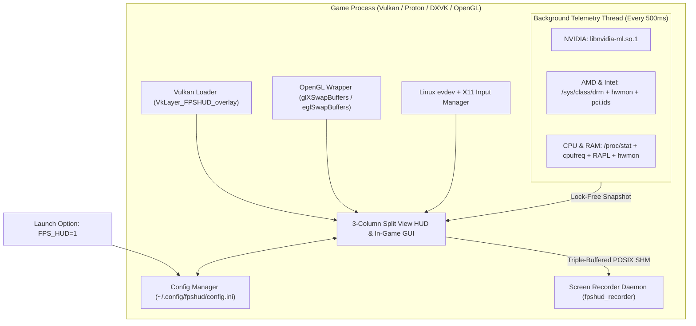

# FPSHUD

**Lightweight In-Game Performance Overlay & Live GUI Configurator for Linux Gaming (Vulkan & OpenGL)**

[](https://github.com/budicuy/FPS_HUD_FOR_LINUX/actions/workflows/ci.yml)
[](LICENSE)
[](CMakeLists.txt)
[](src/)
[](src/telemetry/telemetry.cpp)

> 🌐 **Language / Bahasa Dokumentasi:** **[English (Default)](README.md)** | **[Bahasa Indonesia](README.id.md)**

---

## Quick Install (1 Command — No Compiling Required!)

Install **FPSHUD** in seconds on any Linux distribution (Arch, Ubuntu, Debian, Fedora, Linux Mint, Pop!_OS, Nobara, Bazzite, or SteamOS) without installing compilers or build tools:

```bash
curl -fsSL https://raw.githubusercontent.com/budicuy/FPS_HUD_FOR_LINUX/main/install.sh | bash
```

To uninstall at any time:
```bash
curl -fsSL https://raw.githubusercontent.com/budicuy/FPS_HUD_FOR_LINUX/main/uninstall.sh | bash
```

---

## Overview

### What is FPSHUD for?
When playing games on Linux (whether through Steam Proton, Lutris, Heroic, or native Linux ports), you often want to check your **FPS**, see if your game is stuttering (**1% Low / Frametime**), or keep an eye on your **GPU and CPU temperatures, clock speeds, power draw, and RAM usage**.

With traditional Linux overlays, customizing what appears on screen usually means closing the game, opening a text editor, and manually typing long configuration lines or environment variables. **FPSHUD solves this by giving you a live, interactive control panel directly inside your game.** You simply turn it on with `FPS_HUD=1`, press **`Insert`** or **`F12`** while playing, and click what you want to see—just like modern overlays on Windows, but built natively and lightweight for Linux.

### What is it built with?
FPSHUD is written in **ISO C++26** featuring a zero-heap inline storage architecture (`std::inplace_vector`), Pack Indexing, and SIMD frametime analytics for maximum speed and zero memory allocation overhead during gameplay. It uses **Dear ImGui** to draw both the on-screen HUD and the in-game settings menu, and hooks directly into **Vulkan** (as a standard Vulkan Implicit Layer) and **OpenGL** (`LD_PRELOAD`). Fonts are embedded directly inside the library so text always looks sharp, even inside containerized environments like Steam Linux Runtime and Proton.

### What features are inside?
- **3-Column Split View In-Game Dashboard (`Insert` / `F12` / `F10`)**: A clean, widescreen control panel divided into 3 modular sections (Left: HUD Style, Colors & Typography | Center: 24 Live Hardware Sensors & Presets | Right: Hardware-Accelerated Screen Recorder & Benchmark Hub).
- **Hardware-Accelerated Screen Recording (`F7`)**: Dedicated background video capture daemon supporting HEVC (H.265) and H.264 with Adaptive CQP (16–30), prominent 1-click recording, and PulseAudio/PipeWire audio mixing (Game, Mic, or Both).
- **4 Ready-to-Use Presets**: Switch with one click between **Minimal** (FPS + Frametime only), **Standard** (FPS, GPU, CPU, RAM essentials), **Advance** (all 24 sensors), or save your own **Custom** preset.
- **Works Across All Hardware (NVIDIA, AMD, Intel)**: Automatically detects and reads sensors from **NVIDIA GPUs**, **AMD Radeon GPUs & APUs**, **Intel Arc & Iris GPUs**, and **Intel Core & AMD Ryzen CPUs**—including dual-GPU gaming laptops and handhelds like the Steam Deck.
- **Easy-to-Read Two-Tone Design & Thermal Warnings**: Numbers are displayed in bright white while units (`MHz`, `GB`, `°C`, `W`) are softly dimmed so values never blend together, with automatic yellow/red color warnings when your GPU or CPU runs hot.
- **Accurate 1% & 0.1% Low FPS + CSV Benchmark Recorder (`F9`)**: Measures real frame smoothness over a rolling 3.5-second window (automatically ignoring loading-screen freezes) and lets you record benchmark results directly to a `.csv` file.

### How does it work?
1. **Install once** using the 1-line `curl` command above (or follow the manual install steps).
2. **Enable in your game** by adding `FPS_HUD=1 %command%` in Steam Launch Options (or running `FPS_HUD=1 your_game` in terminal).
3. **Negligible frame pacing impact**: As your game renders each frame, FPSHUD draws the overlay on top of the final image before presentation in less than 8 microseconds. Meanwhile, an asynchronous background thread quietly reads CPU/GPU temperatures and power usage once every 0.5 seconds—preventing frame stutter or render thread lock contention.

---

## Table of Contents

1. [Key Features](#1-key-features)
2. [Installation & Sensor Permissions](#2-installation--sensor-permissions)
3. [How to Use in Steam, Lutris, Heroic & Terminal](#3-how-to-use-in-steam-lutris-heroic--terminal)
4. [In-Game GUI Guide & Keyboard Shortcuts](#4-in-game-gui-guide--keyboard-shortcuts)
5. [Hardware-Accelerated Screen Recording](#5-hardware-accelerated-screen-recording)
6. [Supported Hardware & All 24 Sensors](#6-supported-hardware--all-24-sensors)
7. [Tech Stack & System Architecture](#7-tech-stack--system-architecture)
8. [Developer Guide (Building from Source, Sanitizers & Testing)](#8-developer-guide-building-from-source-sanitizers--testing)
9. [Troubleshooting & FAQ](#9-troubleshooting--faq)
10. [Contributing, Credits & License](#10-contributing-credits--license)

---

## 1. Key Features

- **Simple Activation (`FPS_HUD=1` / `FPS_HUD=0`)**:
  - `FPS_HUD=1`: Turns on the HUD overlay, Screen Recorder, and the In-Game GUI Configurator.
  - `FPS_HUD=0` (or unset / deleted from launch options): Completely disabled with zero background impact.
- **3-Column Split View In-Game GUI (`FPSHUD Configuration Tool`)**:
  - Press **`Insert`**, **`F12`**, or **`F10`** in-game to open a clean 3-column widescreen dashboard (Left: Position, Layout, Font, Colors, Shortcuts | Center: 24 Live Hardware Sensors & Quick Filters | Right: Screen Recorder & Benchmark Hub).
  - Automatically captures your mouse cursor while the menu is open and returns control to the game the moment you close it.
  - Automatically saves all your changes to `~/.config/fpshud/config.ini`.
- **Hardware-Accelerated Screen Recording Hub**:
  - Dedicated background recording daemon (`fpshud_recorder`) with decoupled triple-buffered POSIX Shared Memory IPC.
  - Supports hardware-accelerated **HEVC (H.265 / `hvc1`)** and **H.264** via NVIDIA NVENC and VAAPI with **Adaptive CQP (CQ 16–30)** for crisp, artifact-free gameplay video.
  - Multi-source audio recording (Game Audio, Microphone, Mixed, or Mute) via PulseAudio/PipeWire saved directly to `~/Videos/FPSHUD`.
- **Universal Multi-Vendor Hardware Support**:
  - **NVIDIA**: Uses `libnvidia-ml.so.1` (NVML) dynamically.
  - **AMD Radeon & APUs (`amdgpu`)**: Reads Linux DRM & `hwmon` sensors, supports `pp_dpm_sclk` fallback, and combines shared `GTT` memory on APUs/Steam Deck.
  - **Intel Arc & Integrated Graphics (`i915` / `xe` / Level Zero)**: Dynamic Intel Level Zero Sysman backend (`libze_loader.so.1` via runtime `dlopen`), Linux DRM & `hwmon` sysfs fallback, and Intel RAPL power counters.
  - **Intel Hybrid Architecture (P-Core & E-Core)**: Automatic topology discovery for 12th/13th/14th Gen Intel Core and Core Ultra processors via `/sys/devices/cpu_{core,atom}/cpus` with real-time cluster load breakdown.
  - **Laptop & Handheld Battery (`/sys/class/power_supply`)**: Real-time capacity percentage, discharge/charge wattage, and charging state with automatic desktop PC detection (auto-disabled and grayed out on desktop machines).
  - **Hybrid Gaming Laptops**: Automatically prioritizes the dedicated gaming GPU over integrated graphics by evaluating PCI device class (`0x030000`), `boot_vga` attributes, and Vulkan discrete device flags rather than static card numbering, with exact GPU model resolution via `/usr/share/hwdata/pci.ids`.
- **High-Contrast Readability & Dynamic Alerts**:
  - Category color badges (`FPS` Gold, `GPU` Green, `CPU` Cyan, `RAM` Purple, `SYS` Silver), middle-dot (`·`) separators, and dynamic thermal alerts (**Amber at `>= 72°C`**, **Red at `>= 82°C`**; threshold customization planned for upcoming release).
- **Mini Frametime Graph & CSV Benchmark Logging (`F9`)**:
  - Optional live frametime waveform graph right on the HUD, plus 1-key CSV benchmarking (`~/Documents/fpshud_benchmark.csv`) that logs Avg FPS, 1% Low, 0.1% Low, Min/Max FPS, and peak GPU/CPU temperatures and wattage.
- **Optimized LLVM/Clang Toolchain & Memory Hardening**:
  - Compiled with modern Clang, LLD linker, ThinLTO (`-flto=thin`), and `-O3` producing a compact **1.3 MB** library with memory safety verified by AddressSanitizer and UndefinedBehaviorSanitizer.

### Comparison with MangoHud

| Aspect | **MangoHud** | **FPSHUD** |
| :--- | :--- | :--- |
| **Primary Philosophy** | Standard industry overlay with exhaustive textual config file options. | Modern all-in-one in-game experience with live visual configuration. |
| **Configuration Workflow** | Requires closing the game and editing text configuration files (`~/.config/MangoHud/MangoHud.conf`) or using external tools like GOverlay. | **In-game 3-Column GUI (`Insert` / `F12` / `F10`)**: adjust position, layout, 25 metrics, fonts, colors, and hotkeys live on screen without leaving the game. |
| **Screen Recording** | Requires separate capture software (OBS Studio, GPU Screen Recorder, ReplaySorcery). | **Built-in companion recording daemon (`fpshud_recorder`)** with 1-click recording (`F7`), HEVC/H.264 CQP, and audio mixing. |
| **Maturity & Ecosystem** | Extremely mature, widely adopted across Linux distros, default overlay in SteamOS GameScope. | Modern lightweight alternative designed for gamers wanting immediate visual customization and integrated clipping. |

---

## 2. Installation & Sensor Permissions

### 1-Command Installation (Recommended for Fast Setup)
```bash
curl -fsSL https://raw.githubusercontent.com/budicuy/FPS_HUD_FOR_LINUX/main/install.sh | bash
```

### Option B: Manual Installation with SHA256 Checksum Verification
If you prefer not to pipe scripts to `bash`, you can inspect and install the release archive manually with cryptographic integrity verification:
```bash
# 1. Download release archive and SHA256 checksum from GitHub Releases:
curl -LO https://github.com/budicuy/FPS_HUD_FOR_LINUX/releases/latest/download/fpshud-linux-x86_64.tar.gz
curl -LO https://github.com/budicuy/FPS_HUD_FOR_LINUX/releases/latest/download/fpshud-linux-x86_64.tar.gz.sha256

# 2. Verify archive integrity:
sha256sum -c fpshud-linux-x86_64.tar.gz.sha256

# 3. Extract libraries and binaries into your user folder (~/.local):
mkdir -p ~/.local/lib/fpshud ~/.local/bin ~/.local/share/vulkan/implicit_layer.d
tar -xzf fpshud-linux-x86_64.tar.gz -C ~/.local/lib/fpshud/
ln -sf ~/.local/lib/fpshud/fpshud_test ~/.local/bin/fpshud_test
```

### Hardware Permissions, Security Model & Trade-offs
> [!NOTE]
> **Zero Sudo Architecture for Overlay, Input & RAM:**
> FPSHUD runs **100% sudo-free** out-of-the-box for all core features:
> - **In-Game Hotkeys & GUI Navigation**: Handled directly in-process via hooked Wayland display event queues (`wl_keyboard` / `wl_pointer`) and X11 events without requiring the `input` group or `/dev/input/event*` root access.
> - **RAM Metrics**: Dynamic capacity, resident game memory, Swap/ZRAM, and memory stall pressure (PSI) are parsed cleanly from world-readable `/proc/meminfo`, `/proc/self/status`, and `/proc/pressure/memory`.
> - **Graphics Telemetry**: FPS, frametimes, and GPU sensors (NVIDIA NVML, AMD sysfs, Intel Level Zero / DRM) operate without root privileges.

> [!IMPORTANT]
> **Optional RAPL CPU Power Monitoring (Watts & CVE-2020-8694 Platypus Trade-off):**
> The only sensor that requires elevated setup is privileged CPU Package Power.
> The Linux kernel restricts `/sys/class/powercap/*rapl*/energy_uj` to root (mode `0400`) to mitigate the **Platypus side-channel attack** (CVE-2020-8694), where an unprivileged attacker on a shared system could infer cryptographic operations from micro-fluctuations in CPU power consumption. Installing the optional udev rule (`/etc/udev/rules.d/99-fpshud-rapl.rules`) sets mode `0444` (read-only for all users). This is an explicit user trade-off: package power monitoring convenience versus cryptographic side-channel mitigation on multi-user or sensitive systems.
>
> If you prefer not to grant sudo, FPSHUD continues to run perfectly with all other 23 metrics active.

> [!NOTE]
> **Configure or Verify Permissions Anytime:**
> You can configure optional RAPL sensor permissions at any time without reinstalling:
> ```bash
> fpshud --setup
> ```
> To inspect current hardware sensor accessibility:
> ```bash
> fpshud --status
> ```

> [!TIP]
> **Security Architecture & Trust Boundaries:**
> Games and overlay processes run strictly with your unprivileged user account. Root privileges are never used during gameplay. Sudo is requested only during initial setup to register udev rules in `/etc/udev/rules.d/`.

### 1-Command Uninstallation (Clean Removal)
```bash
curl -fsSL https://raw.githubusercontent.com/budicuy/FPS_HUD_FOR_LINUX/main/uninstall.sh | bash
```

---

## 3. How to Use in Steam, Lutris, Heroic & Terminal

### 1. Steam (Proton / DXVK / Vulkan Games — 99% of Steam Games)
Right-click your game in Steam -> **Properties** -> **General** -> **Launch Options**:
```bash
FPS_HUD=1 %command%
```
*(To disable temporarily without deleting your launch option, change it to `FPS_HUD=0 %command%`. To cleanly and completely disable the overlay, simply remove the environment variable entirely so only `%command%` remains, or leave Launch Options blank).*

> [!NOTE]
> All Windows games running through Proton, DXVK, and modern native Linux Vulkan games use this single option.

### 2. Steam (Legacy Native Linux OpenGL Games Only)
Only required for older native Linux games running on legacy OpenGL:
```bash
FPS_HUD=1 ~/.local/bin/fpshud %command%
```

### 3. Lutris & Heroic Games Launcher
Open **Game Settings** -> **System / Environment Variables** -> Add:
- **Key**: `FPS_HUD`
- **Value**: `1`

### 4. Terminal / Command Line
```bash
# Run any Vulkan game or application:
FPS_HUD=1 ./your_game

# Run any OpenGL game or application:
~/.local/bin/fpshud ./your_game
```

### Anti-Cheat Compatibility Advisory
> [!WARNING]
> **Online Multiplayer Games & Anti-Cheat Software (EAC, BattlEye, VAC, Ricochet):**
> Like MangoHud, OBS Game Capture, and ReShade, FPSHUD functions by injecting into the game's graphics pipeline via a Vulkan Implicit Layer or `LD_PRELOAD`.
> While performance overlays are benign, strict anti-cheat software in competitive online games (e.g., Easy Anti-Cheat, BattlEye, Valve Anti-Cheat, Ricochet) may flag third-party injected libraries as an integrity violation, potentially preventing the game from launching or risking account sanctions.
>
> **Best Practice:** When playing competitive online multiplayer titles, disable the overlay temporarily by setting `FPS_HUD=0 %command%` in your launch options, or cleanly remove the `FPS_HUD` environment variable entirely so the layer is never touched by the loader.

### 32-Bit Game Compatibility
> [!NOTE]
> FPSHUD is compiled as a 64-bit (`x86_64`) library covering virtually all modern Linux native games and Proton titles. If you launch a legacy 32-bit game, the dynamic loader gracefully ignores the 64-bit layer without crashing or interfering, though the HUD will not appear.

---

## 4. In-Game GUI Guide & Keyboard Shortcuts

Once inside a game with `FPS_HUD=1`, use these shortcuts (all customizable inside the GUI):

| Default Key | Action |
| :--- | :--- |
| **`Insert` / `F12` / `F10`** | Open or Close the **`FPSHUD Configuration Tool`** menu |
| **`F11`** | Quickly hide or show the HUD overlay without opening the menu |
| **`F7`** | Start or Stop **Hardware-Accelerated Screen Recording** (`~/Videos/FPSHUD`) |
| **`F9`** | Start or Stop **CSV Benchmark Recording** (`~/Documents/fpshud_benchmark.csv`) |
| **`ESC`** | Close the GUI menu and return mouse control to the game |

> [!TIP]
> **Steam Deck & Handheld Gaming Devices:**
> You can easily open the configuration menu without a physical keyboard by mapping a back grip button (such as **`L4`** or **`R4`**) to keyboard key **`F12`** or **`Insert`** via **Steam Controller Settings -> Edit Layout**.

### The 4 Built-In Presets
- **`Minimal`**: Shows only `FPS` and `Frametime (ms)`.
- **`Standard`**: Shows `FPS`, `Frametime`, `GPU (Load, Clock, Temp)`, `CPU (Load, Clock, Temp)`, and `RAM`.
- **`Advance`**: Enables all **24 sensors** (`FPS`, `AVG`, `1% Low`, `0.1% Low`, `Frametime`, all 7 `GPU` metrics, all 5 `CPU` metrics including `P/E Core Load`, all 4 `Memory/RAM` metrics, `Render API`, `Local Clock`, and `Battery & Power`).
- **`Custom` / `Save Custom`**: Save your favorite combination of sensors and layout to `~/.config/fpshud/custom_preset.ini`.

### Thermal Warning Alerts & Thresholds
By default, FPSHUD highlights temperature values using dynamic color badges:
- **Amber Warning** when GPU or CPU reaches **`>= 72°C`**
- **Red Critical Alert** when GPU or CPU reaches **`>= 82°C`**

> [!NOTE]
> These default thermal thresholds are calibrated for typical gaming desktop and laptop thermal throttling envelopes. Support for customizable threshold values in `config.ini` is planned for an upcoming release.

---

## 5. Hardware-Accelerated Screen Recording

FPSHUD includes a dedicated, lightweight background screen recording daemon (`fpshud_recorder`) that runs decoupled from the game process. Frames are submitted via triple-buffered POSIX Shared Memory (`/dev/shm`), ensuring that hardware video encoding never introduces frame stutter or micro-freezes to your gameplay.

### Hardware Encoder & GPU Readback Architecture
To ensure high-framerate gameplay is never penalized during active recording:
- **Hardware Encoders Supported**:
  - **NVIDIA**: Automatic hardware acceleration via **NVENC** (`hevc_nvenc`, `h264_nvenc`).
  - **AMD & Intel**: Automatic hardware acceleration via **VAAPI** (`hevc_vaapi`, `h264_vaapi`).
  - **Software Fallback**: Graceful fallback to `libx265` / `libx264` if hardware encoder contexts cannot be initialized.
- **Asynchronous GPU Readback Pipeline**:
  - **Vulkan**: Double-buffered staging copy using `vkCmdCopyImageToBuffer` into host-cached staging memory. Frame submission to IPC shared memory is pipelined behind GPU transfer completion fences, eliminating CPU presentation stalls.
  - **OpenGL**: Asynchronous dual-PBO (`GL_PIXEL_PACK_BUFFER`) ring buffer. Frame capture executes non-blocking DMA readback in `pbo[write]` while mapping the previously completed frame in `pbo[read]`.
  - **Decoupled Worker Daemon**: Video encoding, container muxing, and audio mixing occur entirely in the standalone `fpshud_recorder` process via zero-copy POSIX shared memory (`/dev/shm`), preventing encoder overhead from impacting the game's render thread.

### Key Capabilities & Codec Options

| Feature | Description | Default / Recommended |
| :--- | :--- | :--- |
| **Video Codecs** | **HEVC (H.265 / `hvc1`)** or **H.264 (AVC)** | **HEVC (`hvc1`)** for 50% smaller files and universal compatibility in Discord, Chrome, QuickTime, and Premiere. |
| **Rate Control** | **Adaptive CQP (Constant Quantization Parameter)** or **Fixed VBR** | **Adaptive CQP (Level 22)**: dynamically allocates bitrates based on scene complexity so fast action never pixelates. |
| **CQP Levels** | Fine-tune visual quality from **CQ 16** (Near-lossless, higher bitrate) to **CQ 30** (Maximum compression). | **CQ 20 - 22** |
| **Framerate & Resolution** | Native (Matches game resolution), 1080p, 720p, or 1440p at **30, 60, 120 FPS, or Match Display** (up to 144+ FPS via CLI). | **Native @ 60 FPS** |
| **Audio Capture** | Low-latency audio recording via PulseAudio / PipeWire: **Game Only**, **Microphone Only**, **Game + Microphone (Stereo Downmixed)**, or **Mute**. | **Game Audio Only** |
| **Storage Destination** | Clips automatically saved to `~/Videos/FPSHUD/` with timestamped filenames (`FPSHUD_YYYYMMDD_HHMMSS.mp4`). | `~/Videos/FPSHUD` |

### How to Use Screen Recorder

1. **Start / Stop Recording (`F7`)**:
   - Press **`F7`** in-game (or click **`[REC] Start Record`** in Column 3 of the GUI).
   - An in-game status toast confirms recording has started. Press **`F7`** again to finalize the MP4/MKV video file.
2. **Open System Folder**:
   - Click the **`Open System Folder`** button in the in-game GUI menu to open your recordings directory directly in your file manager (Dolphin, Nautilus, Nemo, Thunar, etc.).

---

## 6. Supported Hardware & All 24 Sensors

### Hardware Compatibility Matrix

| Component | Supported Vendors & Drivers | Linux Data Sources |
| :--- | :--- | :--- |
| **NVIDIA GPUs** | NVIDIA Proprietary / Open Kernel (`nvidia`) | `libnvidia-ml.so.1` (NVML runtime `dlopen`) |
| **AMD GPUs & APUs** | AMD Radeon Discrete & APU (`amdgpu`) | `/sys/class/drm/card*/device` + `hwmon` + `mem_info_gtt_*` + `pci.ids` |
| **Intel GPUs** | Intel Arc Discrete & Iris/UHD (`xe`, `i915`) | Intel Level Zero Sysman (`libze_loader.so.1` runtime `dlopen`) with `/sys/class/drm/card*` + `hwmon` + `intel-rapl` fallback |
| **Intel CPUs** | Intel Core & Core Ultra (Hybrid & Standard) | `/proc/cpuinfo`, `/proc/stat`, `/sys/devices/cpu_{core,atom}/cpus`, `cpufreq`, `coretemp`, `intel-rapl` |
| **AMD CPUs** | AMD Ryzen / Threadripper / Custom APU | `/proc/cpuinfo`, `/proc/stat`, `cpufreq`, `k10temp`/`zenpower`, `amd-rapl` |
| **System Memory** | DDR3, DDR4, DDR5, LPDDR4, LPDDR5 | `/proc/meminfo`, `/proc/self/status`, `/proc/pressure/memory` (100% sudo-free) |
| **Battery & Power** | Standard ACPI / Linux Power Supply (`BAT0`, `BAT1`) | `/sys/class/power_supply/BAT*/{capacity,power_now,status}` (auto-disabled on Desktop PCs) |

### All 24 Available Sensors

| # | Sensor Name | Group | What It Shows | Example |
| :--- | :--- | :--- | :--- | :--- |
| `01` | **FPS Counter** | `FPS` | Current smooth frames per second | `144` |
| `02` | **FPS Average** | `FPS` | Average FPS over the last 3.5 seconds | `AVG: 138` |
| `03` | **FPS 1% Low** | `FPS` | Time-weighted 1% slowest frames (stutter indicator) | `1%: 112` |
| `04` | **FPS 0.1% Low** | `FPS` | Time-weighted 0.1% worst micro-stutter frames | `0.1%: 95` |
| `05` | **Frame Time** | `FPS` | Time taken to render a frame in milliseconds | `6.9 ms` |
| `06` | **GPU Load** | `GPU` | GPU core usage percentage | `98%` |
| `07` | **GPU Clock** | `GPU` | Current GPU graphics core clock speed | `2430 MHz` |
| `08` | **GPU VRAM** | `GPU` | Used video memory in GB (includes shared GTT on APUs) | `6.4 GB` |
| `09` | **GPU Bandwidth** | `GPU` | Active VRAM + PCIe memory bandwidth throughput | `165.4 GB/s` |
| `10` | **GPU Temp** | `GPU` | GPU temperature in Celsius | `65 °C` |
| `11` | **GPU Fan** | `GPU` | GPU cooling fan speed percentage | `FAN: 55%` |
| `12` | **GPU Power** | `GPU` | GPU power draw in Watts | `185 W` |
| `13` | **CPU Load** | `CPU` | Total CPU utilization across all threads | `42%` |
| `14` | **CPU Clock** | `CPU` | Highest active core clock speed | `5050 MHz` |
| `15` | **CPU Power** | `CPU` | CPU package power draw in Watts | `58 W` |
| `16` | **CPU Temp** | `CPU` | CPU package temperature in Celsius | `62 °C` |
| `17` | **P/E Core Load** | `CPU` | Intel Hybrid Core breakdown (P-Core % / E-Core %; auto-disabled on non-hybrid CPUs) | `P/E: 45/20%` |
| `18` | **System RAM** | `RAM` | Used system memory in GB and percentage with warning alerts | `9.2 GB 60%` |
| `19` | **Game RAM** | `RAM` | Physical resident memory (VmRSS) allocated by this game | `GAME: 4.8 GB` |
| `20` | **Swap / ZRAM** | `RAM` | Active swap / ZRAM consumption in GB | `SWAP: 1.2 GB` |
| `21` | **Memory Pressure** | `RAM` | Linux PSI metric (last 10s memory stall percentage) | `PSI: 2.1%` |
| `22` | **Render API** | `SYS` | Active graphics engine (`VULKAN` or `OPENGL`) | `VULKAN` |
| `23` | **Local Clock** | `SYS` | Current local system time (`HH:MM`) | `21:45` |
| `24` | **Battery & Power** | `SYS` | Battery percentage, power draw (W), and charging state (auto-disabled on Desktop PCs) | `BAT: 82% (16.5W+)` |

---

## 7. Tech Stack & System Architecture

| Layer | Technology | Highlights |
| :--- | :--- | :--- |
| **Language & Build** | **C++26**, **Clang/LLVM 23 + LLD**, **ThinLTO (`-O3`)** | ISO C++26 zero-heap inline storage (`std::inplace_vector`), Pack Indexing, SIMD frametime analytics, ThinLTO, `-fno-plt`, stack canaries, ASan/UBSan diagnostics & static libstdc++. |
| **Graphics Hooks** | **Vulkan Layer (`1.3`)** + **GLX/EGL Hook** | Hooks `vkQueuePresentKHR`, `glXSwapBuffers`, and `eglSwapBuffers`. |
| **UI Framework** | **Dear ImGui (`v1.91.6`)** | Custom vertex-shaded outline/drop-shadow text & 3-Column Split View dashboard. |
| **Input Capture** | **In-Process Wayland & X11 Hooks + `evdev`** | Zero-sudo in-process Wayland `wl_keyboard`/`wl_pointer` hooking & non-blocking `evdev` with `EVIOCGRAB`. |
| **Telemetry Engine** | **Async 500ms Worker Thread** | Zero heap allocations per frame; lock-free atomic snapshot reads. |
| **Screen Recorder** | **POSIX SHM IPC + FFmpeg (libavcodec)** | Triple-buffered hardware-accelerated HEVC/H.264 capture & PulseAudio/PipeWire audio. |



### Empirical Performance & Resource Footprint Benchmark

To prevent speculation, FPSHUD's real-world overhead was empirically measured in full isolation on bare-metal hardware (**Intel Core i3-12100F @ 4.10 GHz, NVIDIA GeForce GTX 1660 SUPER, Linux 6.x Wayland**) across **10,000 consecutive frames** and **500 hardware telemetry cycles** using glibc `mallinfo2()` and `std::chrono::high_resolution_clock`:

| Metric / Scenario | Measured Overhead | Performance & Resource Impact |
| :--- | :---: | :--- |
| **HUD Render (Minimal: 2 Sensors)** | **1.97 μs** (0.002 ms) / frame | **0.01%** of 1 CPU core @ 60 FPS (0.03% @ 144 FPS) |
| **HUD Render (Standard: 9 Sensors)** | **4.43 μs** (0.004 ms) / frame | **0.03%** of 1 CPU core @ 60 FPS (0.06% @ 144 FPS) |
| **HUD Render (Advance: 24 Sensors)** | **7.67 μs** (0.008 ms) / frame | **0.05%** of 1 CPU core @ 60 FPS (0.11% @ 144 FPS) |
| **In-Game GUI Menu (3-Column)** | **64.71 μs** (0.065 ms) / frame | **0.39%** of 1 CPU core @ 60 FPS (0.93% @ 144 FPS) |
| **Background Telemetry Thread** | **226.77 μs** (0.22 ms) / poll | **0.045%** of 1 CPU core (polls NVML, RAPL, procfs every 500ms) |
| **Core C++ Structures Memory** | **8.66 KB** (8,864 bytes) | Total footprint of `TelemetryCollector`, `HudConfig`, & core state |
| **Runtime Heap Allocation** | **~372 KB** (0.36 MB) | Dear ImGui state, glyph metadata, and string formatting buffers |
| **Font Texture Atlas (Bitmap)** | **4.00 MB** (1024x1024 RGBA32) | High-resolution embedded OpenSans-Bold & VeraMono-Bold glyphs |
| **Per-Frame Draw Geometry** | **11.34 KB** total | 9.69 KB vertex buffer + 1.65 KB index buffer |
| **Per-Frame Heap Stability** | **0 bytes / frame** | **Zero-heap allocation** verified across 10,000 rendered frames |

> [!NOTE]
> **Total Resource Consumption Range (Summary):**
> - **CPU Utilization Range:** **0.01% – 0.05% of 1 CPU core** during gameplay at 60 FPS (**0.03% – 0.11% @ 144 FPS**); background hardware telemetry adds just **~0.045% of 1 core**. Total impact on a modern multi-core processor is **< 0.01% of total CPU capacity**.
> - **Memory (RAM) Footprint Range:** **~4.5 MB** internal data & font atlas footprint (**~17 MB** total isolated process VmRSS), with **0 bytes/frame** heap allocation during active gameplay.
> - **Hardware Testbed Disclosure:** Live bare-metal hardware benchmarks above were measured on our reference Linux testbed (**Intel Core i3-12100F @ 4.10 GHz, NVIDIA GeForce GTX 1660 SUPER, Linux 6.x Wayland**). AMD Radeon (`amdgpu`/`hwmon`) and Intel Arc (`i915`/`xe`/Level Zero) telemetry implementations are validated using the 61-check automated simulation test suite (`./build/fpshud_test 1`). Community benchmark contributions across AMD and Intel Arc setups are warmly welcomed!

---

## 8. Developer Guide (Building from Source, Sanitizers & Testing)

If you are a developer or want to compile **FPSHUD** from source instead of using the prebuilt binary:

### 1. Build & Toolchain Requirements

To build FPSHUD from source, ensure your environment meets these specifications:

| Requirement | Minimum Version / Specification | Purpose |
| :--- | :--- | :--- |
| **C++ Compiler** | **Clang 19+** (Clang 23 recommended) or **GCC 15+** | Pure ISO C++26 (`-std=c++26`) native implementation |
| **Build System** | **CMake >= 3.25** & **Ninja** | Fast multi-threaded build orchestration |
| **Linker** | **LLD (`lld`)** | Fast linking with ThinLTO (`-flto=thin`) optimization |
| **Graphics APIs** | **Vulkan Headers & Loader (>= 1.3)** & **libglvnd (OpenGL / EGL)** | Swapchain presentation hooking |
| **Windowing & Input** | **libX11**, **Wayland client headers**, **Linux evdev** (`linux-api-headers`) | In-game input grabbing & cursor management |
| **Screen Recorder** | **FFmpeg development libraries** (`libavcodec`, `libavformat`, `libswscale`, `libswresample`, `libavutil`) & **libpulse** | Hardware video encoding & audio capture |
| **Hardware Database** | **hwdata** or **pci.ids** | Discrete & integrated GPU model name identification |
| **Asset Generator** | **Python 3.8+** | Generates embedded font C++ headers from TTF assets |

> [!NOTE]
> **Pure Native ISO C++26 Architecture:**
> - **Native Standard Library Support:** Uses pure native ISO C++26 `<inplace_vector>` (`std::inplace_vector`) and language Pack Indexing (`Types...[N]` and `args...[N]`), requiring Clang 19+ or GCC 15+.
> - **Zero Polyfills & Shims:** Zero polyfills or legacy standard fallbacks. Enforced via CMake `FATAL_ERROR` gates to ensure modern language standards and strict compile-time verification.
> - **Why C++26?** Guarantees zero heap allocation churn in the per-frame render loop via fixed inline vector storage and compile-time metric layout serialization.

### 2. Clone, Compile & Run Multi-Device Verification Suite
```bash
git clone https://github.com/budicuy/FPS_HUD_FOR_LINUX.git
cd FPS_HUD_FOR_LINUX

# 1. High-Performance Build with Clang 23 + LLD + ThinLTO (-O3 Extreme)
./scripts/build_clang.sh

# 2. Run the automated 61-check verification suite across 5 simulated device profiles + memory safety:
./build/fpshud_test 1

# 3. (Optional) Run AddressSanitizer + LeakSanitizer + UBSan diagnostic bug detection:
./scripts/run_sanitizers.sh

# 4. (Optional) Run automated Clang-Tidy static code analysis:
ninja -C build clang-tidy
```

### Project Structure
```text
FPS_HUD_FOR_LINUX/
├── .github/workflows/ci.yml             # Automated CI build, 5-device test, multi-distro matrix & GitHub Release
├── .clang-tidy                          # Automated static code analysis rules for C++ memory safety
├── CMakeLists.txt                       # C++26 build config with ThinLTO, LLD, ASan/UBSan & static libstdc++
├── dist/fpshud-linux-x86_64.tar.gz      # Prebuilt portable binary package for 1-command curl install
├── install.sh / uninstall.sh            # 1-command curl installer & uninstaller
├── manifest/
│   ├── libfpshud.version                # Export symbol map (hides internal symbols from game process)
│   └── VkLayer_FPSHUD_overlay.json.in   # Vulkan Implicit Layer manifest template
├── README.md / README.id.md             # English & Indonesian documentation
├── scripts/
│   ├── build_clang.sh                   # Clang 23 + LLD + ThinLTO build script
│   ├── fpshud.in                        # Management CLI & OpenGL LD_PRELOAD wrapper script
│   ├── gen_embedded_fonts.py            # Converts TTF fonts into C++ byte arrays
│   ├── install.sh / uninstall.sh        # Local build installer & uninstaller forwarders
│   ├── package_release.sh               # Standalone release packager for portable distribution
│   ├── run_sanitizers.sh                # AddressSanitizer, LeakSanitizer & UBSan test runner
│   ├── test_e2e_install.sh              # Sandbox end-to-end install & uninstall lifecycle verification
│   └── test_vulkan_headless.sh          # Headless Mesa Lavapipe Vulkan rendering & swapchain verification
├── src/
│   ├── core/                            # Config manager, INI parser, native C++26 pack_indexing
│   ├── input/                           # Linux evdev + X11 input polling & EVIOCGRAB mouse lock
│   ├── layer/                           # Vulkan Implicit Layer & OpenGL GLX/EGL swapchain hooks
│   ├── recorder/                        # FFmpeg screen recorder daemon, IPC & container launcher
│   ├── telemetry/                       # Multi-vendor GPU/CPU telemetry & CSV benchmark recorder
│   ├── ui/                              # Dear ImGui in-game GUI menu, two-tone HUD & embedded fonts
│   └── main.cpp                         # Diagnostic CLI entry point
└── tests/
    └── test_cli.cpp                     # Automated 61-check 5-device simulation & memory safety suite
```

---

## 9. Troubleshooting & FAQ

1. **Pressing `Insert` / `F12` does not open the GUI or mouse clicks pass through to the game:**
   - On Wayland and X11, FPSHUD hooks keyboard events and mouse capture in-process out-of-the-box (zero sudo required). Ensure the game window is currently focused, or try pressing alternative toggle keys (`F10` or `Insert`).
2. **CPU Power shows `0 W`:**
   - Run `fpshud --setup` to install the read-only RAPL udev rule (see [Section 2](#2-installation--sensor-permissions) for Platypus security trade-offs).
3. **How do I reset all settings back to default?**
   - Open the In-Game GUI (`Insert` / `F12`) and click **`Reset`** in the top-right corner, or delete `~/.config/fpshud/config.ini`.
4. **Is FPSHUD safe to use with Anti-Cheat in online games?**
   - See our [Anti-Cheat Compatibility Advisory](#anti-cheat-compatibility-advisory). For competitive multiplayer games protected by EAC, BattlEye, VAC, or Ricochet, we strongly recommend disabling the overlay by setting `FPS_HUD=0 %command%` or cleanly removing the `FPS_HUD` environment variable entirely from your launch options.
5. **Does FPSHUD work with older 32-bit games?**
   - FPSHUD targets 64-bit (`x86_64`) games. When running legacy 32-bit titles, the 64-bit layer is safely bypassed by the system loader without issues, though the HUD will not render.

---

## 10. Contributing, Credits & License

### Contributing
Pull requests, issue reports, and hardware test feedback are always welcome! Before opening a PR, please run `./build/fpshud_test 1` to ensure all 61 multi-vendor checks and memory safety tests pass.

### Credits & Acknowledgments
- **[Dear ImGui](https://github.com/ocornut/imgui)** by Omar Cornut — Immediate Mode GUI library powering the overlay and live configurator.
- **Khronos Group** — Vulkan & OpenGL headers and implicit layer architecture.
- **Linux Kernel Community** — `drm`, `amdgpu`, `i915`/`xe`, `hwmon`, and `powercap` driver maintainers.
- **Open Sans & Bitstream Vera** — Open-source TrueType fonts embedded for crisp in-game typography.

### License
Distributed under the **[MIT License](LICENSE)**.
