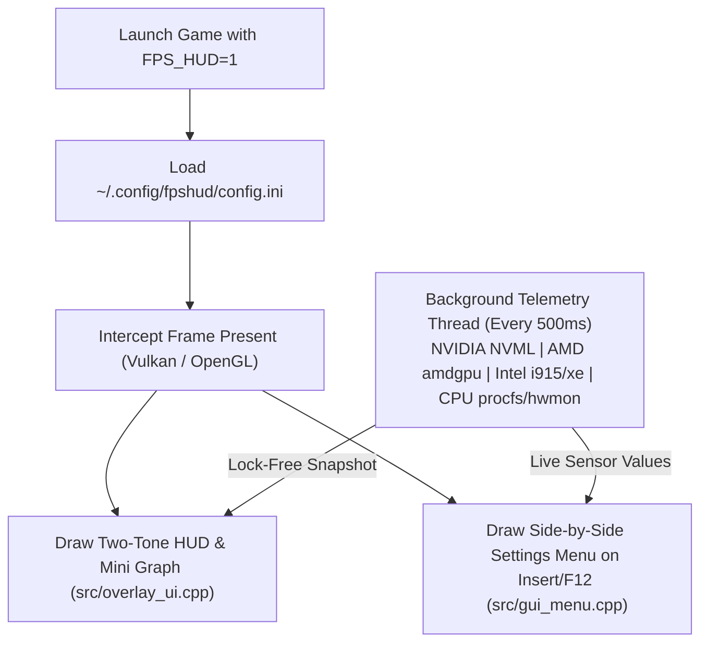

# FPSHUD for Linux

**Lightweight In-Game Performance Overlay & Live GUI Configurator for Linux Gaming (Vulkan & OpenGL)**

[](https://github.com/budicuy/FPS_HUD_FOR_LINUX/actions)
[](LICENSE)
[](CMakeLists.txt)
[](src/)
[](src/telemetry.cpp)

> 🌐 **Language / Bahasa:** **[English (Default)](README.md)** | **[Bahasa Indonesia](README.id.md)**

---

## Overview

### What is FPSHUD?
**FPSHUD** is a lightweight, easy-to-use in-game performance monitor (HUD overlay) made for Linux gamers. It lets you see your real-time **FPS, 1% Low stutters, GPU/CPU temperatures, clock speeds, power draw (Watts), and RAM usage** directly on screen while playing your favorite games on Steam (Proton/DXVK), Lutris, Heroic, or native Linux.

Most Linux overlays force you to close your game, open a text editor, and tweak complicated config files just to change the HUD position or add a sensor. **FPSHUD changes that:** you simply launch your game with **`FPS_HUD=1`**, press **`Insert`** or **`F12`** on your keyboard while playing, and customize everything live through a clean **In-Game Settings Menu (`FPSHUD Configuration Tool`)**!

### What is it built with?
FPSHUD is written in modern **C++20** for maximum speed and minimal resource usage (`~950 KB` binary, zero frame-time lag). It uses:
- **Vulkan Implicit Layer & OpenGL Hooks** to draw smoothly inside almost any game on Linux.
- **Dear ImGui** to provide the interactive, side-by-side in-game configuration menu.
- **Linux Kernel (`drm`, `hwmon`, `powercap`) & NVIDIA NVML** to read hardware sensors directly from your system without heavy background daemons.

### What features are inside?
- **1-Command Installation**: Install or uninstall in seconds using a single `curl` command—no manual compiling or complex package hunting needed.
- **Live In-Game Menu (No Tabs, No Clutter)**: Press `Insert`, `F12`, or `F10` in-game to change screen position, font size, background opacity, colors, or toggle any of the **19 hardware sensors** in real time.
- **Works on All Hardware (NVIDIA, AMD, Intel & Steam Deck/APUs)**: Automatically detects your CPU and GPU model names and reads sensors across **NVIDIA GeForce**, **AMD Radeon**, and **Intel Arc / Iris** graphics, as well as **Intel Core** and **AMD Ryzen** processors.
- **4 Ready-to-Use Presets**: Switch with one click between **Minimal** (FPS only), **Standard**, **Advance** (all 19 sensors), or save your own **Custom** preset.
- **Easy-to-Read Two-Tone Design & Thermal Alerts**: Bright white numbers paired with soft silver units (`MHz`, `GB`, `°C`, `W`) and automatic warning colors when your GPU or CPU gets warm (`>= 72°C` Yellow, `>= 82°C` Red).
- **One-Key Benchmark Recorder (`F9`)**: Press `F9` during gameplay to record your average FPS, 1% Low, 0.1% Low, and peak temperatures into a `.csv` spreadsheet in your `Documents` folder.

### How does it work?
1. When you run a game with `FPS_HUD=1`, Linux automatically loads `libfpshud.so` into the game's rendering pipeline.
2. Every time the game finishes drawing a frame, FPSHUD measures the exact frame delivery time (`ms`) and draws your chosen stats on top of the screen.
3. Meanwhile, a separate background thread quietly checks your CPU and GPU temperatures, clocks, and power usage once every **0.5 seconds** (`500ms`), so monitoring your hardware never slows down your game's FPS.

---

## Quick Install (1 Command via `curl`)

You can install **FPSHUD** immediately on any Linux distribution (Arch, Ubuntu, Debian, Linux Mint, Fedora, Pop!_OS, Nobara, Bazzite, or SteamOS) with a single command:

```bash
curl -fsSL https://raw.githubusercontent.com/budicuy/FPS_HUD_FOR_LINUX/main/install.sh | bash
```

### Quick Uninstall (1 Command)
```bash
curl -fsSL https://raw.githubusercontent.com/budicuy/FPS_HUD_FOR_LINUX/main/uninstall.sh | bash
```

---

## Table of Contents

1. [How to Use in Games (Steam, Lutris, Heroic, Terminal)](#1-how-to-use-in-games-steam-lutris-heroic-terminal)
2. [In-Game Menu & Keyboard Shortcuts](#2-in-game-menu--keyboard-shortcuts)
3. [Supported Hardware & 19 Sensors List](#3-supported-hardware--19-sensors-list)
4. [Optional Sensor & Wayland Permissions](#4-optional-sensor--wayland-permissions)
5. [Tech Stack & System Architecture](#5-tech-stack--system-architecture)
6. [Developer Guide (Build from Source & Automated Testing)](#6-developer-guide-build-from-source--automated-testing)
7. [Troubleshooting & FAQ](#7-troubleshooting--faq)
8. [Contributing, Credits & License](#8-contributing-credits--license)

---

## 1. How to Use in Games (Steam, Lutris, Heroic, Terminal)

FPSHUD uses only **one simple environment variable**:
- **`FPS_HUD=1`** — Turns **ON** the overlay and the in-game menu.
- **`FPS_HUD=0`** — Turns **OFF** the overlay completely.

### Steam (Proton / DXVK / Native Games)
1. Right-click your game in Steam -> **Properties** -> **General**.
2. In **Launch Options**, paste:
   ```bash
   FPS_HUD=1 %command%
   ```
   *(If you are playing an older native Linux **OpenGL** game, use: `FPS_HUD=1 ~/.local/bin/fpshud %command%`)*

### Lutris & Heroic Games Launcher
- Open the game's **Settings / Configuration** -> **System / Environment Variables**:
  - Add variable **`FPS_HUD`** with value **`1`**.

### Terminal / Command Line
```bash
# Test with Vulkan cube:
FPS_HUD=1 vkcube

# Test with OpenGL gears:
~/.local/bin/fpshud glxgears
```

---

## 2. In-Game Menu & Keyboard Shortcuts

While inside a game, use these shortcuts at any time (you can also change these keys inside the GUI):

| Default Key | Action |
| :--- | :--- |
| **`Insert`** / **`F12`** / **`F10`** | **Open / Close the In-Game Settings Menu** (automatically saves your changes when closed) |
| **`F11`** | **Hide / Show the HUD overlay** on screen without opening the menu |
| **`F9`** | **Start / Stop CSV Benchmark Recording** (saved to `~/Documents/fpshud_benchmark.csv`) |
| **`ESC`** | Close the settings menu and return mouse control to the game |

### The 4 Built-In Presets
Inside the top header bar of the GUI, you can switch between 4 presets with a single click:
1. **`Minimal`**: Shows only `FPS` and `Frametime (ms)` in a tiny badge.
2. **`Standard`**: Shows `FPS`, `Frametime`, `GPU (Load, Clock, Temp)`, `CPU (Load, Clock, Temp)`, and `RAM`.
3. **`Advance`**: Turns on all **19 sensors** (`FPS`, `AVG`, `1% Low`, `0.1% Low`, `FT`, full `GPU`, full `CPU`, `RAM`, `Render API`, and `System Clock`).
4. **`Custom` & `Save Custom`**: Lets you save your own favorite sensor layout to `~/.config/fpshud/custom_preset.ini`.

---

## 3. Supported Hardware & 19 Sensors List

### Universal Multi-Vendor Compatibility

| Hardware Type | Supported Devices & Drivers | Automatic Features |
| :--- | :--- | :--- |
| **NVIDIA GPUs** | GeForce GTX / RTX (`nvidia` driver via `libnvidia-ml.so.1`) | Load, Clock, VRAM, Memory Bandwidth, Temp, Fan %, Power (Watts) |
| **AMD GPUs & APUs** | Radeon RX / Integrated APUs / Steam Deck (`amdgpu`) | Load, Clock, VRAM + Shared GTT RAM, Bandwidth, Temp, Fan %, Power (Watts), PCI ID name lookup |
| **Intel GPUs** | Intel Arc Discrete & Iris Xe / UHD (`xe` & `i915`) | Load, Clock, VRAM, Bandwidth, Temp, Fan %, Power (Watts), PCI ID name lookup |
| **Hybrid Laptops** | Dual-GPU Laptops (`iGPU` + `dGPU`) | Automatically prioritizes your dedicated gaming GPU (`card1`) over integrated graphics (`card0`) |
| **Intel & AMD CPUs** | Intel Core & AMD Ryzen Processors | Auto-detects CPU model name, per-core boost clock, load %, temperature (`coretemp` / `k10temp` / `zenpower`), and package power (`RAPL`) |

### All 19 Available Sensors

| # | Sensor Name | Group | What It Shows | Example on HUD |
| :--- | :--- | :--- | :--- | :--- |
| `01` | **FPS Counter** | `FPS` | Current frames per second | `144` |
| `02` | **FPS Average** | `FPS` | Average FPS over the last 3.5 seconds | `AVG: 138` |
| `03` | **FPS 1% Low** | `FPS` | Time-weighted 1% slowest frames (stutter indicator) | `1%: 112` |
| `04` | **FPS 0.1% Low** | `FPS` | Time-weighted 0.1% worst micro-stutters | `0.1%: 95` |
| `05` | **Frame Time** | `FPS` | Time taken to render each frame in milliseconds | `6.9 ms` |
| `06` | **GPU Load** | `GPU` | GPU core usage percentage | `98%` |
| `07` | **GPU Clock** | `GPU` | Current GPU core frequency | `2430 MHz` |
| `08` | **GPU VRAM** | `GPU` | Video memory used in Gigabytes (includes shared GTT on APUs) | `6.4 GB` |
| `09` | **GPU Bandwidth** | `GPU` | Active video memory throughput in GB/s | `165.4 GB/s` |
| `10` | **GPU Temp** | `GPU` | GPU temperature in Celsius | `65 °C` |
| `11` | **GPU Fan** | `GPU` | GPU cooling fan speed percentage | `FAN: 55%` |
| `12` | **GPU Power** | `GPU` | GPU power consumption in Watts | `185 W` |
| `13` | **CPU Load** | `CPU` | Total processor usage percentage | `42%` |
| `14` | **CPU Clock** | `CPU` | Highest active core clock speed | `5050 MHz` |
| `15` | **CPU Power** | `CPU` | Processor package power draw in Watts | `58 W` |
| `16` | **CPU Temp** | `CPU` | Processor temperature in Celsius | `62 °C` |
| `17` | **System RAM** | `RAM` | System memory currently used in Gigabytes | `9.2 GB` |
| `18` | **Render API** | `SYS` | Graphics API running the game (`VULKAN` or `OPENGL`) | `VULKAN` |
| `19` | **Local Clock** | `SYS` | Current local system time (`HH:MM`) | `21:45` |

---

## 4. Optional Sensor & Wayland Permissions

On some Linux distributions, two quick permission commands will ensure hotkeys on Wayland and CPU Watt readings work without needing root:

1. **Allow In-Game Hotkeys & Mouse Grab on Wayland (`evdev`)**:
   ```bash
   sudo usermod -aG input $USER
   # Apply immediately without rebooting:
   sudo chmod a+r /dev/input/event*
   ```
2. **Allow Non-Root CPU Watt Readings (`intel-rapl` / `amd-rapl`)**:
   ```bash
   echo 'SUBSYSTEM=="powercap", KERNEL=="*rapl:*", RUN+="/bin/chmod a+r /sys/class/powercap/%k/energy_uj"' | sudo tee /etc/udev/rules.d/99-rapl-read.rules
   sudo chmod a+r /sys/class/powercap/*rapl*/energy_uj 2>/dev/null || true
   ```

---

## 5. Tech Stack & System Architecture

| Component | Technology | Highlights |
| :--- | :--- | :--- |
| **Language & Build** | **C++20**, CMake, LTO, `-O3` | Statically links `libstdc++` & `libgcc` for universal distro portability (`~950 KB` binary). |
| **Graphics Hooks** | **Vulkan 1.3 Layer** + **GLX/EGL** | Hooks `vkQueuePresentKHR`, `glXSwapBuffers`, and `eglSwapBuffers`. |
| **Overlay & GUI** | **Dear ImGui (`v1.91.6`)** | Custom vertex-shaded outline/drop-shadow text & compact Latin-1 font atlas. |
| **Telemetry Engine** | **POSIX `sysfs`/`procfs` + NVML** | Lock-free atomic/stack snapshots; zero heap allocations per frame. |



---

## 6. Developer Guide (Build from Source & Automated Testing)

If you want to modify the code or build FPSHUD manually from source:

```bash
git clone https://github.com/budicuy/FPS_HUD_FOR_LINUX.git
cd FPS_HUD_FOR_LINUX
./install.sh
```

### Running the Multi-Device Automated Test Suite
FPSHUD includes an automated hardware simulation test suite (`src/test_cli.cpp`) that tests all **19 sensors**, PCI ID name resolution, hybrid laptop dGPU selection, Low FPS tail calculation, and CSV benchmarking across **5 device profiles** (Real Hardware, Simulated AMD Desktop, Simulated Intel Arc Desktop, Hybrid Dual-GPU Laptop, and Steam Deck/APU):

```bash
./build/fpshud_test 1
```

---

## 7. Troubleshooting & FAQ

- **Pressing `Insert` / `F12` does not open the menu in-game:**
  Run `sudo chmod a+r /dev/input/event*` (or add your user to the `input` group with `sudo usermod -aG input $USER` and log out/in).
- **CPU Power shows `0 W`:**
  Run `sudo chmod a+r /sys/class/powercap/*rapl*/energy_uj`.
- **How do I reset all settings to default?**
  Open the in-game menu (`Insert`/`F12`) and click **`Reset`** in the top-right corner, or delete `~/.config/fpshud/config.ini`.

---

## 8. Contributing, Credits & License

- **Contributions**: Pull requests and issues are welcome! Please run `./build/fpshud_test 1` before submitting PRs.
- **Credits**:
  - **[Dear ImGui](https://github.com/ocornut/imgui)** by Omar Cornut for the immediate-mode graphical interface.
  - **Khronos Group** for the Vulkan & OpenGL headers and implicit layer standards.
  - **Linux Kernel Community** for the `drm`, `amdgpu`, `i915`/`xe`, `hwmon`, and `powercap` interfaces.
- **License**: Released under the **[MIT License](LICENSE)**.
