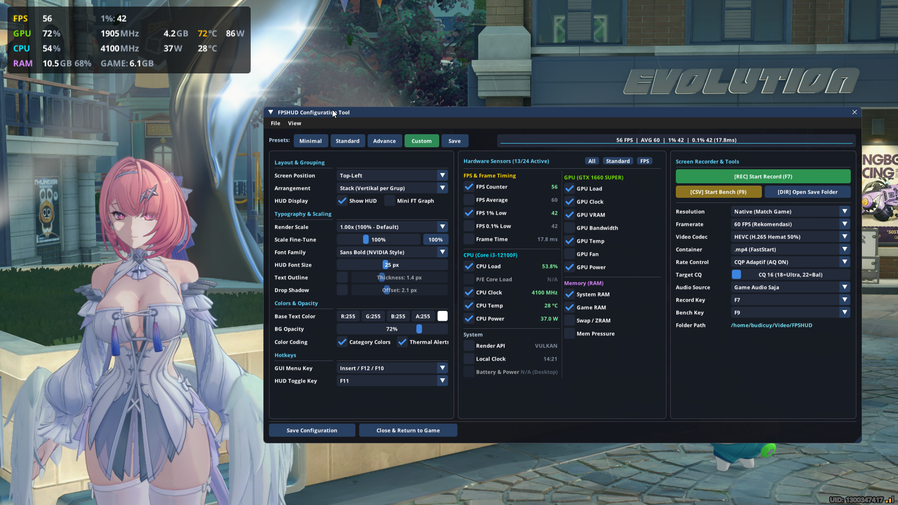
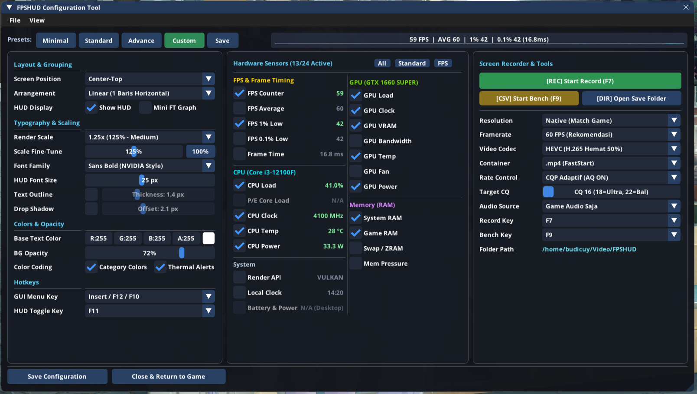
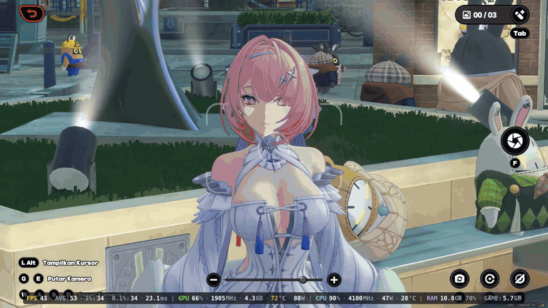
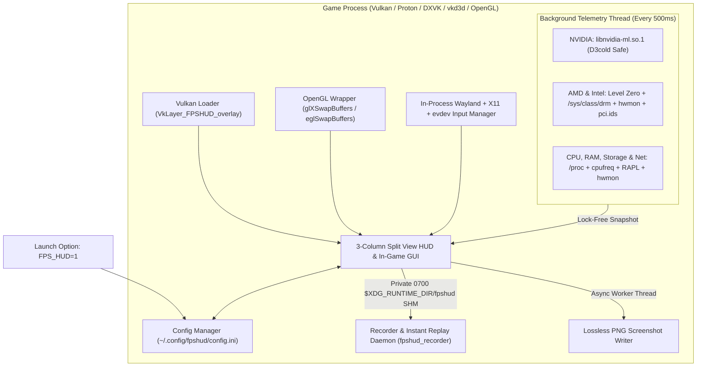

# FPSHUD

**Lightweight In-Game Performance Overlay & Live GUI Configurator for Linux Gaming (Vulkan & OpenGL)**

[](https://github.com/budicuy/FPS_HUD_FOR_LINUX/actions/workflows/ci.yml)
[](LICENSE)
[](CMakeLists.txt)
[](src/)
[](src/telemetry/telemetry.cpp)

> **Language / Bahasa Dokumentasi:** **[English (Default)](README.md)** | **[Bahasa Indonesia](README.id.md)**

---

## Quick Install (Prebuilt Binary)

Install **FPSHUD** in seconds on any Linux distribution (Arch, Ubuntu, Debian, Fedora, Linux Mint, Pop!_OS, Nobara, Bazzite, or SteamOS) without installing compilers or build tools:

```bash
curl -fsSL https://raw.githubusercontent.com/budicuy/FPS_HUD_FOR_LINUX/main/install.sh | bash
```

To uninstall at any time:
```bash
~/.local/bin/fpshud --uninstall
```

---

## Showcase & Demo

<p align="center">
  <b>In-Game Performance Overlay</b><br>
  
</p>

<p align="center">
  <b>Interactive In-Game GUI Configuration Menu</b><br>
  
</p>

### Gameplay Demo

<p align="center">
  
</p>

---

## Overview

### Purpose
When playing games on Linux through Steam Proton, Lutris, Heroic, or native ports, you may want to check frame rates, monitor 1% low pacing, and track GPU and CPU temperatures, clocks, wattage, and memory.

Traditional Linux overlays require closing the game and editing text configuration files. FPSHUD provides an interactive in-game configuration menu. Launch the game with `FPS_HUD=1`, press `Insert` or `F12` during gameplay, and toggle metrics or adjust layout directly on screen.

### Architecture
FPSHUD is written in ISO C++26 using fixed inline storage (`std::inplace_vector`), pack indexing, and SIMD frametime analytics to eliminate heap allocations during gameplay. It uses Dear ImGui for the overlay and configuration menu, hooking into Vulkan (implicit layer) and OpenGL (`LD_PRELOAD`). Fonts are embedded directly in the binary so text renders crisply across native installs and container runtimes like Proton and Steam Linux Runtime.

### Core Features
- **3-Column Split View In-Game Dashboard (`Insert` / `F12`)**: A clean, widescreen control panel divided into 3 modular sections (Left: HUD Style, Colors, GUI Render Scale `50%–200%` & 1-or-2-Key Shortcuts | Center: 31 Live Hardware Sensors & Presets | Right: Screen Recorder, Instant Replay, Lossless Screenshot & Benchmark Hub).
- **Hardware-Accelerated Screen Recording (`F7`), Instant Replay (`F8`) & Lossless Screenshot (`F10`)**: Dedicated background video capture daemon supporting HEVC (H.265) and H.264 (`.mp4`, `.mkv`, `.webm`) with Adaptive CQP (`16–30`), VBV Max Bitrate Ceiling (`4–80 Mbps`), Experimental Pure `1:1` Adaptive VFR, zero-disk-wear In-RAM Instant Replay (`15s–120s`), dependency-free Lossless PNG Screenshots (Clean Game or With HUD, 8-bit & 10-bit HDR), and PulseAudio/PipeWire audio mixing (Game, Mic, or Both).
- **In-Game Video Player & Recorded Clips Gallery**: Review and play recorded gameplay clips directly inside the game overlay. Uses multi-threaded decoding to play 60 and 120 FPS clips without lag, 48 kHz stereo audio via PulseAudio / PipeWire matching OS volume, seek controls, two-step clip deletion, responsive fullscreen mode via `F` or double-click, and frame-boundary deferred GPU release leaving 0 bytes VRAM and 0% CPU overhead when closed.
- **4 Ready-to-Use Presets**: Switch with one click between **Minimal** (FPS + Frametime only), **Standard** (FPS, GPU, CPU, RAM essentials), **Advance** (all 31 sensors), or save your own **Custom** preset.
- **Works Across All Hardware (NVIDIA, AMD, Intel)**: Automatically detects and reads sensors from **NVIDIA GPUs** (with Optimus `D3cold` sleep protection), **AMD Radeon GPUs & APUs**, **Intel Arc & Iris GPUs**, and **Intel Core & AMD Ryzen CPUs**—including dual-GPU gaming laptops and handhelds like the Steam Deck.
- **Easy-to-Read Two-Tone Design & 14-Metric Smart Color Alerts**: Numbers are displayed in bright white while units (`MHz`, `GB`, `°C`, `W`) are softly dimmed so values never blend together, with automatic yellow/red color warnings across 14 metrics (FPS, 1%/0.1% Low, Frametime, GPU/CPU Load & Temp, VRAM, Fan, RAM, Swap, Memory PSI, Disk Temp & I/O, and Battery).
- **Accurate 1% & 0.1% Low FPS + CSV Benchmark Recorder (`F9`)**: Measures real frame smoothness over a rolling 3.5-second window (automatically ignoring loading-screen freezes) and lets you record benchmark results directly to a `.csv` file.

### Workflow
1. **Install once** via the one-line `curl` script or manual tarball extraction.
2. **Enable per game** by adding `FPS_HUD=1 %command%` to Steam Launch Options or prepending `FPS_HUD=1` in the terminal.
3. **Low presentation overhead**: FPSHUD submits the overlay draw calls before presentation in under 8 microseconds per frame. Telemetry runs on an asynchronous worker thread polling sensors every 0.5 seconds, avoiding contention with the game render thread.

---

## Table of Contents

- [Showcase & Demo](#showcase--demo)
1. [Key Features](#1-key-features)
2. [Installation & Sensor Permissions](#2-installation--sensor-permissions)
3. [How to Use in Steam, Lutris, Heroic & Terminal](#3-how-to-use-in-steam-lutris-heroic--terminal)
4. [In-Game GUI Guide & Keyboard Shortcuts](#4-in-game-gui-guide--keyboard-shortcuts)
5. [Screen Recording, Instant Replay & Lossless Screenshot](#5-screen-recording-instant-replay--lossless-screenshot)
6. [Supported Hardware & All 31 Sensors](#6-supported-hardware--all-31-sensors)
7. [Tech Stack & System Architecture](#7-tech-stack--system-architecture)
8. [Developer Guide (Building from Source, Sanitizers & Testing)](#8-developer-guide-building-from-source-sanitizers--testing)
9. [Troubleshooting & FAQ](#9-troubleshooting--faq)
10. [Contributing, Credits & License](#10-contributing-credits--license)

---

## 1. Key Features

- **Simple Activation (`FPS_HUD=1` / `FPS_HUD=0`)**:
  - `FPS_HUD=1`: Turns on the HUD overlay, Screen Recorder, Instant Replay, Screenshot Hub, and the In-Game GUI Configurator.
  - `FPS_HUD=0` (or unset / deleted from launch options): Completely disabled with zero background impact.
- **3-Column Split View In-Game GUI (`FPSHUD Configuration Tool`)**:
  - Press **`Insert`** or **`F12`** in-game to open a clean 3-column widescreen dashboard (Left: Position, Interactive Draggable Monitor Preview + Manual X/Y Position & Reset Layout, Layout, Font, Colors, Live GUI Scale `50%–200%`, 1-or-2-Key Shortcuts | Center: 31 Live Hardware Sensors & Quick Filters | Right: Screen Recorder, Instant Replay, Screenshot & Benchmark Hub).
  - Automatically captures your mouse cursor while the menu is open and returns control to the game the moment you close it.
  - Automatically saves all your changes to `~/.config/fpshud/config.ini`.
- **Hardware-Accelerated Screen Recording (`F7`), Instant Replay (`F8`) & Lossless Screenshot (`F10`)**:
  - Dedicated background recording daemon (`fpshud_recorder`) with decoupled triple-buffered POSIX Shared Memory IPC isolated inside a private `0700` user runtime directory (`$XDG_RUNTIME_DIR/fpshud`).
  - Supports hardware-accelerated **HEVC (H.265 / `hvc1`)** and **H.264** via NVIDIA NVENC and VAAPI in **`.mp4 (FastStart)`**, **`.mkv (Matroska)`**, or **`.webm (WebM)`** containers, with **Adaptive CQP (CQ 16–30)** + **VBV Max Bitrate Ceiling (`4–80 Mbps`)** or **Fixed VBR**, plus **Experimental Pure `1:1` Adaptive VFR**.
  - **Zero-Disk-Wear Instant Replay (`F8`)**: Optional In-RAM encoded packet ring buffer (`15s`, `30s`, `60s`, or `120s`, `0 MB` RAM when disabled) that flushes the last N seconds to disk on demand.
  - **Lossless PNG Screenshot (`F10`)**: Dependency-free background PNG encoder with **Clean Game (Without HUD)** or **With HUD** capture modes, supporting both 8-bit (`RGBA`/`BGRA`) and 10-bit HDR (`A2B10G10R10`/`A2R10G10B10`) swapchains.
  - Multi-source audio recording (Game Audio, Microphone Only, Game + Microphone mixed in stereo, or Mute) via PulseAudio/PipeWire saved directly to `$XDG_VIDEOS_DIR/FPSHUD` (`~/Videos/FPSHUD` or `~/Video/FPSHUD`).
- **In-Game Video Player & Recorded Clips Gallery**:
  - Review saved clips directly in Column 3 of the configuration menu (`Insert` / `F12`) without leaving your game.
  - **Multi-Threaded 60/120 FPS Decoding**: Video decoding uses multi-core decoding threads with clock resync and adaptive frame dropping under high system load, keeping audio and video tightly synchronized on 60 FPS and 120 FPS clips without stutter.
  - **Native System Audio Playback**: Audio decodes via minimal FFmpeg AAC and streams to PulseAudio / PipeWire at 48 kHz stereo, matching your desktop system volume without extra software sliders.
  - **Playback Controls**: Play/Pause, -5s and +5s jumps, and a draggable timeline seek bar.
  - **Responsive Fullscreen Mode & Stepped ESC Navigation**: Press **`F`**, double-click the video, or click **`[Fullscreen]`** to expand the video across your full game viewport with aspect-ratio letterboxing. Pressing **`ESC`** in fullscreen drops back to windowed mode; pressing **`ESC`** in windowed mode closes the video player.
  - **Zero Overhead & Clean GPU Memory Reclamation**: Closing the player via `[Close]`, the title-bar `X`, `ESC`, or `F12` instantly shuts down the background helper process and audio stream. Textures and GPU staging buffers are freed at the frame boundary (`deferred release`) to prevent driver crashes, ensuring 0 bytes VRAM and 0% CPU remain when you return to gaming.
  - **Two-Step Clip Deletion**: Click **`[Delete]`** and confirm with **`[Confirm?]`** to permanently remove unwanted clips from disk.
- **Universal Multi-Vendor Hardware Support & Sensor Hardening**:
  - **NVIDIA (`NVML` + Optimus `D3cold` Protection + dGPU Priority)**: Uses `libnvidia-ml.so.1` dynamically, checks `/sys/bus/pci/devices/*/power/runtime_status` before initializing NVML so sleeping laptop dGPUs (`suspended` / `D3cold`) are never woken up on battery, and iterates all NVIDIA adapters (`nvmlDeviceGetCount_v2`) to prioritize the dedicated discrete GPU (`dGPU`) via active DRM PCI Device ID matching or highest VRAM capacity.
  - **AMD Radeon & APUs (`amdgpu` + 5-Tier VRAM Bandwidth)**: Reads Linux DRM & `hwmon` sensors, supports `pp_dpm_sclk` / `pp_dpm_mclk` fallback, combines shared `GTT` memory on APUs/Steam Deck, and estimates VRAM bandwidth using `gpu_metrics` `vram_max_bandwidth` or a **5-tier VRAM capacity bus-width hierarchy** (`>=19.5 GB` -> 384-bit, `>=14.5 GB` -> 256-bit, `>=10.5 GB` -> 192-bit, `>=5.5 GB` -> 128-bit, `<5.5 GB` -> 64-bit).
  - **AMD Ryzen True Die Temperature (`Tdie` Priority)**: Prioritizes `Tdie` over `Tctl` on `k10temp` / `zenpower` sensors so AMD Ryzen CPUs display true silicon temperature without the artificial +10°C/+20°C fan-curve offset.
  - **Intel Arc & Integrated Graphics (Level Zero + `drm_sysfs` Hybrid)**: Dynamic Intel Level Zero Sysman backend (`libze_loader.so.1` via runtime `dlopen`) reading GPU temperature (`ZES_TEMP_SENSORS_GPU`), core & memory clocks, 3D/Compute engine load, energy counters, VRAM state, and fan speed, with **per-metric hybrid fallback** to Linux DRM & `hwmon` sysfs (`gt_act_freq_mhz`, `freq1_input`, `energy1_input`) for any metric unsupported by Level Zero.
  - **Vulkan `VK_EXT_memory_budget` VRAM Tracking**: Queries real-time GPU heap usage and budget directly from the active Vulkan physical device when kernel sysfs VRAM counters are unavailable (such as Intel iGPUs or unprivileged containers).
  - **3-Tier CPU Package Power Architecture (100% Sudo-Free Capable)**:
    1. *Tier 1 (Hardware Power Counters)*: Reads unprivileged `hwmon` (`k10temp`, `zenpower`, `amd_energy`, `zenergy`) or RAPL (`/sys/class/powercap/*rapl*/energy_uj`).
    2. *Tier 2 (Dynamic TDP & Frequency-Scaled Estimation)*: If RAPL is root-locked (`0400`) and sudo setup is skipped, automatically calculates real-time CPU wattage from `constraint_0_max_power_uw` (world-readable PL1 TDP) or CPU model TDP scaled by CPU load and boost frequency—**never stuck at `0 W`**.
    3. *Tier 3 (Optional Scoped `0440` `render` Group udev Rule)*: Optional `fpshud --setup` grants hardware RAPL read access scoped strictly to `GROUP="render", MODE="0440"` (safer than world-readable `0444`).
  - **Per-Core CPU Load & Clock (`All-Core`)**: Real-time per-thread CPU utilization (%) and per-core frequency (MHz) up to 64 threads with zero-heap inline storage.
  - **Storage I/O, NVMe Temperature & Network Throughput (100% Sudo-Free)**: Real-time physical disk Read/Write speed (`/proc/diskstats`), NVMe/SATA temperature (`nvme` / `drivetemp` `hwmon`), and active network interface Download/Upload throughput (`/proc/net/dev` with automatic `KB/s` <-> `MB/s` scaling).
  - **Render API Translation Detection (`VULKAN`, `DX12`, `DX11`, `DX9`, `OPENGL`)**: Inspects `/proc/self/maps` to automatically identify whether a Vulkan game is running through `vkd3d-proton` (`DX12`), `dxvk` (`DX11` / `DX9`), native `VULKAN`, or `OPENGL`.
  - **Laptop & Handheld Battery (`/sys/class/power_supply`)**: Real-time capacity percentage, discharge/charge wattage, and charging state with automatic desktop PC detection (auto-disabled and grayed out on desktop machines).
  - **Hybrid Gaming Laptops (Vulkan + DRM dGPU Selection)**: Automatically prioritizes the dedicated gaming GPU over integrated graphics by evaluating Vulkan `VK_PHYSICAL_DEVICE_TYPE_DISCRETE_GPU`, PCI vendor IDs (`0x10de` NVIDIA / `0x1002` AMD discrete over `0x8086` Intel iGPU), and `boot_vga` attributes rather than static card numbering, with exact GPU model resolution via `/usr/share/hwdata/pci.ids`.
- **High-Contrast Readability & 14-Metric Smart Color Alerts**:
  - Category color badges (`FPS` Gold, `GPU` Green, `CPU` Cyan, `RAM` Purple, `SYS` Silver), optional dimmed unit/sub-labels (`Dim Unit & Sub-Labels`), middle-dot (`·`) separators, and **Smart Color Alerts (Yellow/Red)** across 14 metrics (including GPU/CPU Temp **Yellow at `>= 72°C`**, **Red at `>= 82°C`**, GPU/CPU Load, FPS/1% Low, Frametime, VRAM, Fan, RAM, Swap, PSI, Disk Temp/I/O, and Battery).
- **Mini Frametime Graph & CSV Benchmark Logging (`F9`)**:
  - Optional live frametime waveform graph right on the HUD, plus 1-key CSV benchmarking (`~/Documents/fpshud_benchmark.csv`) that logs Avg FPS, 1% Low, 0.1% Low, Min/Max FPS, and peak GPU/CPU temperatures and wattage.
- **Optimized LLVM/Clang Toolchain & Memory Hardening**:
  - Compiled with modern Clang, LLD linker, ThinLTO (`-flto=thin`), and `-O3` producing a compact **1.3 MB** library with memory safety verified by AddressSanitizer and UndefinedBehaviorSanitizer.

### Comparison with MangoHud

| Aspect | **MangoHud** | **FPSHUD** |
| :--- | :--- | :--- |
| **Primary Philosophy** | Standard industry overlay with exhaustive textual config file options. | Modern all-in-one in-game experience with live visual configuration. |
| **Configuration Workflow** | Requires closing the game and editing text configuration files (`~/.config/MangoHud/MangoHud.conf`) or using external tools like GOverlay. | **In-game 3-Column GUI (`Insert` / `F12`)**: adjust position, layout, 31 sensors, fonts, colors, GUI scale, and 1-or-2-key hotkeys live on screen without leaving the game. |
| **Screen Recording & Replay** | Requires separate capture software (OBS Studio, GPU Screen Recorder, ReplaySorcery). | **Built-in companion recording daemon (`fpshud_recorder`)** with 1-click recording (`F7`), Instant Replay (`F8`), Lossless Screenshot (`F10`), HEVC/H.264 CQP, and audio mixing. |
| **Maturity & Ecosystem** | Extremely mature, widely adopted across Linux distros, default overlay in SteamOS GameScope. | Modern lightweight alternative designed for gamers wanting immediate visual customization and integrated clipping. |

---

## 2. Installation & Sensor Permissions

### 1-Command Installation (Recommended for Fast Setup)
The installer downloads the prebuilt portable binary package directly from GitHub Releases and cryptographically verifies its SHA256 checksum before extracting (zero compilation or toolchains required):
```bash
curl -fsSL https://raw.githubusercontent.com/budicuy/FPS_HUD_FOR_LINUX/main/install.sh | bash
```

### Option B: Manual Installation with SHA256 Checksum Verification
If you prefer not to pipe scripts to `bash`, you can inspect and install the release archive manually with cryptographic integrity verification:
```bash
# 1. Download release archive and SHA256 checksum from GitHub Releases:
curl -LO https://github.com/budicuy/FPS_HUD_FOR_LINUX/releases/latest/download/fpshud-linux-x86_64.tar.gz
curl -LO https://github.com/budicuy/FPS_HUD_FOR_LINUX/releases/latest/download/fpshud-linux-x86_64.tar.gz.sha256

# 2. Verify archive integrity:
sha256sum -c fpshud-linux-x86_64.tar.gz.sha256

# 3. Extract libraries and binaries into your user folder (~/.local):
mkdir -p ~/.local/lib/fpshud ~/.local/bin ~/.local/share/vulkan/implicit_layer.d
tar -xzf fpshud-linux-x86_64.tar.gz -C ~/.local/lib/fpshud/
ln -sf ~/.local/lib/fpshud/fpshud_test ~/.local/bin/fpshud_test
```

### Hardware Permissions, Sudo Transparency & Security Model
> [!NOTE]
> **Zero-Sudo Architecture**
> FPSHUD operates without root privileges across all features, including CPU power metrics:
> - **In-Game Hotkeys & GUI Navigation**: Handled directly in-process via hooked Wayland display event queues (`wl_keyboard` / `wl_pointer`) and X11 events without requiring the `input` group or `/dev/input/event*` root access.
> - **RAM Metrics**: Dynamic capacity, resident game memory (`VmRSS`), Swap/ZRAM, and memory stall pressure (PSI) are parsed cleanly from world-readable `/proc/meminfo`, `/proc/self/status`, and `/proc/pressure/memory`.
> - **Graphics Telemetry**: FPS, frametimes, and GPU sensors (NVIDIA NVML, AMD sysfs, Intel Level Zero + DRM hybrid) operate without root privileges.
> - **3-Tier CPU Wattage (Never Stuck at `0 W` Without Sudo)**:
>   1. **Tier 1 (Hardware Sensor)**: Reads unprivileged `hwmon` power sensors (`amd_energy`, `zenergy`, `zenpower`, `k10temp`) or RAPL `/sys/class/powercap/*rapl*/energy_uj` when readable.
>   2. **Tier 2 (Sudo-Free Dynamic TDP Estimation)**: When kernel RAPL is locked to root (`0400`), FPSHUD automatically reads the world-readable package power limit (`constraint_0_max_power_uw` PL1 on Intel/AMD) or CPU model TDP baseline and scales it dynamically by real-time CPU load and boost frequency ratio.
>   3. **Tier 3 (Optional Scoped `0440` udev Rule)**: For users who want direct hardware RAPL energy counter readings instead of TDP estimation, `fpshud --setup` installs a scoped read-only udev rule.

> [!IMPORTANT]
> **Sudo Actions and Platypus Mitigation (CVE-2020-8694)**
> Games and overlay hooks never execute as root. Sudo is optional and requested only if the user confirms the RAPL udev prompt during setup or chooses system cleanup during uninstallation:
> 1. **During `fpshud --setup` (or `install.sh` if confirmed)**:
>    - Creates `/etc/udev/rules.d/99-fpshud-rapl.rules` containing:
>      ```udev
>      SUBSYSTEM=="powercap", ACTION=="add|change", KERNEL=="*rapl*", ATTR{energy_uj}!="", GROUP="render", MODE="0440"
>      SUBSYSTEM=="powercap", ACTION=="add|change", KERNEL=="*rapl:*", ATTR{energy_uj}!="", GROUP="render", MODE="0440"
>      ```
>    - Why `GROUP="render", MODE="0440"` instead of `0444`? The Linux kernel restricts `energy_uj` (`0400`) to mitigate the **Platypus side-channel attack** (`CVE-2020-8694`). Instead of making RAPL world-readable (`0444`) to all system accounts and sandboxed services, FPSHUD scopes read-only access (`0440`) strictly to the `render` group (your local GPU/gaming desktop user).
>    - Reloads udev rules via `sudo udevadm control --reload-rules` and `sudo udevadm trigger --subsystem-match=powercap`.
>    - If Flatpak Steam (`~/.var/app/com.valvesoftware.Steam`) is installed, ensures the copied Vulkan layer manifest directory is owned by your normal user account (`chown -R $USER`).
> 2. **During `fpshud --uninstall`**:
>    - All user-space files (`~/.local/lib/fpshud`, `~/.local/bin/fpshud*`, Vulkan layer manifest, and `~/.config/fpshud`) are removed **first without `sudo`**.
>    - If you never enabled `sudo` during installation, `fpshud --uninstall` finishes immediately without asking for `sudo`.
>    - Only if `/etc/udev/rules.d/99-fpshud-*.rules` exists on your system, it asks an optional `[y/N]` prompt whether you also want to remove the system udev rule via `sudo` (so you can press `N` to skip `sudo` at any time).

> [!NOTE]
> **Sensor Permission Verification**
> Optional RAPL sensor permissions can be configured or checked at any time:
> ```bash
> ~/.local/bin/fpshud --setup
> ```
> To inspect current hardware sensor accessibility:
> ```bash
> ~/.local/bin/fpshud --status
> ```

> [!TIP]
> **Trust Boundaries**
> Games and overlay processes run strictly with unprivileged user permissions. Root access is never requested during gameplay.

### 1-Command Uninstallation (Clean Local Removal)
```bash
~/.local/bin/fpshud --uninstall
```

---

## 3. How to Use in Steam, Lutris, Heroic & Terminal

### 1. Steam (Proton & Native Games — Recommended)
Right-click your game in Steam -> **Properties** -> **General** -> **Launch Options**:
```bash
~/.local/bin/fpshud %command%
```
*(Alternatively, for pure Vulkan layer injection without LD_PRELOAD: `FPS_HUD=1 %command%`. Using `~/.local/bin/fpshud %command%` is strongly recommended for Steam Proton titles to guarantee full in-process mouse and cursor state isolation when opening the in-game GUI menu).*

> [!NOTE]
> All Windows games running through Proton, DXVK, and native Linux games (Vulkan & OpenGL) work out-of-the-box with `~/.local/bin/fpshud %command%`.

### 2. Terminal Launch (Native Executables & Wine/Proton)
Launch any game directly from terminal:
```bash
~/.local/bin/fpshud ./your_game
```

### 3. Lutris & Heroic Games Launcher
Open **Game Settings** -> **System / Environment Variables** -> Add:
- **Key**: `FPS_HUD`
- **Value**: `1`

### 4. Terminal / Command Line
```bash
# Run any Vulkan game or application:
FPS_HUD=1 ./your_game

# Run any OpenGL game or application:
~/.local/bin/fpshud ./your_game
```

### Anti-Cheat Compatibility Advisory
> [!WARNING]
> **Online Multiplayer and Anti-Cheat (EAC, BattlEye, VAC, Ricochet)**
> Like MangoHud, OBS Game Capture, and ReShade, FPSHUD injects into the graphics pipeline via a Vulkan implicit layer or `LD_PRELOAD`.
> While performance overlays are benign, anti-cheat systems in competitive multiplayer games (such as Easy Anti-Cheat, BattlEye, Valve Anti-Cheat, or Ricochet) may treat third-party library injection as an integrity violation, which can prevent the game from starting or risk account penalties.
>
> **Recommendation:** When playing competitive online multiplayer titles, disable the overlay by setting `FPS_HUD=0 %command%` or removing `FPS_HUD` from launch options.

### 32-Bit Game Compatibility
> [!NOTE]
> FPSHUD is built as a 64-bit (`x86_64`) library for modern Linux games and Proton titles. When launching legacy 32-bit games, the dynamic loader ignores the 64-bit layer without crashing, and the HUD will not render.

---

## 4. In-Game GUI Guide & Keyboard Shortcuts

Once inside a game with `FPS_HUD=1`, use these shortcuts. All 6 shortcuts support **interactive 1-key or 2-key (`Modifier + Key`, e.g., `Alt + F` or `Ctrl + Shift`) live capture** inside Column 1 of the GUI:

| Default Key | Action |
| :--- | :--- |
| **`Insert` / `F12`** | Open or Close the **`FPSHUD Configuration Tool`** menu |
| **`F11`** | Quickly hide or show the HUD overlay without opening the menu |
| **`F7`** | Start or Stop **Hardware-Accelerated Screen Recording** (`~/Videos/FPSHUD`) |
| **`F8`** | Save **Instant Replay** clip (flushes the last 15s–120s from RAM ring buffer to disk) |
| **`F10`** | Take **Lossless PNG Screenshot** (Clean Game without HUD, or With HUD) |
| **`F9`** | Start or Stop **CSV Benchmark Recording** (`~/Documents/fpshud_benchmark.csv`) |
| **`ESC`** | Close the GUI menu (or cancel active keybind capture) and return mouse control to the game |
| **`F`** *(In Video Player)* | Toggle between Windowed and Fullscreen player view |
| **`Double-Click`** *(On Video)* | Toggle between Windowed and Fullscreen player view |
| **`ESC`** *(In Video Player)* | Exit fullscreen to windowed mode; if pressed in windowed mode, close the video player |

> [!TIP]
> **Steam Deck and Handheld Devices**
> To open the menu on handhelds without a keyboard, map a grip button (such as `L4` or `R4`) to `F12` or `Insert` in **Steam Controller Settings -> Edit Layout**. The **GUI Scale (50%–200%)** slider in Column 1 adjusts interface size for high-DPI or compact displays.

### The 4 Built-In Presets
- **`Minimal`**: Shows only `FPS` and `Frametime (ms)`.
- **`Standard`**: Shows `FPS`, `Frametime`, `GPU (Load, Clock, Temp)`, `CPU (Load, Clock, Temp)`, and `RAM`.
- **`Advance`**: Enables all **31 sensors** (`FPS`, `AVG`, `1% Low`, `0.1% Low`, `Frametime`, all 8 `GPU` metrics including `VRAM Clock`, all 6 `CPU` metrics including `All-Core Load` & `All-Core Clock`, all 4 `Memory/RAM` metrics, `Storage I/O & NVMe Temp`, `Network Speed`, `Render API`, `GPU/CPU Model`, `Local Clock`, and `Battery & Power`).
- **`Custom`**: Customize any combination of sensors and layout and save directly to `~/.config/fpshud/config.ini`.

### Smart Color Alerts (14 Metrics) & Thresholds
When **Smart Color Alerts (Yellow/Red)** is enabled in the GUI, FPSHUD highlights critical performance and hardware states across 14 metrics:
- **GPU & CPU Temperature**: **Yellow** at **`>= 72°C`**, **Red** at **`>= 82°C`**
- **NVMe / SSD Temperature**: **Yellow** at **`>= 65°C`**, **Red** at **`>= 75°C`**
- **GPU, CPU & Per-Core Load**: **Yellow** at **`>= 80%`**, **Red** at **`>= 95%`**
- **GPU VRAM Usage**: **Yellow** at **`>= 80%`**, **Red** at **`>= 92%`**
- **GPU Fan Speed**: **Yellow** at **`>= 75%`**, **Red** at **`>= 90%`**
- **System & Game RAM**: **Yellow** at **`>= 80%`**, **Red** at **`>= 90%`**
- **Swap / ZRAM**: **Yellow** at **`>= 50%`** (or `>= 2 GB`), **Red** at **`>= 80%`** (or `>= 4 GB`)
- **Memory Pressure (PSI)**: **Yellow** at **`>= 5%`**, **Red** at **`>= 20%`**
- **Disk I/O Throughput**: **Yellow** at **`>= 500 MB/s`**, **Red** at **`>= 1500 MB/s`**
- **FPS, 1% Low, 0.1% Low & Frametime**: **Yellow** when FPS `< 45` (or Frametime `> 22.2 ms`), **Red** when FPS `< 30` (or Frametime `> 33.3 ms`)
- **Battery (Discharging)**: **Yellow** at **`<= 25%`**, **Red** at **`<= 12%`**

---

## 5. Screen Recording, Instant Replay & Lossless Screenshot

FPSHUD includes a dedicated, lightweight background screen recording daemon (`fpshud_recorder`) that runs decoupled from the game process. Frames are submitted via triple-buffered POSIX Shared Memory inside a private `0700` runtime directory (`$XDG_RUNTIME_DIR/fpshud`), ensuring that hardware video encoding never introduces frame stutter or micro-freezes to your gameplay.

### Hardware Encoder & GPU Readback Architecture
To ensure high-framerate gameplay is never penalized during active recording:
- **Hardware Encoders Supported**:
  - **NVIDIA**: Automatic hardware acceleration via **NVENC** (`hevc_nvenc`, `h264_nvenc`) with Spatial-AQ & Temporal-AQ enabled in CQP mode.
  - **AMD & Intel**: Automatic hardware acceleration via **VAAPI** (`hevc_vaapi`, `h264_vaapi`).
  - **Software Fallback**: Graceful fallback to `libx265` / `libx264` if hardware encoder contexts cannot be initialized.
- **Asynchronous GPU Readback Pipeline**:
  - **Vulkan**: Double-buffered staging copy using `vkCmdCopyImageToBuffer` into host-cached staging memory with a bounded 2-second fence timeout. Frame submission to IPC shared memory is pipelined behind GPU transfer completion fences, eliminating CPU presentation stalls.
  - **OpenGL**: Asynchronous dual-PBO (`GL_PIXEL_PACK_BUFFER`) ring buffer. Frame capture executes non-blocking DMA readback in `pbo[write]` while mapping the previously completed frame in `pbo[read]`.
  - **Decoupled Worker Daemon**: Video encoding, container muxing, and audio mixing occur entirely in the standalone `fpshud_recorder` process via private POSIX shared memory (`$XDG_RUNTIME_DIR/fpshud`), preventing encoder overhead from impacting the game's render thread.

### Key Capabilities & Codec Options

| Feature | Description | Default / Recommended |
| :--- | :--- | :--- |
| **Video Codecs** | **HEVC (H.265 / `hvc1`)** or **H.264 (AVC)** | **H.264 (AVC)** default; **HEVC (`hvc1`)** for 50% smaller files with native playback in MPV, VLC, Haruna, and browsers. |
| **Container Formats** | **`.mp4 (FastStart)`**, **`.mkv (Matroska)`**, or **`.webm (WebM)`** | **`.mp4 (FastStart)`** for instant web/Discord streaming. |
| **Rate Control & Max Bitrate** | **Adaptive CQP (CQ 16–28 in GUI / 16–30 CLI)** with **VBV Max Bitrate Ceiling (`4–80 Mbps`)** or **Fixed VBR (`4–80 Mbps`)** | **Adaptive CQP (CQ 22)** with **20 Mbps Cap** so complex foliage/action stays sharp without bloated files. |
| **Framerate & Resolution** | **Native (Match Game)**, **1440p (`2560x1440`)**, **1080p (`1920x1080`)**, or **720p (`1280x720`)** at **60, 30, 120 FPS, or Match Display** | **Native @ 60 FPS** |
| **Experimental Adaptive VFR** | **Pure `1:1` Adaptive Variable Framerate** (`Experimental` menu bar) with configurable **Safety Max FPS (`30–240 FPS`)** | Encodes exact game frame timestamps without static 60 FPS frame duplication or drops. |
| **Instant Replay (`F8`)** | **In-RAM Encoded Packet Ring Buffer** (**OFF / `0 MB` RAM**, **15s**, **30s**, **60s**, or **120s**) | Zero SSD/NVMe disk wear while buffering; press **`F8`** to flush `Replay_YYYYMMDD_HHMMSS.<ext>` to disk. |
| **Lossless Screenshot (`F10`)** | **Dependency-Free Background PNG Writer** (**Clean Game Without HUD** or **With HUD**, 8-bit & 10-bit HDR) | Saved asynchronously to `Screenshot_YYYYMMDD_HHMMSS_mmm.png` with zero render stall. |
| **Audio Capture** | Low-latency audio via PulseAudio / PipeWire: **Game Audio Only**, **Microphone Only**, **Game + Microphone (Stereo Mixed)**, or **Mute**. | **Game Audio Only** |
| **Storage Destination** | Automatically saved to `$XDG_VIDEOS_DIR/FPSHUD` (`~/Videos/FPSHUD` or `~/Video/FPSHUD`). | `~/Videos/FPSHUD` |

### How to Use Screen Recorder, Instant Replay & Screenshot

1. **Start / Stop Recording (`F7`)**:
   - Press **`F7`** in-game (or click **`[REC] Start Record`** in Column 3 of the GUI).
   - An in-game status toast confirms recording has started. Press **`F7`** again to finalize the `.mp4`/`.mkv`/`.webm` video file in the background.
2. **Save Instant Replay (`F8`)**:
   - Enable **Replay Buffer** (`15s`–`120s`) in Column 3. Whenever a highlight happens, press **`F8`** (or click **`[SAVE REPLAY]`**) to instantaneously mux the RAM buffer to disk.
3. **Take Lossless Screenshot (`F10`)**:
   - Choose **Clean Game** or **With HUD** under Screenshot Capture Mode, then press **`F10`** (or click **`[IMG] Take Screenshot`**).
4. **Open Save Folder**:
   - Click the **`[DIR] Open Save Folder`** button in Column 3 of the GUI to open your recordings directory directly in your desktop file manager.
5. **Review Clips in the In-Game Video Player**:
   - In Column 3 of the in-game menu (`Insert` / `F12`), browse saved clips in the **Recorded Clips Gallery**.
   - Click **`[Play]`** on any clip to launch the embedded video player (supports smooth playback up to 120 FPS).
   - Press **`F`** or double-click the video canvas to toggle fullscreen mode. Audio plays directly through PulseAudio / PipeWire at your system volume.
   - Press **`ESC`** to return from fullscreen to the windowed modal, then press **`ESC`** again (or click **`[Close]`** / **`X`**) to close the player. All VRAM and CPU usage immediately drops to 0%.
   - Click **`[Delete]`** and confirm with **`[Confirm?]`** to permanently delete a clip from disk.

---

## 6. Supported Hardware & All 31 Sensors

### Hardware Compatibility Matrix

| Component | Supported Vendors & Drivers | Linux Data Sources & Fallback Hierarchy |
| :--- | :--- | :--- |
| **NVIDIA GPUs** | NVIDIA Proprietary / Open Kernel (`nvidia`) | `libnvidia-ml.so.1` (NVML runtime `dlopen`) with multi-GPU discrete (`dGPU`) prioritization via PCI ID & VRAM size |
| **AMD GPUs & APUs** | AMD Radeon Discrete & APU (`amdgpu`) | `/sys/class/drm/card*/device` + `hwmon` + `gpu_metrics` + 5-tier VRAM bus-width & bandwidth estimator + `mem_info_gtt_*` + `pci.ids` |
| **Intel GPUs** | Intel Arc Discrete & Iris/UHD (`xe`, `i915`) | Intel Level Zero Sysman (`libze_loader.so.1` runtime `dlopen`) with per-metric hybrid fallback to `/sys/class/drm/card*` + `hwmon` + `intel-rapl` |
| **Intel CPUs** | Intel Core & Core Ultra | `/proc/cpuinfo`, `/proc/stat` (Total & All-Core), `cpufreq`, `coretemp`, `intel-rapl` (`0440` `render` group) + PL1 TDP dynamic estimation fallback |
| **AMD CPUs** | AMD Ryzen / Threadripper / Custom APU | `/proc/cpuinfo`, `/proc/stat` (Total & All-Core), `cpufreq`, `k10temp`/`zenpower` (`Tdie` prioritized over `Tctl`), `amd_energy`/`zenergy`/`amd-rapl` + TDP dynamic estimation fallback |
| **System Memory** | DDR3, DDR4, DDR5, LPDDR4, LPDDR5 | `/proc/meminfo`, `/proc/self/status`, `/proc/pressure/memory` (100% sudo-free) |
| **Storage & Network** | NVMe, SATA SSD/HDD & Ethernet/Wi-Fi | `/proc/diskstats`, `/sys/class/hwmon` (`nvme`/`drivetemp`), `/proc/net/dev` (100% sudo-free) |
| **Battery & Power** | Standard ACPI / Linux Power Supply (`BAT0`, `BAT1`) | `/sys/class/power_supply/BAT*/{capacity,power_now,status}` (auto-disabled on Desktop PCs) |

### All 31 Available Sensors

| # | Sensor Name | Group | What It Shows | Example |
| :--- | :--- | :--- | :--- | :--- |
| `01` | **FPS Counter** | `FPS` | Current smooth frames per second | `144` |
| `02` | **FPS Average** | `FPS` | Average FPS over the last 3.5 seconds | `AVG: 138` |
| `03` | **FPS 1% Low** | `FPS` | Time-weighted 1% slowest frames (stutter indicator) | `1%: 112` |
| `04` | **FPS 0.1% Low** | `FPS` | Time-weighted 0.1% worst micro-stutter frames | `0.1%: 95` |
| `05` | **Frame Time** | `FPS` | Time taken to render a frame in milliseconds | `6.9 ms` |
| `06` | **GPU Load** | `GPU` | GPU core usage percentage | `98%` |
| `07` | **GPU Core Clock** | `GPU` | Current GPU graphics core clock speed | `2430 MHz` |
| `08` | **GPU VRAM Clock** | `GPU` | Current GPU video memory clock speed | `VCLK: 2200 MHz` |
| `09` | **GPU VRAM** | `GPU` | Used video memory in GB (includes shared GTT on APUs & `VK_EXT_memory_budget`) | `6.4 GB` |
| `10` | **GPU Bandwidth** | `GPU` | Active VRAM + PCIe memory bandwidth throughput | `165.4 GB/s` |
| `11` | **GPU Temp** | `GPU` | GPU temperature in Celsius | `65 °C` |
| `12` | **GPU Fan** | `GPU` | GPU cooling fan speed percentage | `FAN: 55%` |
| `13` | **GPU Power** | `GPU` | GPU power draw in Watts | `185 W` |
| `14` | **CPU Load** | `CPU` | Total CPU utilization across all threads | `42%` |
| `15` | **CPU All-Core Load** | `CPU` | Per-thread CPU load breakdown across active cores | `C0:45% C1:38%` |
| `16` | **CPU Clock** | `CPU` | Highest active core clock speed | `5050 MHz` |
| `17` | **CPU All-Core Clock** | `CPU` | Per-core frequency breakdown in MHz | `C0:5050MHz` |
| `18` | **CPU Power** | `CPU` | CPU package power draw in Watts (RAPL/hwmon or TDP estimation) | `58 W` |
| `19` | **CPU Temp** | `CPU` | CPU package/die (`Tdie`) temperature in Celsius | `62 °C` |
| `20` | **System RAM** | `RAM` | Used system memory in GB and percentage with warning alerts | `9.2 GB 60%` |
| `21` | **Game RAM** | `RAM` | Physical resident memory (VmRSS) allocated by this game | `GAME: 4.8 GB` |
| `22` | **Swap / ZRAM** | `RAM` | Active swap / ZRAM consumption in GB | `SWAP: 1.2 GB` |
| `23` | **Memory Pressure** | `RAM` | Linux PSI metric (last 10s memory stall percentage) | `PSI: 2.1%` |
| `24` | **Disk I/O Speed** | `SYS` | Physical storage Read / Write throughput | `DSK: 120.0R 45.0W MB/s` |
| `25` | **Disk / NVMe Temp** | `SYS` | NVMe / SSD hardware temperature in Celsius | `NVME: 46 °C` |
| `26` | **Network Speed** | `SYS` | Active network interface Download / Upload speed | `NET: 12.4D 1.2U MB/s` |
| `27` | **Render API** | `SYS` | Active graphics engine (`VULKAN`, `DX12`, `DX11`, `DX9`, `OPENGL`) | `VULKAN` |
| `28` | **GPU Model** | `SYS` | Detected discrete / integrated GPU hardware name | `GTX 1660 SUPER` |
| `29` | **CPU Model** | `SYS` | Detected CPU processor model name | `Ryzen 7 7800X3D` |
| `30` | **Local Clock** | `SYS` | Current local system time (`HH:MM`) | `21:45` |
| `31` | **Battery & Power** | `SYS` | Battery percentage, power draw (W), and charging state (auto-disabled on Desktop PCs) | `BAT: 82% (16.5W+)` |

---

## 7. Tech Stack & System Architecture

| Layer | Technology | Highlights |
| :--- | :--- | :--- |
| **Language & Build** | **C++26**, **Clang/LLVM 23 + LLD**, **ThinLTO (`-O3`)** | ISO C++26 zero-heap inline storage (`std::inplace_vector`), Pack Indexing, SIMD frametime analytics, ThinLTO, `-fno-plt`, stack canaries, ASan/UBSan diagnostics & static libstdc++. |
| **Graphics Hooks** | **Vulkan Layer (`1.3`)** + **GLX/EGL Hook** | Hooks `vkQueuePresentKHR`, `glXSwapBuffers`, and `eglSwapBuffers`. |
| **UI Framework** | **Dear ImGui (`v1.91.6`)** | Custom vertex-shaded outline/drop-shadow text & 3-Column Split View dashboard. |
| **Input Capture** | **In-Process Wayland & X11 Hooks + `evdev`** | Zero-sudo in-process Wayland `wl_keyboard`/`wl_pointer` hooking & non-blocking `evdev` with `EVIOCGRAB`. |
| **Telemetry Engine** | **Async 500ms Worker Thread** | Zero heap allocations per frame; lock-free atomic snapshot reads. |
| **Screen Recorder** | **POSIX SHM IPC + FFmpeg (libavcodec)** | Triple-buffered hardware-accelerated HEVC/H.264 capture & PulseAudio/PipeWire audio. |



### Empirical Performance & Resource Footprint Benchmark

To prevent speculation, FPSHUD's real-world overhead was empirically measured in full isolation on bare-metal hardware (**Intel Core i3-12100F @ 4.10 GHz, NVIDIA GeForce GTX 1660 SUPER, Linux 6.x Wayland**) across **10,000 consecutive frames** and **500 hardware telemetry cycles** using glibc `mallinfo2()` and `std::chrono::high_resolution_clock`:

| Metric / Scenario | Measured Overhead | Performance & Resource Impact |
| :--- | :---: | :--- |
| **HUD Render (Minimal: 2 Sensors)** | **1.97 μs** (0.002 ms) / frame | **0.01%** of 1 CPU core @ 60 FPS (0.03% @ 144 FPS) |
| **HUD Render (Standard: 9 Sensors)** | **4.43 μs** (0.004 ms) / frame | **0.03%** of 1 CPU core @ 60 FPS (0.06% @ 144 FPS) |
| **HUD Render (Advance: 31 Sensors)** | **7.67 μs** (0.008 ms) / frame | **0.05%** of 1 CPU core @ 60 FPS (0.11% @ 144 FPS) |
| **In-Game GUI Menu (3-Column)** | **64.71 μs** (0.065 ms) / frame | **0.39%** of 1 CPU core @ 60 FPS (0.93% @ 144 FPS) |
| **Background Telemetry Thread** | **226.77 μs** (0.22 ms) / poll | **0.045%** of 1 CPU core (polls NVML, RAPL, procfs every 500ms) |
| **Core C++ Structures Memory** | **8.66 KB** (8,864 bytes) | Total footprint of `TelemetryCollector`, `HudConfig`, & core state |
| **Runtime Heap Allocation** | **~372 KB** (0.36 MB) | Dear ImGui state, glyph metadata, and string formatting buffers |
| **Font Texture Atlas (Bitmap)** | **4.00 MB** (1024x1024 RGBA32) | High-resolution embedded OpenSans-Bold & VeraMono-Bold glyphs |
| **Per-Frame Draw Geometry** | **11.34 KB** total | 9.69 KB vertex buffer + 1.65 KB index buffer |
| **Per-Frame Heap Stability** | **0 bytes / frame** | **Zero-heap allocation** verified across 10,000 rendered frames |

> [!NOTE]
> **Resource Consumption Summary**
> - **CPU Utilization Range:** **0.01% – 0.05% of 1 CPU core** during gameplay at 60 FPS (**0.03% – 0.11% @ 144 FPS**); background hardware telemetry adds **~0.045% of 1 core**. Total impact on a modern multi-core processor is **< 0.01% of total CPU capacity**.
> - **Memory (RAM) Footprint Range:** **~4.5 MB** internal data & font atlas footprint (**~17 MB** total isolated process VmRSS), with **0 bytes/frame** heap allocation during active gameplay.
> - **Hardware Testbed Disclosure:** Live bare-metal hardware benchmarks above were measured on our reference Linux testbed (**Intel Core i3-12100F @ 4.10 GHz, NVIDIA GeForce GTX 1660 SUPER, Linux 6.x Wayland**). AMD Radeon (`amdgpu`/`hwmon`) and Intel Arc (`i915`/`xe`/Level Zero) telemetry implementations are validated using the 99-check automated simulation test suite (`./build/fpshud_test 1`). Benchmark contributions across AMD and Intel Arc hardware are welcome via issues or pull requests.

---

## 8. Developer Guide (Building from Source, Sanitizers & Testing)

If you are a developer or want to compile **FPSHUD** from source instead of using the prebuilt binary:

### 1. Build & Toolchain Requirements

To build FPSHUD from source, ensure your environment meets these specifications:

| Requirement | Minimum Version / Specification | Purpose |
| :--- | :--- | :--- |
| **C++ Compiler** | **Clang 19+** (Clang 23 recommended) or **GCC 15+** | Pure ISO C++26 (`-std=c++26`) native implementation |
| **Build System** | **CMake >= 3.25** & **Ninja** | Fast multi-threaded build orchestration |
| **Linker** | **LLD (`lld`)** | Fast linking with ThinLTO (`-flto=thin`) optimization |
| **Graphics APIs** | **Vulkan Headers & Loader (>= 1.3)** & **libglvnd (OpenGL / EGL)** | Swapchain presentation hooking |
| **Windowing & Input** | **libX11**, **Wayland client headers**, **Linux evdev** (`linux-api-headers`) | In-game input grabbing & cursor management |
| **Screen Recorder** | **FFmpeg development libraries** (`libavcodec`, `libavformat`, `libswscale`, `libswresample`, `libavutil`) & **libpulse** | Hardware video encoding & audio capture |
| **Hardware Database** | **hwdata** or **pci.ids** | Discrete & integrated GPU model name identification |
| **Asset Generator** | **Python 3.8+** | Generates embedded font C++ headers from TTF assets |

> [!NOTE]
> **ISO C++26 Architecture**
> - **Native Standard Library Support:** Uses pure native ISO C++26 `<inplace_vector>` (`std::inplace_vector`) and language Pack Indexing (`Types...[N]` and `args...[N]`), requiring Clang 19+ or GCC 15+.
> - **Zero Polyfills & Shims:** Zero polyfills or legacy standard fallbacks. Enforced via CMake `FATAL_ERROR` gates to ensure modern language standards and strict compile-time verification.
> - **Why C++26?** Guarantees zero heap allocation churn in the per-frame render loop via fixed inline vector storage and compile-time metric layout serialization.

### 2. Clone, Compile & Run Multi-Device Verification Suite
```bash
git clone https://github.com/budicuy/FPS_HUD_FOR_LINUX.git
cd FPS_HUD_FOR_LINUX

# 1. High-Performance Build with Clang 23 + LLD + ThinLTO (-O3 Extreme)
./scripts/build_clang.sh

# 2. Run the automated 99-check verification suite across 5 simulated device profiles + memory safety:
./build/fpshud_test 1

# 3. (Optional) Install local build directly to ~/.local (offline / no download):
./scripts/install.sh

# 4. (Optional) Run AddressSanitizer + LeakSanitizer + UBSan diagnostic bug detection:
./scripts/run_sanitizers.sh

# 5. (Optional) Run automated Clang-Tidy static code analysis:
ninja -C build clang-tidy
```

### Project Structure
```text
FPS_HUD_FOR_LINUX/
├── .github/workflows/ci.yml             # Automated CI build, 5-device test, multi-distro matrix & GitHub Release
├── .clang-tidy                          # Automated static code analysis rules for C++ memory safety
├── CMakeLists.txt                       # C++26 build config with ThinLTO, LLD, ASan/UBSan & static libstdc++
├── install.sh                           # 1-command curl installer
├── manifest/
│   ├── libfpshud.version                # Export symbol map (hides internal symbols from game process)
│   └── VkLayer_FPSHUD_overlay.json.in   # Vulkan Implicit Layer manifest template
├── README.md / README.id.md             # English & Indonesian documentation
├── scripts/
│   ├── build_clang.sh                   # Clang 23 + LLD + ThinLTO build script
│   ├── fpshud.in                        # Management CLI & OpenGL LD_PRELOAD wrapper script
│   ├── gen_embedded_fonts.py            # Converts TTF fonts into C++ byte arrays
│   ├── install.sh / uninstall.sh        # Local developer build installer & uninstaller
│   ├── package_release.sh               # Standalone release packager for portable distribution
│   ├── run_sanitizers.sh                # AddressSanitizer, LeakSanitizer & UBSan test runner
│   ├── test_e2e_install.sh              # Sandbox end-to-end install & uninstall lifecycle verification
│   └── test_vulkan_headless.sh          # Headless Mesa Lavapipe Vulkan rendering & swapchain verification
├── src/
│   ├── core/                            # Config manager, INI parser, native C++26 pack_indexing
│   ├── experimental-feature/            # Pure 1:1 Adaptive VFR controller & Experimental GUI menu
│   ├── input/                           # In-process Wayland + X11 hooks & Linux evdev mouse lock
│   ├── layer/                           # Vulkan Implicit Layer, OpenGL GLX/EGL hooks & glibc_compat.c
│   ├── recorder/                        # FFmpeg daemon, Instant Replay, PNG writer & recorder_launcher.c
│   ├── telemetry/                       # Multi-vendor GPU/CPU/Storage/Net telemetry & CSV benchmark
│   └── ui/                              # Dear ImGui 3-column GUI menu, two-tone HUD & embedded fonts
└── tests/
    └── test_cli.cpp                     # Automated 99-check 5-device simulation, sensor probe & safety suite
```

---

## 9. Troubleshooting & FAQ

1. **Input handling, mouse cursor isolation, and shortcut keys:**
   - **Preventing mouse click-through and camera spinning (Steam Proton & Native)**: For Steam Proton games, launch with `~/.local/bin/fpshud %command%`. FPSHUD isolates the cursor in-process via non-blocking `EVIOCGRAB` so clicks inside the GUI menu never bleed into the game, camera rotation stays locked, and no double cursor appears.
   - **`ESC` & `F` key navigation in the video player**: When the video player modal is open, `InputManager` routes keys directly to the player: pressing `ESC` while fullscreen returns to windowed mode, and pressing `ESC` in windowed mode closes the video player without closing the main HUD overlay. Pressing `F` toggles fullscreen. Pressing `ESC` when the video player is closed dismisses the GUI menu and returns mouse control to the game.
2. **The `sudo` mechanism and CPU wattage telemetry:**
   - **100% Sudo-Free by Default**: FPSHUD installs and executes entirely in user space (`~/.local/`). All metrics (FPS, frametimes, NVIDIA/AMD/Intel GPU sensors, RAM, Swap, PSI, Disk I/O, NVMe, Network, and input shortcuts) function out of the box without root access or custom groups.
   - **CPU Wattage Without Sudo**: If kernel RAPL counters are root-only (`0400`), FPSHUD automatically uses Layer 2 (real-time dynamic estimation using PL1 power ceiling `constraint_0_max_power_uw` and CPU boost frequency)—wattage remains accurate and never gets stuck at `0 W`.
   - **When is Sudo Used?**: Root access is strictly optional. Running `~/.local/bin/fpshud --setup` asks for `sudo` only if you explicitly choose to configure the udev rule (`GROUP="render", MODE="0440"`) to read direct RAPL hardware energy counters while mitigating Platypus (`CVE-2020-8694`).
3. **Resetting settings to default:**
   - In the in-game GUI (`Insert` / `F12`), select **File -> Reset to Standard Default** in the menu bar, or delete `~/.config/fpshud/config.ini`.
4. **Anti-cheat compatibility in online games:**
   - Review the [Anti-Cheat Compatibility Advisory](#anti-cheat-compatibility-advisory). For competitive multiplayer titles using EAC, BattlEye, VAC, or Ricochet, disable the overlay by setting `FPS_HUD=0 %command%` or removing `FPS_HUD` from launch options.
5. **32-bit game compatibility:**
   - FPSHUD targets 64-bit (`x86_64`) games. When launching 32-bit games, the loader bypasses the 64-bit layer, and the overlay will not display.

---

## 10. Contributing, Credits & License

### Contributing
Pull requests, issue reports, and hardware test feedback are always welcome! Before opening a PR, please run `./build/fpshud_test 1` to ensure all 99 multi-vendor checks and memory safety tests pass.

### Credits & Acknowledgments
- **[Dear ImGui](https://github.com/ocornut/imgui)** by Omar Cornut — Immediate Mode GUI library powering the overlay and live configurator.
- **Khronos Group** — Vulkan & OpenGL headers and implicit layer architecture.
- **Linux Kernel Community** — `drm`, `amdgpu`, `i915`/`xe`, `hwmon`, and `powercap` driver maintainers.
- **Open Sans & Bitstream Vera** — Open-source TrueType fonts embedded for crisp in-game typography.

### License
Distributed under the **[MIT License](LICENSE)**.
