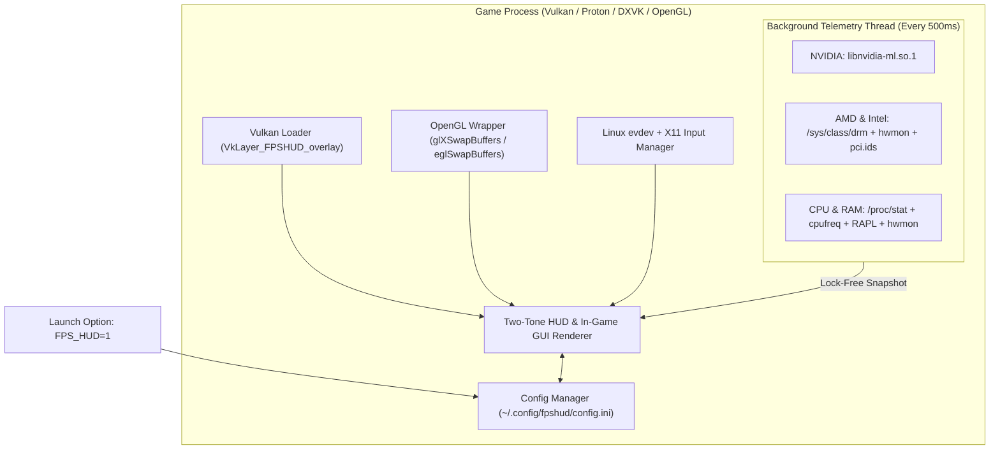

# FPSHUD

**Lightweight In-Game Performance Overlay & Live GUI Configurator for Linux Gaming (Vulkan & OpenGL)**

[](https://github.com/budicuy/FPS_HUD_FOR_LINUX/actions/workflows/ci.yml)
[](LICENSE)
[](CMakeLists.txt)
[](src/)
[](src/telemetry.cpp)

> 🌐 **Language / Bahasa Dokumentasi:** **[English (Default)](README.md)** | **[Bahasa Indonesia](README.id.md)**

---

## Quick Install (1 Command — No Compiling Required!)

Install **FPSHUD** in seconds on any Linux distribution (Arch, Ubuntu, Debian, Fedora, Linux Mint, Pop!_OS, Nobara, Bazzite, or SteamOS) without installing compilers or build tools:

```bash
curl -fsSL https://raw.githubusercontent.com/budicuy/FPS_HUD_FOR_LINUX/main/install.sh | bash
```

To uninstall at any time:
```bash
curl -fsSL https://raw.githubusercontent.com/budicuy/FPS_HUD_FOR_LINUX/main/uninstall.sh | bash
```

---

## Overview

### What is FPSHUD for?
When playing games on Linux (whether through Steam Proton, Lutris, Heroic, or native Linux ports), you often want to check your **FPS**, see if your game is stuttering (**1% Low / Frametime**), or keep an eye on your **GPU and CPU temperatures, clock speeds, power draw, and RAM usage**.

With traditional Linux overlays, customizing what appears on screen usually means closing the game, opening a text editor, and manually typing long configuration lines or environment variables. **FPSHUD solves this by giving you a live, interactive control panel directly inside your game.** You simply turn it on with `FPS_HUD=1`, press **`Insert`** or **`F12`** while playing, and click what you want to see—just like modern overlays on Windows, but built natively and lightweight for Linux.

### What is it built with?
FPSHUD is written in **modern C++20** for maximum speed and minimal memory usage, uses **Dear ImGui** to draw both the on-screen HUD and the in-game settings menu, and hooks directly into **Vulkan** (as a standard Vulkan Implicit Layer) and **OpenGL** (`LD_PRELOAD`). Fonts are embedded directly inside the library so text always looks sharp, even inside containerized environments like Steam Linux Runtime and Proton.

### What features are inside?
- **In-Game Settings Menu (`Insert` / `F12` / `F10`)**: A clean, tabless side-by-side dashboard that lets you toggle sensors, change screen position, adjust font size, pick colors, and switch presets live without restarting your game.
- **4 Ready-to-Use Presets**: Switch with one click between **Minimal** (FPS + Frametime only), **Standard** (FPS, GPU, CPU, RAM essentials), **Advance** (all 19 sensors), or save your own **Custom** preset.
- **Works Across All Hardware (NVIDIA, AMD, Intel)**: Automatically detects and reads sensors from **NVIDIA GPUs**, **AMD Radeon GPUs & APUs**, **Intel Arc & Iris GPUs**, and **Intel Core & AMD Ryzen CPUs**—including dual-GPU gaming laptops and handhelds like the Steam Deck.
- **Easy-to-Read Two-Tone Design & Thermal Warnings**: Numbers are displayed in bright white while units (`MHz`, `GB`, `°C`, `W`) are softly dimmed so values never blend together, with automatic yellow/red color warnings when your GPU or CPU runs hot.
- **Accurate 1% & 0.1% Low FPS + CSV Benchmark Recorder (`F9`)**: Measures real frame smoothness over a rolling 3.5-second window (automatically ignoring loading-screen freezes) and lets you record benchmark results directly to a `.csv` file.

### How does it work?
1. **Install once** using the 1-line `curl` command above (it places the portable `libfpshud.so` library in `~/.local/lib/fpshud/` and registers the Vulkan layer in your user folder).
2. **Enable in your game** by adding `FPS_HUD=1 %command%` in Steam Launch Options (or running `FPS_HUD=1 your_game` in terminal).
3. **Zero FPS drop while gaming**: As your game renders each frame, FPSHUD draws the overlay on top of the final image before it hits your monitor. Meanwhile, a separate background thread quietly reads your CPU/GPU temperatures and power usage once every 0.5 seconds—so the overlay never slows down your game.

---

## Table of Contents

1. [Key Features](#1-key-features)
2. [Installation & Sensor Permissions](#2-installation--sensor-permissions)
3. [How to Use in Steam, Lutris, Heroic & Terminal](#3-how-to-use-in-steam-lutris-heroic--terminal)
4. [In-Game GUI Guide & Keyboard Shortcuts](#4-in-game-gui-guide--keyboard-shortcuts)
5. [Supported Hardware & All 19 Sensors](#5-supported-hardware--all-19-sensors)
6. [Tech Stack & System Architecture](#6-tech-stack--system-architecture)
7. [Developer Guide (Building from Source & Testing)](#7-developer-guide-building-from-source--testing)
8. [Troubleshooting & FAQ](#8-troubleshooting--faq)
9. [Contributing, Credits & License](#9-contributing-credits--license)

---

## 1. Key Features

- **Simple Activation (`FPS_HUD=1` / `FPS_HUD=0`)**:
  - `FPS_HUD=1`: Turns on the HUD overlay and the In-Game GUI Configurator.
  - `FPS_HUD=0` (or unset): Completely disabled with zero background impact.
- **Tabless Side-by-Side In-Game GUI (`FPSHUD Configuration Tool`)**:
  - Press **`Insert`**, **`F12`**, or **`F10`** in-game to open a 2-column dashboard (Left: Position, Layout, Font, Colors, Shortcuts | Right: 19 Live Hardware Sensors & Quick Presets).
  - Automatically captures your mouse cursor while the menu is open and returns control to the game the moment you close it.
  - Automatically saves all your changes to `~/.config/fpshud/config.ini`.
- **Universal Multi-Vendor Hardware Support**:
  - **NVIDIA**: Uses `libnvidia-ml.so.1` (NVML) dynamically.
  - **AMD Radeon & APUs (`amdgpu`)**: Reads Linux DRM & `hwmon` sensors, supports `pp_dpm_sclk` fallback, and combines shared `GTT` memory on APUs/Steam Deck.
  - **Intel Arc & Integrated Graphics (`i915` / `xe`)**: Reads Linux DRM & `hwmon` sensors, `lmem_total_bytes`, and Intel RAPL power counters.
  - **Hybrid Gaming Laptops**: Automatically prioritizes the dedicated gaming GPU (`card1`) over the integrated GPU (`card0`) and identifies exact GPU model names via `/usr/share/hwdata/pci.ids`.
- **High-Contrast Readability & Dynamic Alerts**:
  - Category color badges (`FPS` Gold, `GPU` Green, `CPU` Cyan, `RAM` Purple, `SYS` Silver), middle-dot (`·`) separators, and automatic thermal alerts (**Amber at `>= 72°C`**, **Red at `>= 82°C`**).
- **Mini Frametime Graph & CSV Benchmark Logging (`F9`)**:
  - Optional live frametime waveform graph right on the HUD, plus 1-key CSV benchmarking (`~/Documents/fpshud_benchmark.csv`) that logs Avg FPS, 1% Low, 0.1% Low, Min/Max FPS, and peak GPU/CPU temperatures and wattage.

---

## 2. Installation & Sensor Permissions

### 1-Command Installation (Recommended for All Users)
```bash
curl -fsSL https://raw.githubusercontent.com/budicuy/FPS_HUD_FOR_LINUX/main/install.sh | bash
```
> [!NOTE]
> During installation, the script will prompt for optional `sudo` permission. Granting it will automatically configure:
> 1. **RAM Speed & Generation** (`DDR4 / DDR5 / LPDDR5` in `MT/s`).
> 2. **CPU Power Consumption** (`intel-rapl` / `amd-rapl` in Watts).
> 3. **Wayland Hotkeys & Mouse Input** (`/dev/input/event*` for `Insert` / `F12` in-game GUI).
>
> If you decline or run non-interactively without sudo, the installation continues cleanly and non-privileged sensors will function normally.

### 1-Command Uninstallation (Clean Removal)
```bash
curl -fsSL https://raw.githubusercontent.com/budicuy/FPS_HUD_FOR_LINUX/main/uninstall.sh | bash
```

---

## 3. How to Use in Steam, Lutris, Heroic & Terminal

### 1. Steam (Proton / DXVK / Vulkan Games)
Right-click your game in Steam -> **Properties** -> **General** -> **Launch Options**:
```bash
FPS_HUD=1 %command%
```
*(To disable temporarily, change it to `FPS_HUD=0 %command%`)*

### 2. Steam (Native Linux OpenGL Games)
```bash
FPS_HUD=1 ~/.local/bin/fpshud %command%
```

### 3. Lutris & Heroic Games Launcher
Open **Game Settings** -> **System / Environment Variables** -> Add:
- **Key**: `FPS_HUD`
- **Value**: `1`

### 4. Terminal / Command Line
```bash
# Run any Vulkan game or application:
FPS_HUD=1 ./your_game

# Run any OpenGL game or application:
~/.local/bin/fpshud ./your_game
```

---

## 4. In-Game GUI Guide & Keyboard Shortcuts

Once inside a game with `FPS_HUD=1`, use these shortcuts (all customizable inside the GUI):

| Default Key | Action |
| :--- | :--- |
| **`Insert` / `F12` / `F10`** | Open or Close the **`FPSHUD Configuration Tool`** menu |
| **`F11`** | Quickly hide or show the HUD overlay without opening the menu |
| **`F9`** | Start or Stop **CSV Benchmark Recording** (`~/Documents/fpshud_benchmark.csv`) |
| **`ESC`** | Close the GUI menu and return mouse control to the game |

### The 4 Built-In Presets
- **`Minimal`**: Shows only `FPS` and `Frametime (ms)`.
- **`Standard`**: Shows `FPS`, `Frametime`, `GPU (Load, Clock, Temp)`, `CPU (Load, Clock, Temp)`, and `RAM`.
- **`Advance`**: Enables all **23 sensors** (`FPS`, `AVG`, `1% Low`, `0.1% Low`, `Frametime`, all 7 `GPU` metrics, all 4 `CPU` metrics, all 5 `Memory/RAM` metrics, `Render API`, and `Local Clock`).
- **`Custom` / `Save Custom`**: Save your favorite combination of sensors and layout to `~/.config/fpshud/custom_preset.ini`.

---

## 5. Supported Hardware & All 23 Sensors

### Hardware Compatibility Matrix

| Component | Supported Vendors & Drivers | Linux Data Sources |
| :--- | :--- | :--- |
| **NVIDIA GPUs** | NVIDIA Proprietary / Open Kernel (`nvidia`) | `libnvidia-ml.so.1` (NVML runtime `dlopen`) |
| **AMD GPUs & APUs** | AMD Radeon Discrete & APU (`amdgpu`) | `/sys/class/drm/card*/device` + `hwmon` + `mem_info_gtt_*` + `pci.ids` |
| **Intel GPUs** | Intel Arc Discrete & Iris/UHD (`xe`, `i915`) | `/sys/class/drm/card*` + `hwmon` + `intel-rapl:0:1` + `pci.ids` |
| **Intel CPUs** | Intel Core (All Generations) | `/proc/cpuinfo`, `/proc/stat`, `cpufreq`, `coretemp`, `intel-rapl` |
| **AMD CPUs** | AMD Ryzen / Threadripper / Custom APU | `/proc/cpuinfo`, `/proc/stat`, `cpufreq`, `k10temp`/`zenpower`, `amd-rapl` |
| **System Memory** | DDR3, DDR4, DDR5, LPDDR4, LPDDR5 | `/proc/meminfo`, `/proc/self/status`, `/proc/pressure/memory`, SMBIOS 17 |

### All 23 Available Sensors

| # | Sensor Name | Group | What It Shows | Example |
| :--- | :--- | :--- | :--- | :--- |
| `01` | **FPS Counter** | `FPS` | Current smooth frames per second | `144` |
| `02` | **FPS Average** | `FPS` | Average FPS over the last 3.5 seconds | `AVG: 138` |
| `03` | **FPS 1% Low** | `FPS` | Time-weighted 1% slowest frames (stutter indicator) | `1%: 112` |
| `04` | **FPS 0.1% Low** | `FPS` | Time-weighted 0.1% worst micro-stutter frames | `0.1%: 95` |
| `05` | **Frame Time** | `FPS` | Time taken to render a frame in milliseconds | `6.9 ms` |
| `06` | **GPU Load** | `GPU` | GPU core usage percentage | `98%` |
| `07` | **GPU Clock** | `GPU` | Current GPU graphics core clock speed | `2430 MHz` |
| `08` | **GPU VRAM** | `GPU` | Used video memory in GB (includes shared GTT on APUs) | `6.4 GB` |
| `09` | **GPU Bandwidth** | `GPU` | Active VRAM + PCIe memory bandwidth throughput | `165.4 GB/s` |
| `10` | **GPU Temp** | `GPU` | GPU temperature in Celsius | `65 °C` |
| `11` | **GPU Fan** | `GPU` | GPU cooling fan speed percentage | `FAN: 55%` |
| `12` | **GPU Power** | `GPU` | GPU power draw in Watts | `185 W` |
| `13` | **CPU Load** | `CPU` | Total CPU utilization across all threads | `42%` |
| `14` | **CPU Clock** | `CPU` | Highest active core clock speed | `5050 MHz` |
| `15` | **CPU Power** | `CPU` | CPU package power draw in Watts | `58 W` |
| `16` | **CPU Temp** | `CPU` | CPU package temperature in Celsius | `62 °C` |
| `17` | **System RAM** | `RAM` | Used system memory in GB and percentage with warning alerts | `9.2 GB 60%` |
| `18` | **Game RAM** | `RAM` | Physical resident memory (VmRSS) allocated by this game | `GAME: 4.8 GB` |
| `19` | **Swap / ZRAM** | `RAM` | Active swap / ZRAM consumption in GB | `SWAP: 1.2 GB` |
| `20` | **Memory Pressure** | `RAM` | Linux PSI metric (last 10s memory stall percentage) | `PSI: 2.1%` |
| `21` | **RAM Speed** | `RAM` | Effective memory transfer speed and generation | `DDR5: 6000 MT/s` |
| `22` | **Render API** | `SYS` | Active graphics engine (`VULKAN` or `OPENGL`) | `VULKAN` |
| `23` | **Local Clock** | `SYS` | Current local system time (`HH:MM`) | `21:45` |

---

## 6. Tech Stack & System Architecture

| Layer | Technology | Highlights |
| :--- | :--- | :--- |
| **Language & Build** | **C++20**, **CMake**, **LTO (`-O3`)** | Statically links `libstdc++` & `libgcc` for universal distro portability. |
| **Graphics Hooks** | **Vulkan Layer (`1.3`)** + **GLX/EGL Hook** | Hooks `vkQueuePresentKHR`, `glXSwapBuffers`, and `eglSwapBuffers`. |
| **UI Framework** | **Dear ImGui (`v1.91.6`)** | Custom vertex-shaded outline/drop-shadow text & split-panel dashboard. |
| **Input Capture** | **Linux `evdev` + `X11` Fallback** | Non-blocking `/dev/input/event*` polling with `EVIOCGRAB` cursor lock. |
| **Telemetry Engine** | **Async 500ms Worker Thread** | Zero heap allocations per frame; lock-free atomic snapshot reads. |



---

## 7. Developer Guide (Building from Source & Testing)

If you are a developer or want to compile **FPSHUD** from source instead of using the prebuilt binary:

### 1. Install Build Dependencies
- **Arch Linux**: `sudo pacman -S --needed base-devel cmake ninja git pkgconf vulkan-headers vulkan-icd-loader mesa libglvnd libx11 wayland hwdata`
- **Ubuntu / Debian**: `sudo apt install -y build-essential cmake ninja-build git pkg-config libvulkan-dev libgl1-mesa-dev libegl1-mesa-dev libx11-dev pci.ids`
- **Fedora**: `sudo dnf install -y gcc-c++ cmake ninja-build git pkgconf-pkg-config vulkan-headers vulkan-loader-devel mesa-libGL-devel mesa-libEGL-devel libX11-devel hwdata`

### 2. Clone, Compile & Run Multi-Device Verification Suite
```bash
git clone https://github.com/budicuy/FPS_HUD_FOR_LINUX.git
cd FPS_HUD_FOR_LINUX
./scripts/install.sh

# Run the automated 26-check verification suite across 5 simulated device profiles:
./build/fpshud_test 1
```

### Project Structure
```text
FPS_HUD_FOR_LINUX/
├── .github/workflows/ci.yml             # Automated CI build, 5-device test & GitHub Release publisher
├── CMakeLists.txt                       # C++20 build config with LTO & static libstdc++/libgcc
├── dist/fpshud-linux-x86_64.tar.gz      # Prebuilt portable binary package for 1-command curl install
├── install.sh / uninstall.sh            # 1-command curl installer & uninstaller
├── README.md / README.id.md             # English & Indonesian documentation
└── src/
    ├── config.hpp / config.cpp          # Preset manager & INI configuration persistence
    ├── embedded_fonts.hpp               # Embedded OpenSans-Bold & VeraMono-Bold TTF byte arrays
    ├── telemetry.hpp / telemetry.cpp    # Multi-vendor GPU/CPU telemetry & CSV benchmark recorder
    ├── input_manager.hpp / .cpp         # Linux evdev + X11 input polling & EVIOCGRAB mouse lock
    ├── gui_menu.hpp / gui_menu.cpp      # Tabless Side-by-Side Dear ImGui in-game configurator
    ├── overlay_ui.hpp / overlay_ui.cpp  # Two-tone HUD renderer, outline/shadow & mini FT graph
    ├── vulkan_layer.cpp                 # Vulkan Implicit Layer dispatch & vkQueuePresentKHR hook
    ├── opengl_hook.cpp                  # OpenGL GLX/EGL buffer swap hooks
    └── test_cli.cpp                     # Automated 5-Device Sysfs Simulation & Verification Suite
```

---

## 8. Troubleshooting & FAQ

1. **Pressing `Insert` / `F12` does not open the GUI or mouse clicks pass through to the game:**
   - Run `sudo chmod a+r /dev/input/event*` (or permanently add your user to the `input` group with `sudo usermod -aG input $USER` and log out/in).
2. **CPU Power shows `0 W`:**
   - Run `sudo chmod a+r /sys/class/powercap/*rapl*/energy_uj` (see [Section 2](#2-installation--sensor-permissions) to make it permanent across reboots).
3. **How do I reset all settings back to default?**
   - Open the In-Game GUI (`Insert` / `F12`) and click **`Reset`** in the top-right corner, or delete `~/.config/fpshud/config.ini`.

---

## 9. Contributing, Credits & License

### Contributing
Pull requests, issue reports, and hardware test feedback are always welcome! Before opening a PR, please run `./build/fpshud_test 1` to ensure all 26 multi-vendor checks pass.

### Credits & Acknowledgments
- **[Dear ImGui](https://github.com/ocornut/imgui)** by Omar Cornut — Immediate Mode GUI library powering the overlay and live configurator.
- **Khronos Group** — Vulkan & OpenGL headers and implicit layer architecture.
- **Linux Kernel Community** — `drm`, `amdgpu`, `i915`/`xe`, `hwmon`, and `powercap` driver maintainers.
- **Open Sans & Bitstream Vera** — Open-source TrueType fonts embedded for crisp in-game typography.

### License
Distributed under the **[MIT License](LICENSE)**.
